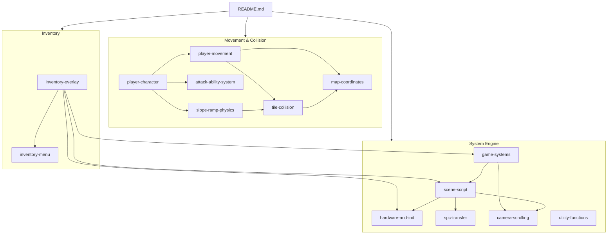

# Bank 02 — Complete Code Analysis Index

> Comprehensive reference for all code and data in IOG's ROM bank `$02`
> (`$028000`–`$02FFFF`), spanning the system engine, player character,
> movement physics, inventory system, and utility functions.

**Evidence labels.** Each major section is tagged with the kind of claim it makes: **[ASM]** = directly observed in the extracted asm of this block; **[INFERRED]** = interpretation of behavior that is not literally encoded in the file; **[XREF]** = cross-file / engine-wide convention stated elsewhere (not provable from this file alone). Sections that mix kinds split them into separately tagged bullets or paragraphs. The `.asm` files in `extracted/` are authoritative; where prose and asm comments disagree, the asm wins. Block ranges below come from `db-us/blocks.json` and names from `db-us/names/bank02.json`.

---

## 1. Bank Overview

*Evidence: [ASM] for ranges and counts; the one-line role summaries are [INFERRED] from the block contents*

Bank `$02` is the game's primary **gameplay code bank**, containing:

- The **system engine** — hardware abstraction, scene loading, graphics/music transfer, camera, and map interaction
- The **player character** — a modular five-actor architecture managing movement, attacks, abilities, and visual effects
- The **movement physics engine** — directional collision handling with slope/ramp support and tile probing
- The **inventory menu** — a full-screen overlay with 4 tabs and 16-slot item management
- **Utility functions** — dialogue display and VRAM buffer operations

| Metric | Value |
|--------|-------|
| **Bank range** | `$028000`–`$02FFFF` (32,768 bytes) |
| **Mapped code/data** | `$028000`–`$02F08C` (~28,812 bytes) |
| **Free space** | `$02F08C`–`$02FFFF` (~3,956 bytes) |
| **Named addresses** | 546 (entries in `db-us/names/bank02.json`) |
| **ASM files** | 29 (one per `blocks.json` block, listed in §11) |
| **blocks.json blocks** | 29 (3 of them, `hardware_math`, `player_move_main`, `player_move_east`, have two mapped parts; the others are one range each) |
| **Roots that `?INCLUDE` bank-02 files** | 3 (`system_core` is itself `?BANK 00`; `player_character` and `inventory_menu` are `?BANK 02`) |

---

## 2. Memory Map

*Evidence: [ASM] (from `db-us/blocks.json`; sizes are `end − start`)*

```
$028000 ┌───────────────────────────────────────────────────┐
        │ hardware_math          [MulDivide]                │  59 B
$02803B ├───────────────────────────────────────────────────┤
        │ vblank_joypad          [VBlankWaitAndJoypad]      │ 406 B
$0281D1 ├───────────────────────────────────────────────────┤
        │ hardware_math          [Multiply8x8Unsigned + extras]   │ 159 B
$028270 ├───────────────────────────────────────────────────┤
        │ QuintetLzDecompress     [QuintetLzDecompress]       │ 306 B
$0283A2 ├───────────────────────────────────────────────────┤
        │ DmaWordToVram          [DmaWordToVram]            │  25 B
$0283BB ├───────────────────────────────────────────────────┤
        │ scene_script           [SceneScriptMain + cmds]   │ 3,283 B
$02908E ├───────────────────────────────────────────────────┤
        │ spc_transfer           [SPC upload + binary]      │ 3,412 B
$029DE2 ├───────────────────────────────────────────────────┤
        │ system_init            [InitSystemVariables]       │ 606 B
$02A040 ├───────────────────────────────────────────────────┤
        │ music_actors           [MusicJingleActor]        │ 219 B
$02A11B ├───────────────────────────────────────────────────┤
        │ DisplaySceneTitle      [DisplaySceneTitle]          │ 206 B
$02A1E9 ├───────────────────────────────────────────────────┤
        │ event_blocks           [ApplyAllEventBlocks]       │ 1,012 B
$02A5DD ├───────────────────────────────────────────────────┤
        │ warps_interaction      [CheckWarpAndChest]         │ 1,453 B
$02AB8A ├───────────────────────────────────────────────────┤
        │ camera_tilemap         [CameraFullRefresh]         │ 1,305 B
$02B0A3 ├───────────────────────────────────────────────────┤
        │ map_coords             [TileCoordsToMapIndex]      │ 363 B
$02B20E ├═══════════════════════════════════════════════════┤
        │ shadow_shimmer     [ShadowShimmerInit]      │ 144 B
$02B29E ├───────────────────────────────────────────────────┤
        │ player_move_controller [PlayerMoveController]      │ 397 B
$02B42B ├───────────────────────────────────────────────────┤
        │ slope_ramp_physics     [SlopePhysicsEntry]         │ 904 B
$02B7B3 ├───────────────────────────────────────────────────┤
        │ attack_ability_system  [AttackSystemEntry]         │ 3,033 B
$02C38C ├───────────────────────────────────────────────────┤
        │ player_character       [PlayerCharacterDef]        │ 3,140 B
$02CFD0 ├═══════════════════════════════════════════════════┤
        │ player_move_main (pt1) [PlayerMovementTick]        │ 104 B
$02D038 ├───────────────────────────────────────────────────┤
        │ player_move_ns         [DispatchNorthMove]         │ 526 B
$02D246 ├───────────────────────────────────────────────────┤
        │ player_move_main (pt2) [ComputeYSnapOffset]        │ 304 B
$02D376 ├───────────────────────────────────────────────────┤
        │ player_move_south      [DispatchSouthMove]         │ 870 B
$02D6DC ├───────────────────────────────────────────────────┤
        │ player_move_east (pt1) [DispatchEastMove]          │ 359 B
$02D843 ├───────────────────────────────────────────────────┤
        │ player_move_ramps      [EastRampDown]              │ 650 B
$02DACD ├───────────────────────────────────────────────────┤
        │ player_move_east (pt2) [AutoAlignNS_East]          │ 179 B
$02DB80 ├───────────────────────────────────────────────────┤
        │ player_move_west       [DispatchWestMove]      │ 1,410 B
$02E102 ├───────────────────────────────────────────────────┤
        │ tile_collision         [TileProbeMain]             │ 660 B
$02E396 ├═══════════════════════════════════════════════════┤
        │ inventory_menu         [InventoryMenuDef]          │ 2,412 B
$02ED02 ├───────────────────────────────────────────────────┤
        │ inventory_overlay      [OpenInventoryScreen]       │ 838 B
$02F048 ├───────────────────────────────────────────────────┤
        │ ShowDialogueFrame      [ShowDialogueFrame]         │  34 B
$02F06A ├───────────────────────────────────────────────────┤
        │ vram_buffer_clear      [ClearBg3TilemapBuffer_PreserveHud]    │  34 B
$02F08C ├───────────────────────────────────────────────────┤
        │                  FREE SPACE                        │ 3,956 B
$02FFFF └───────────────────────────────────────────────────┘
```

### Address Ranges by Category

| Category | Range | Size | % of Bank |
|----------|-------|------|-----------|
| System Engine | `$028000`–`$02B20E` | 12,814 B | 39.1% |
| Player Actors | `$02B20E`–`$02CFD0` | 7,618 B | 23.3% |
| Movement Physics | `$02CFD0`–`$02E396` | 5,062 B | 15.4% |
| Inventory System | `$02E396`–`$02F048` | 3,250 B | 9.9% |
| Utility Functions | `$02F048`–`$02F08C` | 68 B | 0.2% |
| Free Space | `$02F08C`–`$02FFFF` | 3,956 B | 12.1% |

---

## 3. Compilation Units

*Evidence: [ASM] (the `?INCLUDE` lines of each root file); the "independent unit" framing is [INFERRED]*

Three root files pull bank-02 files in with `?INCLUDE`. The lists below are the **direct** includes of each root, read from the `.asm` headers; files reached only through another include are not repeated.

### Root 1: System Engine (`system_core.asm`)

The main game loop and core system infrastructure. The root is `?BANK 00`. Its direct includes are:

```
system_core.asm (?BANK 00, extracted/system/engine/)
  ├─ actor_execution, combat_collision, cop_dispatch, hdma_dma_spc,
  │  math_lookup_tables, scene_lifecycle (?BANK 03), sprite_composition,
  │  system_strings, thinker_execution      (not bank 02)
  ├─ GlobalInputHandler (?BANK 03) ──→ inventory_overlay, item_use_system,
  │                                    radar_map_screen, ...
  ├─ camera_tilemap.asm         (?BANK 02)
  ├─ event_blocks.asm           (?BANK 02)
  ├─ spc_transfer.asm           (?BANK 02)
  ├─ system_init.asm            (?BANK 02)
  ├─ vblank_joypad.asm          (?BANK 02)
  └─ warps_interaction.asm      (?BANK 02)
```

The remaining bank-02 engine files (`hardware_math`, `QuintetLzDecompress`, `DmaWordToVram`, `scene_script`, `music_actors`, `DisplaySceneTitle`, `map_coords`, `ShowDialogueFrame`) are reached through other includes (for example `scene_lifecycle` includes `DmaWordToVram`, and `warps_interaction` and `combat_collision` include `ShowDialogueFrame`).

### Root 2: Player Character (`player_character.asm`)

The player's modular actor system (`?BANK 02`, `extracted/actors/player/`). Direct includes:

```
player_character.asm
  ├─ attack_ability_system.asm   ──→ ability_damage_tables, actor_pool,
  │                                  ApplyOrbitalOffsetFromRef, spriteset_aura,
  │                                  spriteset_dark_friar, spriteset_pickups_effects
  ├─ game_over_sequence.asm
  ├─ hardware_math.asm           (extracted/system/engine/)
  ├─ player_move_controller.asm  ──→ player_move_main.asm
  │       player_move_main ──→ player_move_east, player_move_ns,
  │                            player_move_south, player_move_west, tile_collision
  ├─ shadow_shimmer.asm
  ├─ slope_ramp_physics.asm      ──→ tile_collision
  └─ spriteset_darkgaia_projectile.asm   (spritemap data)
```

`attack_ability_system.asm` also includes `player_character` back (a circular include).

### Root 3: Inventory Menu (`inventory_menu.asm`)

A self-contained inventory actor (`?BANK 02`). Direct includes: `flag_helpers`, `inventory_spritemap` (spritemap data) and `system_strings` (text data). The overlay that runs it is a separate file (`inventory_overlay.asm`).

### Standalone bank-02 files and who includes them

| File | Block | Included by (from `?INCLUDE` lines in `extracted/`) |
|------|-------|---------------|
| `DmaWordToVram.asm` | `DmaWordToVram` | `scene_lifecycle`, `inventory_overlay` |
| `inventory_overlay.asm` | `inventory_overlay` | `GlobalInputHandler` (which also calls `OpenInventoryScreen`) |
| `ShowDialogueFrame.asm` | `ShowDialogueFrame` | `warps_interaction`, `combat_collision` |
| `vram_buffer_clear.asm` | `vram_buffer_clear` | `inventory_overlay`, `GlobalInputHandler`, `scene_lifecycle`, `radar_map_screen`, `sFA_diary_menu` |

---

## 4. Document Suite

*Evidence: [XREF] (index of the sibling documents; each one tags its own sections)*

| Document | Coverage |
|----------|----------|
| [hardware-and-init.md](hardware-and-init.md) | Hardware math, VBlank sync and joypad remap / consumption, LZ decompression, system init |
| [scene-script.md](scene-script.md) | Scene script interpreter (24-entry opcode jump table), cache-and-diff, `DmaWordToVram` |
| [spc-transfer.md](spc-transfer.md) | SPC700 music upload protocol |
| [game-systems.md](game-systems.md) | Music actors, DisplaySceneTitle, event blocks, warps |
| [camera-scrolling.md](camera-scrolling.md) | Camera targets, BG scroll registers and mode flags, `CameraSmoothScroll` paths, column / row strips, `CameraFullRefresh` (32 column passes) |
| [map-coordinates.md](map-coordinates.md) | Tile coordinate helpers, map index conversion |
| [tile-collision.md](tile-collision.md) | Tile probe system, collision types |
| [player-character.md](player-character.md) | Five-actor player architecture, state machine |
| [player-movement.md](player-movement.md) | Six movement files, collision cascade |
| [attack-ability-system.md](attack-ability-system.md) | `AttackSystemEntry` dispatch for Will and Freedan (`characterForm` 0 and 1), `abilityBitmask` checks, charge / release, trail followers |
| [slope-ramp-physics.md](slope-ramp-physics.md) | Terrain slope companion actor |
| [inventory-menu.md](inventory-menu.md) | `InventoryMenuDef` actor: four tabs, 16 slot actors, cursors, Yes/No prompt, this baserom's input masks |
| [inventory-overlay.md](inventory-overlay.md) | `OpenInventoryScreen`: save, scene `$FF` run loop, restore; save / restore map |
| [utility-functions.md](utility-functions.md) | ShowDialogueFrame, VRAM buffer clear |

> **Note:** Player actor files are split across three documents:
> player-character, attack-ability-system, and slope-ramp-physics.

### Document Relationship Map



---

## 5. Calling Conventions

*Evidence: [XREF] / [INFERRED]. A summary of patterns seen across the bank-02 files, not an exhaustive per-routine rule; the individual documents give the literal register state of each routine. `PlayerMovementTick` and `AnimateEventBlock` do use `PHD` (checked in their asm).*

### 5.1 JSL vs JSR

| Convention | Usage |
|-----------|-------|
| `JSL $@label` (3-byte long) | All inter-file calls across bank boundaries |
| `JSR $&label` (2-byte short) | Intra-bank calls within the same `?BANK 02` compilation unit |

Since all bank 02 code shares `?BANK 02`, any file can `JSR` to any other bank 02
function directly. Cross-bank calls (to banks `$00`, `$03`, etc.) always use `JSL`.

### 5.2 Register State Conventions

| Convention | Where Used |
|-----------|-----------|
| `PHP`/`PLP` wrapper | Most public entry points — callee-saves processor flags |
| `PHD`/`PLD` wrapper | `PlayerMovementTick`, `AnimateEventBlock` — use direct page for locals |
| `PHB`/`PLB` wrapper | Graphics functions that set DBR to `$7E` |
| A=16-bit (`REP #$20`) | Default for arithmetic; most functions assume 16-bit A on entry |
| A=8-bit (`SEP #$20`) | MMIO register writes, tile collision checks |
| `RTL` | Public (JSL-callable) entry points |
| `RTS` | Internal subroutines (JSR-callable) |
| COP opcodes | Actor coroutines: `COP [SpawnAfter]`, `COP [SetEntryHere]`, etc. |

### 5.3 COP Actor Entrancy

All COP-based actor code runs with: `m=0, x=0, d=0, i=1`, `X=D=ActorID`, `DBR=$81`.

---

## 6. Key WRAM Variables

*Evidence: [ASM] for names and addresses (the `!equate` lines of the extracted files); roles come from the block notes of the files named. Rows marked "(unverified)" were carried over from the earlier README and not re-checked against an asm equate.*

### System Variables

| Address | Name in asm | Role |
|---------|------|---------|
| `$0644` | `sceneCurrent` | currently loaded scene ID (`$FF` while the inventory overlay runs) |
| `$0646` | `sceneTableIndex` | `sceneCurrent × 2` |
| `$0642` | `sceneNext` | pending scene transition |
| `$0656` | `joypadCurrent` | newly pressed buttons plus auto-repeat triggers, after removing consumed bits and `joypadMaskStd` (what `BranchIfPressed` tests) |
| `$0658` | `joypadHeld` | cooperative **consumption mask**: game code `TSB`s the bits it has handled; a bit stays until the physical button is released |
| `$065A` | `joypadMaskStd` | unconditionally suppressed buttons |
| `$065C` | `joypadMaskInv` | auto-repeat mask (`$0F00` = the D-pad, set by the dialogue handler, the diary menu and the inventory overlay) |
| `$065E` | `joypadRemapped` | remapped logical value built during the remap step |
| `$0660` | `joypadRaw` | stored by the NMI handler as hardware data, then replaced with the remapped value by `vblank_joypad` |
| `$0664`–`$066A` | — | graphics loading parameters (unverified) |
| `$068A` / `$068C` / `$068E` / `$0690` | `bg1ScrollH` / `effectScrollH` / `mapScrollV` / `effectScrollV` | current BG scroll values (layer 0 and layer 1; see [camera-scrolling.md](camera-scrolling.md) §Variable Roles) |
| `$0693`–`$069D` | — | map geometry (unverified) |
| `$06BE` / `$06C2` | `cameraTargetX` / `cameraTargetY` | layer-0 camera targets |
| `$06C0` / `$06C4` | `cameraDeltaX` / `cameraDeltaY` | layer-1 scroll targets (named "delta", not deltas) |
| `$06C6` / `$06C8` / `$06CA` | `scrollOverrideH` / `forcedScrollOverride` / `scrollOverrideV` | scroll override words (all three zeroed by the overlay; only the first two are saved) |
| `$06EE` / `$06EF` | `layerPriorityFlag` (word) / `scrollModeFlags` (its high byte) | camera and layer mode flags; see [camera-scrolling.md](camera-scrolling.md) |
| `$06F2`–`$06F6` | — | music track IDs (unverified) |

### Player Variables

| Address | Name | Purpose |
|---------|------|---------|
| `$09A2` | `playerXPos` | Player X position |
| `$09A4` | `playerYPos` | Player Y position |
| `$09AA` | `playerActor` | Player actor slot index |
| `$09AE` | `playerFlags` | Player state bitmask (see [player-character.md](player-character.md)) |
| `$09B2` | `playerSpeedEw` | East-West speed |
| `$09B4` | `playerSpeedNs` | North-South speed |
| `$09B6` | — | Slope step counter |
| `$09BA`/`$09BC` | — | Slope speed curve table pointers |
| `$09C2` | — | Deceleration curve table pointer |
| `$09C6` | — | Slope fractional accumulator |
| `$09C8`/`$09CA` | — | Max speed clamp values (EW/NS) |
| `$0AD4` | `characterForm` | Character form (0=Will, 1=Freedan, 2=Shadow) |
| `$0AA2` | `abilityBitmask` | Ability availability bitmask |
| `$00EA` | `activeAbilityGfx` (name in the overlay asm comment) | written `1` by `LaunchDarkFriar` and `2` by `LaunchAuraBarrier`; read by `ReloadAbilityFX`; zeroed at scene setup |

### Movement Scratch Variables

*Evidence: [INFERRED] / [XREF]. Carried over from the earlier README; roles vary by routine, so check [player-movement.md](player-movement.md) and the asm before relying on a row.*

| Address | Purpose |
|---------|---------|
| `$20` | Horizontal movement delta (speed × direction) |
| `$22` | Player X position (sub-pixel, ×4 scale) |
| `$24` | Vertical movement delta |
| `$26` | Player Y position (sub-pixel, ×4 scale) |
| `$1A` | Probe X coordinate (tile-space) |
| `$1E` | Probe Y coordinate (tile-space) |
| `$00`–`$04` | Scratch: tile index, alignment offset |
| `$AA`–`$AB` | Movement state flags |

---

## 7. Cross-File Dependency Overview

*Evidence: [ASM] for the call targets named (all are `JSL` / `COP` sites in the files shown); the tree layout is a summary, not a full call graph*

The primary inter-file call chains within bank 02:

```
system_core (bank 00)
  ├─ JSL → VBlankWaitAndJoypad, EnableNmiAndJoypad     ← vblank_joypad
  ├─ JSL → FlushVramWriteQueue                          ← event_blocks
  ├─ JSL → CameraSmoothScroll, FlushDirtyTilemapStrips  ← camera_tilemap
  ├─ JSL → Bg3TilemapVramDma                                ← camera_tilemap
  ├─ JSL → CheckWarpAndChest                             ← warps_interaction
  └─ JSL → InitSystemVariables, UploadCgramPalette       ← system_init

scene_lifecycle (bank 03 — scene loading; `ClearSceneState`)
  ├─ JSL → SceneScriptMain                                ← scene_script
  ├─ JSL → CameraFullRefresh (×2)                         ← camera_tilemap
  ├─ JSL → ApplyAllEventBlocks                            ← event_blocks
  └─ JSL → PlaceOpenedChestTiles, InitWarpTable           ← warps_interaction

scene_script (music load command)
  └─ JSL → SpcBlockTransfer                               ← spc_transfer

GlobalInputHandler (bank 03)
  └─ JSL → OpenInventoryScreen                            ← inventory_overlay
       └─ JSL → SceneScriptNoMusic (open and close)       ← scene_script

player_character (player actor spawn chain)
  ├─ COP [SpawnBefore] → AttackSystemEntry               ← attack_ability_system
  ├─ COP [SpawnAfter]  → PlayerMoveController            ← player_move_controller
  ├─ COP [SpawnAfter]  → SlopePhysicsEntry               ← slope_ramp_physics
  └─ COP [SpawnListAppend] (flags `$2800`) → ShadowShimmerInit  ← shadow_shimmer

PlayerMoveController
  └─ JSL → PlayerMovementTick                             ← player_move_main
           ├─ JSR → DispatchNorthMove / NorthWallHandler  ← player_move_ns
           ├─ JSR → DispatchSouthMove                     ← player_move_south
           ├─ JSR → DispatchEastMove                      ← player_move_east
           ├─ JSR → DispatchWestMove / WestRamp*      ← player_move_west
           └─ JSR → TileProbeMain, ReadCollisionNibble    ← tile_collision

map_coords (bridge: system engine ↔ movement physics)
  ├─ JSR → FindSlopeForWestMove / FindSlopeForEastMove
  └─ JSR → tile_collision.* (12+ cross-file JSR calls)
```

---

## 8. Collision Type Reference

*Evidence: [ASM] for the rows below (as read by `ReadCollisionNibble` / `TileProbeMain`); names for the other values are [INFERRED] and live in the movement documents*

The earlier version of this table gave a meaning to every value (for example "semi-solid" for `$05`). That conflicted with the audited [tile-collision.md](tile-collision.md) and was not supported by the probe code, so only the rows that file establishes are kept here:

| Type | What the asm establishes |
|------|---------|
| `$00` | passable; `TileProbeMain` returns carry clear |
| `$01`–`$04`, `$06`–`$09`, `$0B`, `$0D` | nonzero types; their movement meaning is defined in `player_move_*` / `player_character`, not in the probe |
| `$05` | west-facing slope (slope dispatch and ramp movement) |
| `$0A` | east-facing slope |
| `$0E` and above | solid (the blocking threshold callers compare against) |
| `$0F` | returned for an invalid map index (`X ≥ $4000`) and out-of-bounds probes |

`TileProbeMain` sets carry for **any** nonzero type. See [tile-collision.md](tile-collision.md) §Collision Type Reference for the actor-solid mark (`$F0` high nibble → `$0F`).

---

## 9. Notable Design Patterns

*Evidence: [ASM] for the spawn order and the inventory save / restore figures; the pattern names and the "communicate through shared WRAM" summary are [INFERRED]*

### 9.1 Five-Actor Player Architecture

The player character uses a **modular multi-actor design** (see [player-character.md](player-character.md)). After `PlayerCharacterDef` init, the actor linked list is: **attack_ability_system** (SpawnBefore) → **player_character** → **slope_ramp_physics** → **player_move_controller**, then **shadow_shimmer** appended with `SpawnListAppend` (flags `$2800`). Roles:

1. **player_character** — state machine (idle, walk, climb, attack)
2. **player_move_controller** — physics pipeline (joypad → velocity → collision)
3. **slope_ramp_physics** — terrain physics (slopes, deceleration curves)
4. **attack_ability_system** — special abilities (see [attack-ability-system.md](attack-ability-system.md))
5. **shadow_shimmer** — visual FX (Shadow palette shimmer)

Inter-actor communication uses shared WRAM variables rather than direct calls.

### 9.2 Collision Cascade

Nearly every movement handler follows this pattern (see [player-movement.md](player-movement.md)):
1. Probe tile at destination → get collision type
2. Switch on type (`$02`, `$03`, `$06`, `$08`, `$09`, `$0A`, `$0C`, `$0E`+)
3. For complex types: probe adjacent tiles, check sub-tile alignment
4. Apply movement or snap to boundary
5. Call `ApplyMovementDeltas` to finalize

### 9.3 Cache-and-Diff Graphics Loading

Scene graphics consistently uses (see [scene-script.md](scene-script.md)):
1. `CheckSourceCacheHit` — check if source pointer changed since last load
2. If changed: decompress (`QuintetLzDecompress`), then DMA
3. If unchanged: skip (cached)

### 9.4 Inventory State Sandwich

The inventory overlay (see [inventory-overlay.md](inventory-overlay.md)) builds scene `$FF` over the live actor and thinker pools, so `SaveGameState` first copies the pools and tables away with seven `MVN` moves (256 + 256 + 4096 + 4096 + 256 + 256 + 515 = 9,731 bytes) plus 34 bytes of joypad, actor-count, DP `$4E`–`$5D` and camera words, and `RestoreGameState` copies them back (the palette buffer through `RestorePaletteBuffer`). Not saved: tile / map data (the scene script reloads it), VRAM, and the player / ability sprite tiles (reloaded explicitly). `scrollOverrideV`, `$06CC` and `$00B2` are zeroed but not saved. An earlier version of this README gave "~5.5 KB"; the `MVN` lengths in the asm do not support that figure.

### 9.5 Speed Curve Tables

Slope physics and deceleration use 16-entry signed delta tables indexed by a
wrapping frame counter (`AND #$000F`). Different curve pointers allow per-terrain
speed profiles (see [slope-ramp-physics.md](slope-ramp-physics.md)).

---

## 10. blocks.json Structure

*Evidence: [ASM] (read from `db-us/blocks.json`; sizes are `end − start`). The "Parts" column from the earlier README (for example "5" for `spc_transfer`, "8" for `system_init`) is gone: `blocks.json` maps those blocks as one range each, and the engine discovers the pieces inside them by code analysis.*

Bank 02 blocks sit under two top-level categories, `system` and `actors`. There is no `functions` category in `db-us/blocks.json` any more: `inventory_overlay`, `ShowDialogueFrame` and `vram_buffer_clear` are `system` blocks.

### System (`system.*`)

| Block Key | Range | Type | Mapped parts |
|-----------|-------|------|-------|
| `hardware_math` | `$028000`–`$02803B` (`MulDivide`) and `$0281D1`–`$028270` (`Multiply8x8Unsigned`) | Code | 2 |
| `vblank_joypad` | `$02803B`–`$0281D1` | Code | — |
| `QuintetLzDecompress` | `$028270`–`$0283A2` | Code | — |
| `DmaWordToVram` | `$0283A2`–`$0283BB` | Code | — |
| `scene_script` | `$0283BB`–`$02908E` | Code | — |
| `spc_transfer` | `$02908E`–`$029DE2` | Code | — |
| `system_init` | `$029DE2`–`$02A040` | Code | — |
| `music_actors` | `$02A040`–`$02A11B` | Code | — |
| `DisplaySceneTitle` | `$02A11B`–`$02A1E9` | Code | — |
| `event_blocks` | `$02A1E9`–`$02A5DD` | Code | — |
| `warps_interaction` | `$02A5DD`–`$02AB8A` | Code | — |
| `camera_tilemap` | `$02AB8A`–`$02B0A3` | Code | — |
| `map_coords` | `$02B0A3`–`$02B20E` | Code | — |
| `player_move_main` | `$02CFD0`–`$02D038` (`PlayerMovementTick`) and `$02D246`–`$02D376` (`ComputeYSnapOffset`) | Code | 2 |
| `player_move_ns` | `$02D038`–`$02D246` | Code | — |
| `player_move_south` | `$02D376`–`$02D6DC` | Code | — |
| `player_move_east` | `$02D6DC`–`$02D843` (`DispatchEastMove`) and `$02DACD`–`$02DB80` (`AutoAlignNS_East`) | Code | 2 |
| `player_move_ramps` | `$02D843`–`$02DACD` | Code | — |
| `player_move_west` | `$02DB80`–`$02E102` | Code | — |
| `tile_collision` | `$02E102`–`$02E396` | Code | — |
| `inventory_menu` | `$02E396`–`$02ED02` | actor-def | — |
| `inventory_overlay` | `$02ED02`–`$02F048` | Code | — |
| `ShowDialogueFrame` | `$02F048`–`$02F06A` | Code | — |
| `vram_buffer_clear` | `$02F06A`–`$02F08C` | Code | — |

### Actors (`actors.*`)

| Block Key | Range | Type | Mapped parts |
|-----------|-------|------|-------|
| `shadow_shimmer` | `$02B20E`–`$02B29E` | Code | — |
| `player_move_controller` | `$02B29E`–`$02B42B` | Code | — |
| `slope_ramp_physics` | `$02B42B`–`$02B7B3` | Code | — |
| `attack_ability_system` | `$02B7B3`–`$02C38C` | Code | — |
| `player_character` | `$02C38C`–`$02CFD0` | actor-def | — |

---

## 11. Source Files Reference

*Evidence: [ASM] (file locations checked against `extracted/`)*

The 29 bank 02 ASM files, grouped by directory under `extracted/` (engine, player actors, player movement, inventory, functions):

| File | Directory | Block |
|------|-----------|-------|
| `hardware_math.asm` | `extracted/system/engine/` | `hardware_math` |
| `vblank_joypad.asm` | `extracted/system/engine/` | `vblank_joypad` |
| `QuintetLzDecompress.asm` | `extracted/system/engine/` | `QuintetLzDecompress` |
| `DmaWordToVram.asm` | `extracted/system/engine/` | `DmaWordToVram` |
| `scene_script.asm` | `extracted/system/engine/` | `scene_script` |
| `spc_transfer.asm` | `extracted/system/engine/` | `spc_transfer` |
| `system_init.asm` | `extracted/system/engine/` | `system_init` |
| `music_actors.asm` | `extracted/system/engine/` | `music_actors` |
| `DisplaySceneTitle.asm` | `extracted/system/engine/` | `DisplaySceneTitle` |
| `event_blocks.asm` | `extracted/system/engine/` | `event_blocks` |
| `warps_interaction.asm` | `extracted/system/engine/` | `warps_interaction` |
| `camera_tilemap.asm` | `extracted/system/engine/` | `camera_tilemap` |
| `map_coords.asm` | `extracted/system/engine/` | `map_coords` |
| `shadow_shimmer.asm` | `extracted/actors/player/` | `shadow_shimmer` |
| `player_move_controller.asm` | `extracted/actors/player/` | `player_move_controller` |
| `slope_ramp_physics.asm` | `extracted/actors/player/` | `slope_ramp_physics` |
| `attack_ability_system.asm` | `extracted/actors/player/` | `attack_ability_system` |
| `player_character.asm` | `extracted/actors/player/` | `player_character` |
| `player_move_main.asm` | `extracted/system/player/` | `player_move_main` |
| `player_move_ns.asm` | `extracted/system/player/` | `player_move_ns` |
| `player_move_south.asm` | `extracted/system/player/` | `player_move_south` |
| `player_move_east.asm` | `extracted/system/player/` | `player_move_east` |
| `player_move_ramps.asm` | `extracted/system/player/` | `player_move_ramps` |
| `player_move_west.asm` | `extracted/system/player/` | `player_move_west` |
| `tile_collision.asm` | `extracted/system/player/` | `tile_collision` |
| `inventory_menu.asm` | `extracted/system/inventory/` | `inventory_menu` |
| `inventory_overlay.asm` | `extracted/system/inventory/` | `inventory_overlay` |
| `ShowDialogueFrame.asm` | `extracted/system/functions/` | `ShowDialogueFrame` |
| `vram_buffer_clear.asm` | `extracted/system/functions/` | `vram_buffer_clear` |

---

## 12. Related Resources

*Evidence: [XREF]*

- **[COP System Overview](../../cop/README.md)** — full list of COP opcodes used in actor code
- **[Actor Organization](../../actor-organization-analysis.md)** — how actors are structured across the ROM
- **[Assembler Syntax](../../../../gaia-knowledge/curated/gaialabs/assembler-syntax.md)** — `$&` / `$@` label rules (in the sibling `gaia-knowledge` repo)
- **`db-us/blocks.json`** — block/part structure definitions
- **`db-us/names/bank02.json`** — 546 named addresses in bank 02
- **`db-us/overrides.json`** — per-address register state corrections
- **`db-us/transforms.json`** — per-block regex rewrites that make the extracted asm differ from vanilla (button masks in `attack_ability_system`, `player_character` and `inventory_menu`)
