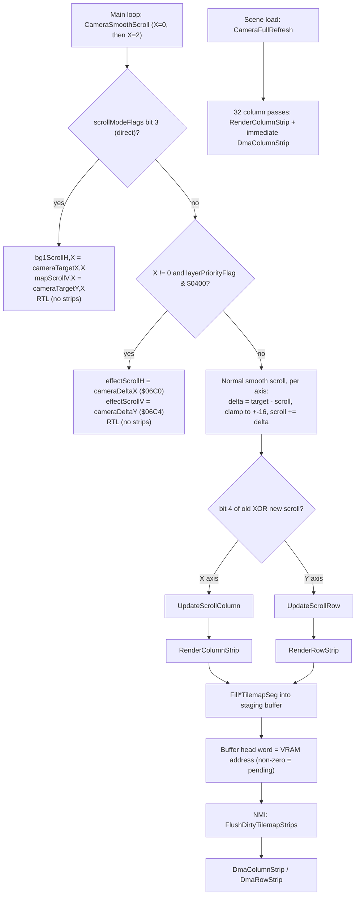
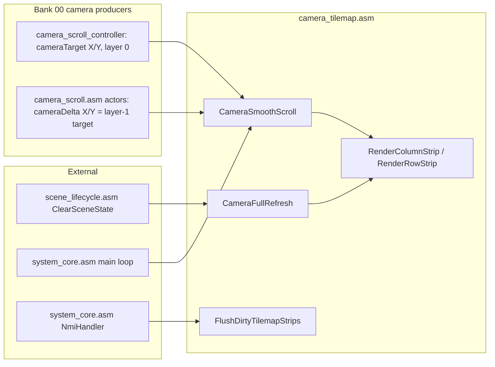

# Bank $02 — Camera Scrolling & Tilemap DMA

*Part of the [Bank $02 Documentation Suite](README.md)*

**Bank:** `$02` (FastROM; accessed via `$@` long calls from other banks)  
**Document scope:** Incremental tilemap scrolling, strip staging buffers, and VBlank DMA upload to the BG nametables.  
**ASM source:** [`camera_tilemap.asm`](../../../extracted/system/engine/camera_tilemap.asm) (block: `camera_tilemap`, scene: `engine`). Upstream camera producers live in bank `$00`: [`camera_scroll.asm`](../../../extracted/system/engine/camera_scroll.asm) and [`camera_scroll_controller.asm`](../../../extracted/actors/camera_scroll_controller.asm).  
**Last updated:** 2026-10-29

> **Evidence labels.** Each major section is tagged with the kind of claim it makes: **[ASM]** = directly observed in the extracted asm of this block; **[INFERRED]** = interpretation of behavior that is not literally encoded in the file; **[XREF]** = cross-file / engine-wide convention stated elsewhere (not provable from this file alone). Sections that mix kinds split them into separately tagged bullets or paragraphs. The `.asm` files in `extracted/` are authoritative; where prose and asm comments disagree, the asm wins.

*Evidence: [ASM] + [XREF]*

This document covers **`camera_tilemap.asm`**: the per-frame scroll update (`CameraSmoothScroll`), the full tilemap rebuild (`CameraFullRefresh`), the strip renderers that stage tilemap data in WRAM, and the V-Blank DMA of those strips (plus the BG3 text tilemap upload). It sits above the hardware math layer ([`hardware-and-init.md`](hardware-and-init.md)).

- **[ASM]** `CameraFullRefresh` is called from `ClearSceneState` in [`scene_lifecycle.asm`](../../../extracted/system/engine/scene_lifecycle.asm) (layer 0 if `$069B` is nonzero, layer 1 with `X = 2` if `$069D` is nonzero), and only when `scrollModeFlags` bit 3 is clear; with bit 3 set that code calls `scene_script.RenderPaletteTiles` instead.
- **[ASM]** `CameraSmoothScroll` is called from the main loop in [`system_core.asm`](../../../extracted/system/engine/system_core.asm) as `LDX #$0000` then `LDX #$0002`, once per pass; the file has three such pairs (normal, cutscene-only and overlay-only passes). `FlushDirtyTilemapStrips` and `Bg3TilemapVramDma` are called from `NmiHandler` (steps 4 and 7 of its header).

Companion docs: [`map-coordinates.md`](map-coordinates.md) (tile/index helpers) · [`tile-collision.md`](tile-collision.md) (collision probing)

**Related:** [`scene-script.md`](scene-script.md) · [`../bank00/camera-scroll-system.md`](../bank00/camera-scroll-system.md) · [`README.md`](README.md) · [`../../cop/README.md`](../../cop/README.md)

## Block Layout (camera_tilemap)

*Evidence: [ASM] (`$02AB8A`–`$02B0A3` from `db-us/names/bank02.json` / `blocks.json`)*

```
$02AB8A ┌─ CameraFullRefresh ──────────────────────────┐
        │  CameraSmoothScroll / UpdateScroll*          │
        │  RenderRowStrip / RenderColumnStrip          │  camera_tilemap
        │  WrapMapIndex / Fill*TilemapSeg              │
        │  FlushDirtyTilemapStrips                     │
        │  DmaColumnStrip / DmaRowStrip                │
        │  Bg3TilemapVramDma                           │
$02B0A3 └──────────────────────────────────────────────┘
```

> **Note:** `map_coords.asm` begins at `$02B0A3` (see [`map-coordinates.md`](map-coordinates.md)). `tile_collision.asm` lives at `$02E102` (see [`tile-collision.md`](tile-collision.md)).

## Variable Roles

*Evidence: [ASM] for addresses and symbol names (the `!` equates and indexed accesses in `camera_tilemap.asm`); [XREF] for who writes them; [INFERRED] where marked*

The camera state is spread over four **different kinds** of word. Keeping them apart is the key to reading this file. Almost every access is indexed by the layer selector in `X` (`0` = layer 0 / BG1, `2` = layer 1 / BG2), so each name below is the layer-0 word and `+2` is the layer-1 word.

### 1. Camera targets (where the scroll should go)

| Layer 0 (`X=0`) | Layer 1 (`X=2`) | Symbol | Role |
|---|---|---|---|
| `$06BE` | `$06C0` | `cameraTargetX` (`,X`) | Target horizontal scroll. Layer 0 is written by `camera_scroll_controller` (bank `$00`, [XREF]). |
| `$06C2` | `$06C4` | `cameraTargetY` (`,X`) | Target vertical scroll. |

**[ASM] Aliasing.** `$06C0` / `$06C4` have a second name, `cameraDeltaX` / `cameraDeltaY` (declared in `camera_scroll.asm` and used by `CameraSmoothScroll`'s layer-1 mode). They are the **same words** as `cameraTargetX+2` / `cameraTargetY+2`. **[XREF]** The comments in `camera_drift.asm` / `layer1_scroll_actors.asm` state that these two words are the layer-1 scroll *position/target*, not per-frame deltas; the `camera_scroll.asm` actors fill them with `MulDivide(ratio, cameraTarget)`. They are also **not** `effectDeltaX/Y` (`$06E4` / `$06E6`, written by `camera_scroll_controller`).

### 2. Current BG scroll registers (where the scroll is now)

| Layer 0 | Layer 1 | Symbol | Role |
|---|---|---|---|
| `$068A` | `$068C` | `bg1ScrollH` / `effectScrollH` | Current horizontal scroll. `$068C` is the layer-1 word named `effectScrollH`. |
| `$068E` | `$0690` | `mapScrollV` / `effectScrollV` | Current vertical scroll. `$0690` is the layer-1 word named `effectScrollV`. |
| `$06CE` / `$06D2` | `$06D0` / `$06D4` | `scrollDeltaXClamped` / `scrollDeltaYClamped` (`,X`) | The delta actually applied this frame by the normal smooth-scroll path (range −16…+16). Read back by `UpdateScrollColumn` / `UpdateScrollRow` for the sign. |

### 3. Mode flags

| Address | Symbol | Bits used in `camera_tilemap.asm` |
|---|---|---|
| `$06EF` | `scrollModeFlags` | bit 3 (`$08`): **direct mode**: copy targets straight to scroll, no smoothing, no strip rendering. Tested as `LDA $scrollModeFlags` / `BIT #$0008` with a 16-bit accumulator. |
| `$06EE` (word) | `layerPriorityFlag` | bit `$0400`: **layer-1 position bypass**. A 16-bit `BIT #$0400` on the word at `$06EE`, which the asm comment identifies as `$06EF` bit 2. Only honored for `X ≠ 0`. |

**[ASM]** The two names overlay adjacent bytes: `layerPriorityFlag` is the word at `$06EE`, whose high byte is `scrollModeFlags` (`$06EF`). A 16-bit access to `layerPriorityFlag` therefore sees `scrollModeFlags` in bits 8–15 (`$0400` = `scrollModeFlags` bit 2). `CameraSmoothScroll` reads both, which is why its two bypass modes are distinct tests even though they live in neighbouring bytes.

**[XREF]** Other known uses (from the extracted files named, not from `camera_tilemap.asm`): `scrollModeFlags` bit 3 also gates the Mode 7 matrix upload (`vblank_joypad.asm`), the direct BG1 scroll write in `UploadScrollRegisters` (`system_core.asm`), and `RenderPaletteTiles` instead of `CameraFullRefresh` (`scene_lifecycle.asm`); `scrollModeFlags` bit 0 means dual-layer scene (`scene_script.asm` `RebuildCollisionLayer`). `layerPriorityFlag` bit `$0200` is **camera frozen** (set/cleared by `FreezeCameraForAttack` / `UnfreezeCameraAfterAttack` in `player_character.asm`; `camera_scroll_controller` returns early when it is set). The display preset record writes the low byte of `layerPriorityFlag` from preset byte +5 and the low 5 bits of `scrollModeFlags` from preset byte +7 (`scene_script.asm`).

**[INFERRED]** Because `CameraSmoothScroll` contains no test of `layerPriorityFlag` bit `$0200`, the camera freeze works by `camera_scroll_controller` no longer updating `cameraTargetX/Y`; `CameraSmoothScroll` keeps running and keeps easing the scroll toward the (now unchanged) target.

### 4. Map bounds, tilemap bases and strip staging

| Address | Symbol | Role |
|---|---|---|
| `$0692` / `$0694` | `mapBoundsX` (`,X`) | Map width in pixels (layer 1: `$0694` = `effectBoundsX`). Its high byte `$0693` / `$0695` is the map width in 256-px pages (row page stride, `mapRowStrideL0/L1`). |
| `$0696` / `$0698` | `mapBoundsY` (`,X`) | Map height in pixels (layer 1: `$0698`). |
| `$069A` (`,X`) | (unnamed here) | Map data size in bytes = (map width / 16) × (map height / 16) = stride × rows × 256; used as the wrap modulus by `WrapMapIndex` and `RenderColumnStrip`. Measured equal to that product in all 228 scene rows read; `$069C` (layer 1) likewise equals `$0695` × `$0699` × 256. |
| `$069E` (`,X`) | `mapTilemapBaseA` | Map data base address; high byte `$069F` is the base page added in index math. |
| `$06AE` (`,X`) | `metatileDefBase` | Pointer to the metatile definition table (8 bytes per metatile = four 8×8 tile words). |
| `$06B2` / `$06B4` | `colStripStagingPtr` (`,X`) | Pointer to the column-strip staging buffer for layer 0 / layer 1. |
| `$06B6` / `$06B8` | `rowStripStagingPtr` (`,X`) | Pointer to the row-strip staging buffer for layer 0 / layer 1. |
| `$06BA` (`,X`) | (unnamed here) | VRAM tilemap base word address for the layer. |

Staging buffers (initial pointers set by `system_init`, per the file header): column strip layer 0 at `$7E3100`, row strip layer 0 at `$7E3184`, column strip layer 1 at `$7E3288`, row strip layer 1 at `$7E330C`. The **first word of each buffer is the pending VRAM destination address; zero means nothing is pending**. `FlushDirtyTilemapStrips` and `CameraFullRefresh` clear all four when done.

### 5. Direct-page scratch used by this file

| DP | Role in `camera_tilemap.asm` |
|---|---|
| `$18` | Rendering **pixel X** of the strip (not a tile coordinate here) |
| `$1C` | Rendering **pixel Y** of the strip |
| `$00` | Temporary AND-mask (`bounds − 1`) in `CameraFullRefresh` |
| `$02` | Metatile definition table pointer for `Fill*TilemapSeg` |
| `$04` | Current map index (also `Y` for `Fill*TilemapSeg`) |
| `$06` | Saved unwrapped map index (`RenderColumnStrip` edge step) |
| `$08` | Map data size (`RenderColumnStrip`) |
| `$0E` | Metatile count / loop counter in `Fill*TilemapSeg` |
| `$10` | Start metatile row within the page (`RenderColumnStrip`); also the size of the wrapped second segment |
| `$1A` | Map width in pixels (`RenderColumnStrip`) |
| `$1E` | Map data upper bound = base + size (`RenderColumnStrip`) |

**[XREF]** `$18` / `$1C` are reused as **tile** coordinates by `TileCoordsToMapIndex` in `map_coords.asm` and `$1A` / `$1E` as probe pixel coordinates in `tile_collision.asm`. The same DP numbers have different units in different files; do not read the shared numbers as a shared variable.

## Scrolling Pipeline

*Evidence: [ASM] (call order and data flow); [XREF] (NMI orchestration)*

The camera system uses a **two-phase** update: logical scroll and strip staging in the main loop, physical VRAM upload in the NMI. Three distinct paths inside `CameraSmoothScroll` decide what happens each frame:



**Phase 1 — Scroll (main loop):** only the normal path (third box) clamps, tests tile-boundary crossings and stages strips. The two bypass paths return before any strip is rendered.

**Phase 2 — Strip DMA (NMI):** `FlushDirtyTilemapStrips` uploads the four staging buffers and clears their head words.

**Full Refresh (scene load):** `CameraFullRefresh` makes 32 **column** passes (not rows) with an immediate DMA after each, then uploads CGRAM.

## camera_tilemap.asm

*Evidence: [ASM]*

| Address | Name | Behavior (from the asm header and body) |
|---------|------|-------------|
| `$02AB8A` | CameraFullRefresh | Wraps the layer's camera target into the map bounds, copies it to the scroll words, then renders and DMAs 32 metatile columns; clears the staging heads; `UploadCgramPalette`. |
| `$02AC2E` | CameraSmoothScroll | Per-frame scroll for layer `X`: direct mode, layer-1 position bypass, or clamped smooth scroll with strip staging. |
| `$02ACCC` | UpdateScrollRow | After a vertical tile-boundary crossing: picks the newly visible row (Y offset −16 or +`$E0`) and calls `RenderRowStrip`. |
| `$02ACF1` | UpdateScrollColumn | After a horizontal tile-boundary crossing: picks the newly visible column (X offset 0 or +`$100`) and calls `RenderColumnStrip`. |
| `$02AD0B` | RenderRowStrip | Stages one **row** strip: 32 metatiles (two 16-metatile page halves) into the row staging buffer. |
| `$02AD8D` | WrapMapIndex | Wraps a map index back inside `base + size`. |
| `$02ADA2` | RenderColumnStrip | Stages one **column** strip: 16 metatiles vertically (up to two segments plus an edge tile) into the column staging buffer (335 bytes of code). |
| `$02AEF1` | FillHorizTilemapSeg | Expands a horizontal run of metatile indices into VRAM-format tile words. |
| `$02AF26` | FillVertTilemapSeg | Same, for a vertical run (source index advances by `$10` per metatile). |
| `$02AF5F` | FlushDirtyTilemapStrips | NMI routine: DMAs the four staging buffers when their head word is nonzero, then clears the heads. |
| `$02AFC7` | DmaColumnStrip | Two DMA transfers of `$40` bytes (one tile column each) with VRAM increment 32. |
| `$02B000` | DmaRowStrip | Two DMA transfers of `$80` bytes (one nametable half each) with VRAM increment 1. |
| `$02B038` | Bg3TilemapVramDma | NMI routine: uploads the BG3 text tilemap buffer (`$7F0200`) to VRAM `$7800`. |

**Naming (from the file header, [ASM]).** `RenderColumnStrip`, `DmaColumnStrip` and the `$06B2`/`$06B4` buffers deal with **column** strips (a vertical run of 16 metatiles, DMA'd with VRAM increment 32). `RenderRowStrip`, `DmaRowStrip` and the `$06B6`/`$06B8` buffers deal with **row** strips. `UpdateScrollRow` / `UpdateScrollColumn` and the `Fill*TilemapSeg` routines use the geometric meaning of the strip they fill, so the two vocabularies meet inside this file. In `FlushDirtyTilemapStrips`, "horizontal/vertical" refers to the scroll direction that produces the strip, not to its shape. An older version of this document had the row/column shapes swapped.

### CameraFullRefresh

*Evidence: [ASM]*

A complete rebuild of one layer's 64-tile-wide (two-nametable) tilemap. It does **not** clamp: it wraps.

1. `PHP`, `REP #$20`. X-axis: if `cameraTargetX,X ≥ mapBoundsX,X` the target is ANDed with `mapBoundsX − 1` (an exact modulo only when the bound is a power of two) and stored back. The (possibly wrapped) value is written to `bg1ScrollH,X`, and `$18 = value AND #$FFF0` (16-px aligned).
2. Y-axis: a **negative** `cameraTargetY,X` is left unchanged; otherwise, if `≥ mapBoundsY,X`, it is ANDed with `mapBoundsY − 1` and stored back. The value is written to `mapScrollV,X`, and `$1C = value AND #$FFF0`.
3. DMA channel 0 is configured once: `VMAIN = $81` (word access, increment 32), `DMAP0 = $01`, `BBAD0 = $18` (VRAM data port), source bank `$7E`.
4. **Column loop, counter `$0020`, so 32 passes**, each:
   - `RenderColumnStrip` builds one 16-metatile-tall column at pixel X `$18` / pixel Y `$1C` into the column staging buffer (`colStripStagingPtr,X`);
   - the buffer's head word (VRAM address) is read into `Y` and `DmaColumnStrip` uploads it **immediately** (this path is not the NMI);
   - `$18 += $10` (one metatile column, 16 px), wrapped against `mapBoundsX,X` when it passes the width.
   32 passes × 16 px = 512 px, the full two-nametable width of the layer.
5. The four staging head words (`$7E3100`, `$7E3288`, `$7E3184`, `$7E330C`) are zeroed so the NMI does not re-trigger them; `JSL system_init.UploadCgramPalette`; `PLP`, `RTL`.

| Location | Direction | Role |
|----------|-----------|------|
| `cameraTargetX,X` / `cameraTargetY,X` | In/Out | Wrapped in place |
| `bg1ScrollH,X` / `mapScrollV,X` | Out | Current scroll set to the (wrapped) target |
| `mapBoundsX,X` / `mapBoundsY,X` | In | Wrap bounds |
| `$18` / `$1C` | Out | 16-px-aligned pixel X / Y of the strip origin |
| `$7E0000,X` (head word of the staging buffer) | In | VRAM destination read each pass |

**Callers [ASM]:** `scene_lifecycle.asm` `ClearSceneState`. **Inferred:** the immediate (non-NMI) DMA is safe because it runs during scene load; the file only states that it "runs from scene load, not NMI".

### CameraSmoothScroll

*Evidence: [ASM]*

Per-frame scroll update for the layer in `X`; it handles both axes. The routine begins with `PHP` / `REP #$20` and has **three mutually exclusive paths**, tested in this order:

| # | Path | Condition | What it does | Strips? |
|---|------|-----------|--------------|---------|
| 1 | **Direct mode** | `scrollModeFlags` (`$06EF`) bit 3 set | `bg1ScrollH,X = cameraTargetX,X`; `mapScrollV,X = cameraTargetY,X`; `RTL`. Applies to either layer, no delta clamp, no tile-boundary test. | No |
| 2 | **Layer-1 position bypass** | `X ≠ 0` **and** `layerPriorityFlag & $0400` (`$06EF` bit 2) | `effectScrollH ($068C) = cameraDeltaX ($06C0)`; `effectScrollV ($0690) = cameraDeltaY ($06C4)`; `RTL`. | No |
| 3 | **Normal smooth scroll** | otherwise | Per axis: `delta = target − scroll`, clamp to −16…+16, store in `scrollDelta?Clamped,X`, `scroll += delta`, XOR old/new scroll and test bit 4 (`BIT #$0010`) to detect a 16-px boundary crossing; X axis → `UpdateScrollColumn`, Y axis → `UpdateScrollRow`. | Yes |

Notes:

- **[ASM]** Path 2 is never taken for `X = 0`; layer 0 always falls to path 3 unless path 1 applies.
- **[ASM]** Because `cameraDeltaX/Y` are the same words as `cameraTargetX/Y` for `X = 2` (see *Variable Roles*), path 2 writes the same values to the same destinations as path 1 would for layer 1. They differ in what triggers them and in which layers they can apply to: path 1 is a scene-wide mode flag (and is also what the Mode 7 / palette-tile scenes use), path 2 is a layer-1-only flag.
- **[ASM]** In path 3 the clamp is asymmetric in the code: a positive delta below `$10` passes unchanged, anything `≥ $10` becomes `+16`; a negative delta passes if `≥ −16`, otherwise becomes `−16`. The old scroll value is kept on the stack for the XOR test; at most one column and one row strip per layer per frame because `|delta| ≤ 16`.
- **[ASM]** The scroll words are *not* masked or written to the PPU here. **[XREF]** `UploadScrollRegisters` (`system_core.asm`, called from `NmiHandler`) writes them to the PPU; its direct mode (`scrollModeFlags` bit 3) writes `bg1ScrollH` / `mapScrollV` to BG1HOFS/BG1VOFS masking the high bytes to 7 bits.

| Location | Direction | Role |
|----------|-----------|------|
| `cameraTargetX,X` / `cameraTargetY,X` | In | Layer target (`$06BE`/`$06C2`; layer 1: `$06C0`/`$06C4`) |
| `bg1ScrollH,X` / `mapScrollV,X` | In/Out | Current scroll |
| `scrollDeltaXClamped,X` / `scrollDeltaYClamped,X` | Out | Applied delta (path 3 only) |
| `scrollModeFlags` | In | Bit 3, path 1 |
| `layerPriorityFlag` | In | Bit `$0400`, path 2 |
| `cameraDeltaX` / `cameraDeltaY` | In | Path 2 source |
| `X` | In | Layer selector (0 or 2) |

| Symbol | Relationship |
|--------|--------------|
| `UpdateScrollColumn` | Called on horizontal boundary crossing (path 3) |
| `UpdateScrollRow` | Called on vertical boundary crossing (path 3) |
| `system_core.asm` | Caller: `X=0` then `X=2` (three pairs of call sites) |

**[XREF] Upstream producers.** `camera_scroll_controller` (the default field camera actor) computes `cameraTargetX/Y` for layer 0 from the player position (target = player − `$80`, clamped to `cameraOffset`/`cameraBounds`) and publishes `effectDeltaX/Y`. The `camera_scroll.asm` actors (`ScrollCameraTrack`, `ScrollCameraVertical`, `ScrollCameraAccumulate`, `ScrollCameraInit`) compute `cameraDeltaX/Y` (= the layer-1 target) with `MulDivide`. None of those run inside `camera_tilemap.asm`.

### UpdateScrollRow

*Evidence: [ASM]*

Called by path 3 after the Y scroll crossed a 16-px boundary. `$18 = bg1ScrollH,X`; the row offset is `−16` (`$FFF0`) when `scrollDeltaYClamped,X` is negative (top edge) or `+$E0` (224 px, bottom edge) otherwise; `$1C = mapScrollV,X + offset`, then reduced by repeated subtraction of `mapBoundsY,X` until it is inside the map; `JSR RenderRowStrip`; `RTS`.

| Location | Direction | Role |
|----------|-----------|------|
| `bg1ScrollH,X` / `mapScrollV,X` | In | Scroll words |
| `scrollDeltaYClamped,X` | In | Sign picks the edge |
| `$18` / `$1C` | Out | Pixel X / Y of the row |

### UpdateScrollColumn

*Evidence: [ASM]*

Called by path 3 after the X scroll crossed a 16-px boundary. The column offset is `0` when `scrollDeltaXClamped,X` is negative (left edge) or `+$100` (256 px, right edge) otherwise; `$18 = bg1ScrollH,X + offset`; `$1C = mapScrollV,X`; `JSR RenderColumnStrip`; `RTS`. No map-bound wrap is applied here (`RenderColumnStrip` wraps through `WrapMapIndex`).

### RenderRowStrip

*Evidence: [ASM] + [INFERRED] (marked)*

Stages one **row strip**: a horizontal run of 32 metatiles (512 px, two 256-px map pages) into the row staging buffer (`rowStripStagingPtr,X`), for `DmaRowStrip`.

1. `PHP`/`PHB`/`PHX`; `$02 = metatileDefBase,X`; data bank = `$7E`.
2. Map index: `(Y page × width in pages) + X page + base page` via `Multiply8x8Unsigned` (width pages from `$0693,X`, base page from `$069F,X`), low byte = `$1C AND $F0`; `WrapMapIndex`.
3. VRAM address = `((Y AND $00F0) << 2) + $06BA,X`: the metatile row selects the VRAM row at 64 words per metatile row. Bit 8 of `$18` selects which nametable gets the first page: left half stores the address in slot 0 and `+$0400` at `+$82`; right half swaps them.
4. **Always two passes** of `FillHorizTilemapSeg` with 16 metatiles each: first page, then map index `+ $100` (next page, re-wrapped) into the slot at `+$82`.

| Location | Direction | Role |
|----------|-----------|------|
| `$18` / `$1C` | In | Pixel X / Y |
| `$0693,X` | In | Map width in pages (high byte of `mapBoundsX`) |
| `$069F,X` | In | Map base page |
| `$06BA,X` / `$06B6,X` | In | VRAM base / row staging pointer |
| `$02` / `$04` | In/Out | Metatile defs / map index |

Called by `UpdateScrollRow`. Inferred: the strip always starts at the left edge of a map page; the file says so in its header, but the left/right nametable assignment depends on `$18` bit 8 only.

### WrapMapIndex

*Evidence: [ASM]*

`A = index`, `X = layer`. Computes `A − $069E,X − $069A,X`; if that subtraction does **not** borrow (index ≥ base + size) it re-adds `$069E,X`, stores the result in `$04` and `Y` (so `index − size`) and repeats until it borrows, then returns. If the first test already borrows, it returns immediately **without touching `$04` / `Y`**; callers set `$04` / `Y` to the unwrapped index beforehand. `$069A,X` is the wrap modulus: it equals the number of map data bytes (map width / 16 × map height / 16) in all 228 scene rows measured. Map bounds are not always powers of two (43 scenes have a non-power-of-two X bound of 768, 1280 or 1536 and 58 a Y bound of 768, 1280, 1536, 1792 or 2304; 83 of 223 scenes have at least one, e.g. Itory Village `$15`, 1280 × 1024, stride 5), so a bounds-based `AND bounds−1` is exact only in the other scenes. All bounds are multiples of 256 and every layer has at most 32 pages. Whether the `AND #$0100` column wrap shows on screen in the stride 5 / 7 scenes was not tested.

Callers: `RenderRowStrip`, `RenderColumnStrip` (several sites).

### RenderColumnStrip

*Evidence: [ASM] + [INFERRED] (marked)*

Stages one **column strip**: a vertical run of 16 metatiles (256 px, one pair of tile columns) in the column staging buffer (`colStripStagingPtr,X`), for `DmaColumnStrip`.

1. Loads `$1A = mapBoundsX,X`, `$08 = $069A,X`, `$1E = base + size`, `$02 = metatileDefBase,X`; data bank `$7E`.
2. Map index = `Y page × width in pages + X page + base page` (page byte) combined with `(metatile row = Y low >> 4) × 16 + (X low >> 4)` (`Multiply8x8Unsigned` twice); `WrapMapIndex`; the unwrapped index is saved in `$06`.
3. Tile column = `($18 >> 3) AND $3E` (even, 0–62 words in the 64-wide ring). **Bit 5 selects the nametable half**; it changes only the VRAM address (`$0400` higher for the right half). VRAM address of the left tile column is stored at buffer `+0`, address `+1` at buffer `+$42` (the right tile column of each 2-wide metatile).
4. The strip is filled in VRAM order starting at the current Y row (`$10 = (Y>>4) AND $F`), in up to **two segments**: first `16 − $10` metatiles to the bottom of the page via `FillVertTilemapSeg`; second (only if `$10 > 0`) the remaining `$10` metatiles from the top of the next page row (map width further on, wrapped at the map-data end).
5. **Edge tile:** the last slot is overwritten with the metatile row just above the strip start (stepping back one page row when the start row is 0, and skipped if that index would precede the map base). The file labels this step inferred from the arithmetic and not runtime-verified.

| Location | Direction | Role |
|----------|-----------|------|
| `$18` / `$1C` | In | Pixel X / Y |
| `$04` / `$06` | In/Out | Map index / saved copy |
| `$10` | Temp | Start row / second-segment size |
| `$1A` / `$1E` / `$08` | Temp | Width, upper bound, map size |
| `$06B2,X` / `$06BA,X` | In | Column staging pointer / VRAM base |

Callers: `UpdateScrollColumn`, `CameraFullRefresh` (32 passes).

### FillHorizTilemapSeg

*Evidence: [ASM]*

`A = metatile count`, `X = staging write pointer`, `Y = $04` map index. For each metatile byte (masked to 8 bits, ×8 plus `$02` = its 4-word definition): word 0 → `+$02`, word 1 → `+$04` (top-left, top-right), word 2 → `+$42`, word 3 → `+$44` (bottom-left, bottom-right). `+$42` is exactly one VRAM tilemap row (32 words = `$40` bytes) below the top row. `X += 4` and `Y += 1` per metatile. Caller: `RenderRowStrip` (twice).

### FillVertTilemapSeg

*Evidence: [ASM]*

Same inputs; for each metatile: word 0 → `+$02`, word 2 → `+$04` (left tile column, upper then lower), word 1 → `+$44`, word 3 → `+$46` (right tile column), `X += 4`, source index `+= $10` (one map row) per metatile. The buffer holds two tile columns of 32 words: the left at `+$02` after its address word at `+0`, the right at `+$44` after its address word at `+$42`. Caller: `RenderColumnStrip` (up to three calls).

### FlushDirtyTilemapStrips

*Evidence: [ASM] + [XREF] (NMI caller)*

NMI routine. Sets `VMAIN = $81`, `DMAP0 = $01`, `BBAD0 = $18`, source bank `$7E`, then processes four staging buffers in order, skipping any whose head word is zero:

1. column strip, layer 0 (`$06B2` → `$7E3100`) → `DmaColumnStrip`
2. column strip, layer 1 (`$06B4` → `$7E3288`) → `DmaColumnStrip`
3. `VMAIN = $80` (word access, increment 1)
4. row strip, layer 0 (`$06B6` → `$7E3184`) → `DmaRowStrip`
5. row strip, layer 1 (`$06B8` → `$7E330C`) → `DmaRowStrip`

Finally all four head words are zeroed. Caller: `NmiHandler`, after `UploadScrollRegisters` and before `UploadCgramPalette`.

### DmaColumnStrip

*Evidence: [ASM]*

Entry: `Y` = VRAM destination (the buffer head word), `X` = buffer offset. Skips the 2-byte address word, then performs **two** DMA transfers of `$40` bytes (64 bytes = 32 tilemap words = one full tile column). With the caller's `VMAIN = $81` each word lands 32 words after the previous, so each transfer fills one 32-tile-high column. After the first transfer the source pointer advances by `$40` to the second column's header, reads its VRAM address (address + 1) into `Y`, and transfers again. The two halves are the left and right tile columns of the metatile column, **not** two nametables. Callers: `FlushDirtyTilemapStrips`, `CameraFullRefresh`.

### DmaRowStrip

*Evidence: [ASM]*

Entry as above. **Word-mode** DMA (`DMAP0 = $01`) with the caller's `VMAIN = $80` (increment 1): two transfers of `$80` bytes (64 words). With increment 1 the first 32 words fill one tile row of a nametable and the next 32 words fill the tile row below it. The two halves are the **two nametables** (the 512-px strip split across them); the second half's header is at source `+$80`. Caller: `FlushDirtyTilemapStrips`.

### Bg3TilemapVramDma

*Evidence: [ASM] + [XREF]*

NMI routine for the BG3 text tilemap (`bg3TilemapBuffer`, WRAM `$7F0200`, written by the console string renderer). Returns at once if `hudDisableFlag` (`$09ED`) bit 7 is set, or if `displayModeFlags` (`$09EC`) has none of bits `$31` (0, 4, 5). Then:

| `displayModeFlags` bit | Transfer |
|---|---|
| 0 (`$01`) | `$0800` bytes (32×32 map) from `$7F0200` to VRAM `$7800` |
| 4 (`$10`) or 5 (`$20`) | `$0140` bytes (five tile rows) from `$7F0280` to VRAM `$7840` (tile row 2 onward). Bits 4 and 5 behave identically; the bit-5 path pre-clears that bit but the common `TRB` clears bits 0/4/5 anyway. |

Afterwards `TRB #$31` clears the request bits, `VMAIN = $80`, `DMAP0 = $01`, `BBAD0 = $18`, source bank `$7F`, and DMA channel 0 is triggered. BG3SC is `$78`, so VRAM `$7800` is the BG3 tilemap. Bit 3 of `displayModeFlags` is a separate player-tile DMA request handled in `system_core.asm`.

## Integration Overview

*Evidence: [XREF] + [INFERRED]. These are cross-file relationships; the specific facts are in the sections above.*



| From | To | Mechanism |
|------|----|-----------|
| `camera_scroll_controller` | `camera_tilemap` | Writes `cameraTargetX/Y` (`$06BE` / `$06C2`); freezes while `layerPriorityFlag` `$0200` is set [XREF] |
| `camera_scroll.asm` actors | `camera_tilemap` | Write `cameraDeltaX/Y` (`$06C0` / `$06C4`), consumed by the layer-1 bypass and by `X=2` target reads [XREF] |
| `scene_lifecycle` | `CameraFullRefresh` | Direct JSL per layer when `scrollModeFlags` bit 3 is clear |
| `system_core` | `CameraSmoothScroll` | JSL, `X=0` then `X=2` |
| `NmiHandler` | `FlushDirtyTilemapStrips`, `Bg3TilemapVramDma` | JSL in V-Blank |
| `camera_tilemap` | `map_coords` | Same map index format (page-major, 256-byte pages); **not** shared variables: `$18` / `$1C` are pixel coordinates here and tile coordinates in `TileCoordsToMapIndex` |

**[INFERRED]** The camera window words at `$06D6`–`$06DE` (declared as `cameraOffsetX/Y`, `cameraBoundsX/Y` in `camera_scroll_controller.asm` and as `cameraOffsetX/Y`, `cameraBoundsX`, `cameraLowerYBound` in `tile_collision.asm`) are not referenced by `camera_tilemap.asm`; they belong to the camera producers and the collision code, not to the scroll registers above. Earlier versions of this page listed them in the scroll state table.

## See Also

*Evidence: [XREF]*

- [`map-coordinates.md`](map-coordinates.md) — tile/pixel coordinate transforms, map-buffer index navigation, ramp cascade probes
- [`tile-collision.md`](tile-collision.md) — corner probes, collision nibble lookup at `$7FC000`, movement delta finalization
- [`player-movement.md`](player-movement.md) — movement physics that calls into `tile_collision`
- [`attack-ability-system.md`](attack-ability-system.md) — `FreezeCameraForAttack` sets `layerPriorityFlag` `$0200`
- [`hardware-and-init.md`](hardware-and-init.md) — `MulDivide`, `UploadCgramPalette` consumers
