# Inventory Overlay — `inventory_overlay.asm`

*Part of the [Bank $02 Documentation Suite](README.md)*

> `OpenInventoryScreen`: save the gameplay state, build scene `$FF`, run it until flag byte `#00` is set, restore the gameplay state, reload the previous scene's graphics.

**Source:** [`inventory_overlay.asm`](../../../extracted/system/inventory/inventory_overlay.asm) (ROM `$02ED02`–`$02F048`, decimal 191746–192584)

**Evidence labels.** Each major section is tagged with the kind of claim it makes: **[ASM]** = directly observed in the extracted asm of this block; **[INFERRED]** = interpretation of behavior that is not literally encoded in the file; **[XREF]** = cross-file / engine-wide convention stated elsewhere (not provable from this file alone). Sections that mix kinds split them into separately tagged bullets or paragraphs. The `.asm` files in `extracted/` are authoritative; where prose and asm comments disagree, the asm wins.

---

## Overview

*Evidence: [ASM] + [XREF] caller*

- **[ASM]** The block holds six routines: `OpenInventoryScreen` (open, run loop and close in one `JSL`), `ReloadAbilityFX`, `ResetThinkerWaitCounters`, `SaveGameState`, `RestoreGameState`, `RestorePaletteBuffer`. `PHP` / `PLP` bracket `OpenInventoryScreen`; A, X and Y are clobbered.
- **[ASM]** The "inventory" is scene id `$FF`. `OpenInventoryScreen` sets `sceneCurrent = $00FF`, sets `sceneTableIndex = sceneCurrent × 2` (= `$01FE`), then calls `SceneScriptNoMusic`, `InitActorPool`, `SpawnSceneActors` and `SpawnSceneThinkers`. It reuses the live WRAM actor / thinker pools; that is why `SaveGameState` copies them away first.
- **[ASM]** The block note lists what is not saved: tile / map data (the scene script reloads it), VRAM (reloaded), and the player / ability sprite tiles (reloaded explicitly by `LoadPlayerGraphics` and `ReloadAbilityFX`).
- **[XREF]** The only caller found in `extracted/` is `GlobalInputHandler` ([`GlobalInputHandler.asm`](../../../extracted/system/engine/GlobalInputHandler.asm), ROM bank `$03`, `JSL $@inventory_overlay.OpenInventoryScreen`). It runs when `joypadCurrent` has Select (`$2000`) and `playerFlags & $2800` is clear. Before the call it does `TSB joypadHeld` with `$2000` and `VBlankWaitAndJoypad`. After the return it calls `DisableNmiKeepJoypad` and sets `$6000` in `joypadHeld` (Select plus vanilla Y) so neither re-triggers at once. Inside this file the call is a single `JSL`; the caller's input handling is described in the `GlobalInputHandler` block, not here.

```mermaid
flowchart TD
    OPEN["OpenInventoryScreen<br/>NMI off, forced blank, HDMAEN=0"] --> SAVE["SaveGameState"]
    SAVE --> PUSH["push effectDeltaX, displayModeFlags,<br/>eventFlags, sceneCurrent"]
    PUSH --> SCENE["sceneCurrent = $FF<br/>sceneTableIndex = sceneCurrent*2"]
    SCENE --> PPU["window regs=0, BG3SC/BG2SC/BG1SC,<br/>SceneScriptNoMusic, palette"]
    PPU --> ZERO["zero camera + scroll words<br/>invalidate source cache C/D"]
    ZERO --> SPAWN["ClearBg3TilemapBuffer_Full,<br/>InitActorPool, SpawnSceneActors,<br/>SpawnSceneThinkers"]
    SPAWN --> FIRST["RunActors_Normal x2, SortActorsByDepth,<br/>ComposeAllSprites, UpdateFrameDialogue,<br/>VBlank wait, INIDISP=$0F"]
    FIRST --> LOOP["code_02EE17:<br/>UpdateFrameDialogue; BG1SC = bg1ConfigMode"]
    LOOP --> EXIT{"BranchOnFlagByte #00<br/>still zero?"}
    EXIT -->|yes| LOOP
    EXIT -->|no| CLOSE["forced blank, HDMAEN=0,<br/>RestoreGameState"]
    CLOSE --> POP["scroll words from camera words;<br/>pop sceneCurrent, eventFlags,<br/>displayModeFlags, effectDeltaX"]
    POP --> RELOAD["SceneScriptNoMusic, ApplyAllEventBlocks,<br/>PlaceOpenedChestTiles, RestorePaletteBuffer,<br/>LoadScenePalettes, LoadPlayerGraphics, ReloadAbilityFX"]
    RELOAD --> HUD["HUD / BG3 restore,<br/>ResetThinkerWaitCounters, ResetHdmaState,<br/>UpdateFrameRender x2, SetFlagByte #FF"]
    HUD --> DONE["INIDISP=$0F, PLP, RTL"]
```

---

## Save / Restore Map

*Evidence: [ASM]*

`SaveGameState` copies state into the backup areas below and `RestoreGameState` copies it back; the palette staging buffer is restored by the separate `RestorePaletteBuffer`. Addresses are exactly as the asm writes them.

| Live state | Size | Backup location | Mechanism |
|---|---|---|---|
| `joypadCurrent` (`$0656`) | word | `$7E:38AC` | `LDA` / `STA`; the live word is zeroed (`STZ`) |
| `joypadHeld` (`$0658`) | word | `$7E:38AE` | `LDA` / `STA`; **not** zeroed |
| `joypadMaskStd` (`$065A`) | word | `$7E:38B0` | `LDA` / `STA`; the live word is zeroed |
| `activeActorCount` (`$0DBC`) | word | `$0DBE` (a word just outside every copied page) | `LDA` / `STA` |
| DP `$4E`–`$5D` | 8 words | `$7E:389C` | `LDA $004E,X` / `STA $7E389C,X` loop, X `0`–`$0E` |
| `$06BE`–`$06C9` (6 words: `cameraTargetX`, `cameraDeltaX`, `cameraTargetY`, `cameraDeltaY`, `scrollOverrideH`, `forcedScrollOverride`) | 12 bytes | `$7E:3890` | indexed loop from `cameraTargetX` |
| `$00:0E00` actor free-slot list | 256 B (`A=$00FF`) | `$7E:3490` | `MVN #$7E, #$00` |
| `$7E:3000` thinker free-slot list | 256 B | `$7E:3590` | `MVN #$7E, #$7E` |
| `$00:1000`–`$1FFF` actor slots | 4096 B (`A=$0FFF`) | `$7F:E000` | `MVN #$7F, #$00` |
| `$7F:1000`–`$1FFF` actor extended data | 4096 B | `$7F:F000` | `MVN #$7F, #$7F` |
| `$00:0F00` thinker table (16 slots × `$10`) | 256 B | `$7E:3690` | `MVN #$7E, #$00` |
| `$7F:0F00` thinker extended data | 256 B | `$7E:3790` | `MVN #$7E, #$7F` |
| `$7F:0A00` palette staging buffer | `$203` = 515 B (`A=$0202`) | `$7E:38B4` | `MVN #$7E, #$7F` |

- **[ASM]** The seven `MVN` copies total 9,731 bytes (plus 34 bytes of joypad, count, DP and camera words). An older version of this doc and the README said "~5.5 KB"; the `MVN` lengths in the asm do not support that figure.
- **[ASM]** The actor slot page is the **bank `$00`** page `$1000`–`$1FFF` (`MVN #$7F, #$00`), not `$7E:1000`. The asm comment says "84 actor slots of `$30` bytes ($1000 total)"; the copy length is `$1000` bytes either way.
- **[ASM] Not saved, but zeroed at open:** `scrollOverrideV` (`$06CA`), the unnamed word `$06CC` and the unnamed DP word `$00B2`. `RestoreGameState` does not restore them, so their old values are lost. The unnamed words `$00F4` / `$00F8` are zeroed at close (they were never saved either).
- **[ASM]** DBR is saved with `PHB` / `PLB` around both state routines, because each `MVN` leaves the destination bank in DBR.

---

## Memory Map

*Evidence: [ASM] (addresses from `db-us/names/bank02.json`)*

| Address | Name | Role |
|---------|------|------|
| `$02ED02` | `OpenInventoryScreen` | Entry, scene `$FF` run loop and close path. |
| `$02EECC` | `ReloadAbilityFX` | Re-uploads ability FX tiles and palette from `$00EA` after the inventory scene overwrote sprite VRAM. |
| `$02EF0B` | `ResetThinkerWaitCounters` | Zeroes the `$08` wait counter of every thinker in the list headed at DP `$5A`. |
| `$02EF1D` | `SaveGameState` | Copies the state in the table above to the backup areas. |
| `$02EFB2` | `RestoreGameState` | Copies it back (everything except the palette staging buffer). |
| `$02F035` | `RestorePaletteBuffer` | `$7E:38B4` → `$7F:0A00`, `$203` bytes. |

The main loop label `code_02EE17` is an unnamed local label inside `OpenInventoryScreen`.

---

## OpenInventoryScreen

*Evidence: [ASM] for the numbered steps; [XREF] where marked*

### Open path

1. `PHP`, `SEP #$20`, `DisableNmiKeepJoypad` (NMITIMEN = `$01`: NMI off, joypad auto-read on), `EnterForcedBlank` (INIDISP `$80`), `STZ HDMAEN`.
2. `JSR SaveGameState` (see the table above).
3. `REP #$20`, then the **overlay stack** is built in this push order. Every push is a 16-bit `PHA`:

   | Push # | Value pushed | Live value afterwards |
   |---|---|---|
   | 1 | `effectDeltaX` (`$06E4`) | `STZ` → `$0000` |
   | 2 | `displayModeFlags` (`$09EC`) | `$4000` (every request bit clear; bit 14 is bit 6 of `hudDisableFlag` at `$09ED`, the HUD-off bit per the asm comment) |
   | 3 | `eventFlags` (`$0A00`, flags `$00`–`$0F`) | `STZ` → `$0000`; this also clears flag byte `#00`, the loop's exit flag, so the loop starts armed |
   | 4 | `sceneCurrent` (`$0644`) low byte (`AND #$00FF`) | `sceneCurrent = $00FF`; `ASL` → `sceneTableIndex` (`$0646`) = `$01FE` (`sceneTableIndex = sceneCurrent × 2`) |

   Before the pushes, `joypadMaskInv` (`$065C`) is set to `$0F00` (the Up / Down / Left / Right bits only). The asm comment names this the D-pad repeat mask; the overlay clears it again at close (step 16).
4. `SEP #$20`. Event flag `$FF` (bit 7 of `eventFlagsF8toFF` `$0A1F`, the scene-setup-complete latch) is cleared with `AND #$7F`.
5. PPU: `W12SEL`, `W34SEL`, `WOBJSEL`, `WBGLOG`, `WOBJLOG`, `WH0`, `WH2`, `WH3` = 0; `WH1 = $FF`. With every `W*SEL` zero no layer uses the window, so the `WH0 = 0` / `WH1 = $FF` pair is inert. `BG3SC = $78` (tilemap at VRAM word `$7800`), `BG3HOFS` / `BG3VOFS` each written twice with 0.
6. `SceneScriptNoMusic` builds the scene `$FF` graphics (it finds the scene through `sceneCurrent`; see [scene-script.md](scene-script.md)). Then `BG2SC = $0C`, `BG1SC = $04` and `bg1ConfigMode` (`$0AE6`) = `$04`, `LoadScenePalettes`, palette staging colour index 2 (`$7F0A04` / `$7F0A05`) = `$5B1B`, `UploadCgramPalette`.
7. **Camera and scroll zeroing.** Source-pointer cache slots C (`$0672`) and D (`$0675`) are invalidated by 16-bit stores of 0 to `srcCacheBgC+1` and `srcCacheBgD+1` (address high byte and bank), so the next lookup misses and the close path re-decompresses those BG tile sources. Then 0 is stored to `cameraTargetX`, `cameraTargetY`, `cameraDeltaX`, `cameraDeltaY`, `bg1ScrollH`, `mapScrollV`, `effectScrollH`, `effectScrollV`, `scrollOverrideH`, `forcedScrollOverride`, `scrollOverrideV`, `$06CC` and `$00B2`.
8. `ClearBg3TilemapBuffer_Full`, `InitActorPool`, `SpawnSceneActors`, `SpawnSceneThinkers`, `ClearActorRenderList`.
9. `RunActors_Normal` ×2, `SortActorsByDepth`, `$FF` stored to `$7F3100` and `$7F3101` (empty compose list), `ComposeAllSprites`, one `UpdateFrameDialogue`.
10. `EnableNmiAndJoypad` (NMITIMEN `$81`), `VBlankWaitAndJoypad`, `INIDISP = $0F`, `DisableNmiKeepJoypad` (NMI off again; `UpdateFrameDialogue` pulses it on for its own VBlank wait).

### Run loop (`code_02EE17`)

- **[ASM]** Each pass: `UpdateFrameDialogue`, then `bg1ConfigMode` → `BG1SC`, then `COP [BranchOnFlagByte] ( #00, #00, &code_02EE17 )`. The branch is taken while flag byte `#00` (events `$00`–`$07`) is zero; the loop exits when it is nonzero.
- **[ASM]** The asm comments say the `inventory_menu` actor sets that flag byte to close the screen, and that it changes `bg1ConfigMode` to flip between the item grid and the status view. Which button or tab triggers the close is in [inventory-menu.md](inventory-menu.md), not in this file.
- **[ASM]** `UpdateFrameDialogue` runs `RunActors_CutsceneOnly`, camera scroll, light HDMA-phase thinkers, sprite composition, one VBlank wait with NMI pulsed on, and light general thinkers (per the asm comment). **[XREF]** `RunActors_CutsceneOnly` dispatches only actors with actor flag `$10` bit 11 (`$0800`; `actor_execution.asm`). The children that `inventory_menu` spawns all use `SpawnAfterFlags` values containing `$0800` (`#$1800`, `#$0802`, `#$0800`; see [inventory-menu.md](inventory-menu.md)), which is consistent with that loop. How the menu actor itself and the statue pedestals get the bit is not shown in either file.

### Close path

11. `STZ BG3VOFS` ×2, `DisableNmiKeepJoypad`, `EnterForcedBlank`, `STZ HDMAEN`.
12. `JSR RestoreGameState`.
13. Direct copy of the restored camera words into the scroll words: `cameraTargetX` → `bg1ScrollH`, `cameraTargetY` → `mapScrollV`, `cameraDeltaX` → `effectScrollH`, `cameraDeltaY` → `effectScrollV`. (`cameraDelta*` hold the layer-1 position, not deltas; see [camera-scrolling.md](camera-scrolling.md) §Variable Roles. **[XREF]**)
14. `REP #$20`, then **pop in reverse push order**:
    1. `PLA` → `sceneCurrent`; `ASL` → `sceneTableIndex` (recomputed as `sceneCurrent × 2`)
    2. `PLA` → `eventFlags` (flags `$00`–`$0F` as before the inventory, including flag byte `#00`)
    3. `PLA` → `displayModeFlags`
    4. `PLA` → `effectDeltaX`
15. `SEP #$20`. Previous-scene reload, in this order: `SceneScriptNoMusic` (reads the restored `sceneCurrent`; **[XREF]** the scene script locates the scene by that id), `ApplyAllEventBlocks`, `PlaceOpenedChestTiles` (rewrites the opened 2×2 chest tile pattern for every chest whose event flag is set; map tiles only), `RestorePaletteBuffer`, `LoadScenePalettes`, `LoadPlayerGraphics`, `ReloadAbilityFX`.
16. HUD / BG3 restore: `ClearActorRenderList`, `ClearBg3TilemapBuffer_Full`, `TSB displayModeFlags` with `$41` (bit 0 = full BG3 tilemap upload; bit 6 = sine-table rebuild trigger read by `BuildSineLookupTable`), `LoadHudTilemap`. Then `playerSpriteCachePtr` (`$09CC`), `playerSpriteCacheBank` (`$09CE`), `cachedPrevHp` and `cachedPrevMaxHp` are zeroed (change-detection copies, so the next frames treat them as changed), and `joypadMaskInv`, `$00F4`, `$00F8` are zeroed.
17. `COP [RunBg3Script] ( @system_strings.consolestring_01E818 )`, `ResetThinkerWaitCounters`, `ResetHdmaState`, `UpdateFrameRender`, `COP [SetFlagByte] ( #FF )`, `UpdateFrameRender`, `INIDISP = $0F`, `PLP`, `RTL`.

- **[ASM]** The scene reload at close is plain calls to the routines above. It is not a separate engine event or scene transition: `sceneNext` is never touched in this file.
- **[ASM]** `SetFlagByte #FF` sets event flag `$FF` again. The asm comment says `scene_lifecycle` sets it at the same point of scene setup. **[XREF]**
- **[ASM]** The four words pushed in step 3 stay on the stack until step 14, so nothing between them may leave an unbalanced push. Every nested call in between (`JSR` / `JSL` / `COP`) is balanced.
- **[INFERRED]** Because `PHP` / `PLP` frame the routine and the four pushes are 16-bit, the stack depth at the `RTL` equals the depth at entry. This is not stated in a comment; it follows from counting the pushes and pops above.

### Variables used

| Location | Name | Use here |
|---|---|---|
| `$0644` | `sceneCurrent` | pushed, set to `$00FF`, popped |
| `$0646` | `sceneTableIndex` | set to `sceneCurrent × 2`, recomputed after the pop |
| `$065C` | `joypadMaskInv` | `$0F00` while open, zeroed at close |
| `$06E4` | `effectDeltaX` | pushed, zeroed, popped |
| `$09EC` | `displayModeFlags` | pushed, `$4000` while open, popped at step 14; then `$41` is OR-ed in by `TSB` at step 16 |
| `$0A00` | `eventFlags` | pushed, zeroed, popped |
| `$0A1F` | `eventFlagsF8toFF` | flag `$FF` cleared at open, set again at close by `SetFlagByte #FF` |
| `$0AE6` | `bg1ConfigMode` | `$04` at open; copied to `BG1SC` every loop pass |

---

## ReloadAbilityFX

*Evidence: [ASM] + [XREF] writers of `$00EA`*

- **[ASM]** Reads `$00EA` (`activeAbilityGfx` in the asm comment). `0` returns at once. `1`: VRAM word `$4400` ← DMA `misc_fx_1CC000` (`$0480` bytes), then `COP [CopyPalette] ( @fx_palette_198070, #00, #A0, #10 )` stages 16 colours at colour index `$A0` (OBJ palette row 10). `2` or more: VRAM word `$4400` ← `misc_fx_1CC480` (`$0600` bytes), then `CopyPalette` of `fx_palette_198090`, 7 colours from colour index `$A9`.
- **[ASM]** The DMA goes through `DmaWordToVram` while the screen is still in forced blank. The palette is written to the `$7F0A00` staging buffer; the NMI upload sends it to CGRAM.
- **[XREF]** `$00EA` is written by `LaunchDarkFriar` (`1`) and `LaunchAuraBarrier` (`2`) in [`attack_ability_system.asm`](../../../extracted/actors/player/attack_ability_system.asm) and zeroed in `scene_lifecycle.asm` scene setup. In practice, after one of those two abilities has been used in the current scene, opening and closing the inventory re-uploads its effect tiles. This is **[INFERRED]** from those writers; the overlay itself only tests the value.

---

## SaveGameState / RestoreGameState / RestorePaletteBuffer

*Evidence: [ASM]*

- **[ASM] `SaveGameState`:** `PHP`, `PHB`, `REP #$20`; the table above in order: joypad words (`joypadCurrent` and `joypadMaskStd` zeroed live so no gameplay input leaks into the inventory scene), `activeActorCount`, DP `$4E`–`$5D`, the six camera words, then seven `MVN` copies. The asm comment notes that each `MVN` leaves X / Y just past its block, which is why the second, fourth and sixth copies reload only X.
- **[ASM] DP `$4E`–`$5D`** per the block note: actor free-list pointer `$4E`/`$50`, thinker free-list pointer `$52`/`$54`, actor list head / tail `$56` / `$58`, thinker list head / tail `$5A` / `$5C`.
- **[ASM] `RestoreGameState`:** the reverse. The joypad words, `activeActorCount`, DP `$4E`–`$5D` and the camera words come back first, then the `MVN` copies in the same order as the save. Y is reloaded only for the second and fourth copies. The palette staging buffer is not touched.
- **[ASM] `RestorePaletteBuffer`:** `MVN #$7F, #$7E` from `$7E:38B4` to `$7F:0A00`, `$203` bytes. It runs after the scene graphics are reloaded, so `LoadScenePalettes` and `ReloadAbilityFX` see the saved colours.
- **[ASM]** `joypadHeld` is saved and restored but not zeroed: the Select-consumed bit the caller set before the call is therefore still present when it is restored.

---

## ResetThinkerWaitCounters

*Evidence: [ASM]*

- **[ASM]** `PHP`, `PHD`, `REP #$20`. Loads DP `$5A` (thinker list head); exits if zero. For each thinker: `TCD` (D = the slot), `STZ $08` (wait counter; the asm comment: 0 = run on the next pass, a stored n skips n passes), `LDA $06` (next link), loop until the link is zero. `PLD`, `PLP`, `RTS`.
- **[ASM]** It operates on the **thinker** list (head `$5A`, tail `$5C`); the actor list uses `$56` / `$58`. It runs after `RestoreGameState`, so it touches the restored gameplay thinkers, not leftovers of the inventory scene. No actor is touched.

---

## Cross-references

*Evidence: [XREF]*

| Document | Relationship |
|----------|-------------|
| [inventory-menu.md](inventory-menu.md) | The `inventory_menu` actor that sets flag byte `#00` and changes `bg1ConfigMode` |
| [camera-scrolling.md](camera-scrolling.md) | Variable roles of the camera and scroll words zeroed and restored here |
| [hardware-and-init.md](hardware-and-init.md) | `DisableNmiKeepJoypad`, `EnterForcedBlank`, `EnableNmiAndJoypad`, `VBlankWaitAndJoypad` |
| [game-systems.md](game-systems.md) | `ApplyAllEventBlocks` (event tile swaps reapplied on close) |
| [scene-script.md](scene-script.md) | `SceneScriptNoMusic` |
| [attack-ability-system.md](attack-ability-system.md) | Writers of `$00EA` |
