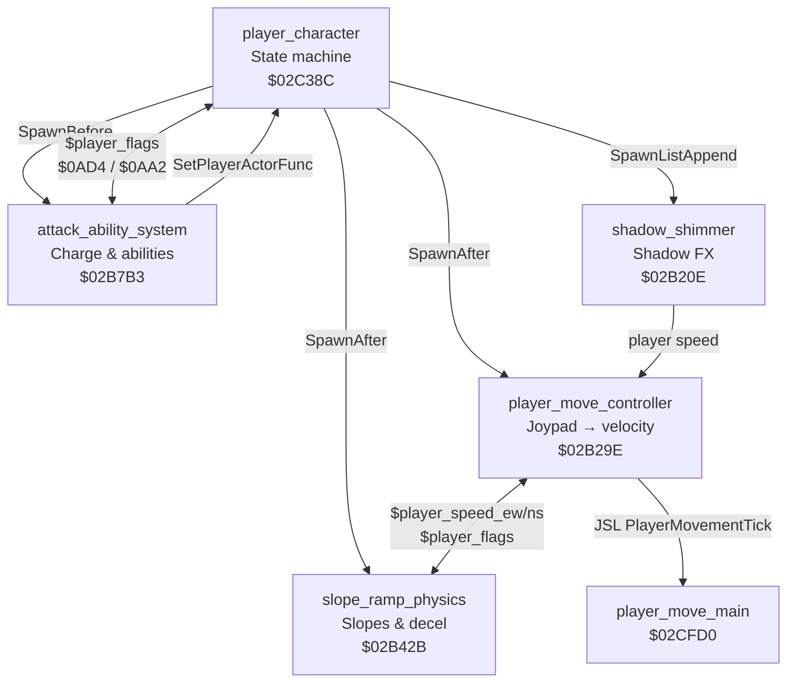
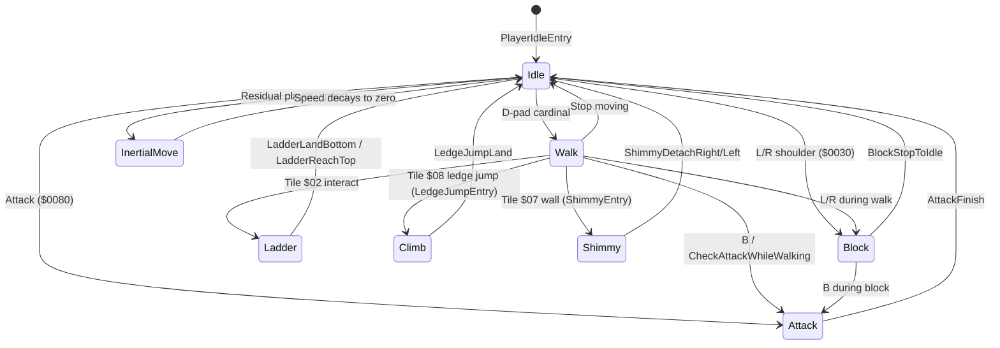

# Player Character System

*Part of the [Bank $02 Documentation Suite](README.md)*

> Modular five-actor architecture for the player character

> **Evidence labels.** Each major section is tagged with the kind of claim it makes: **[ASM]** = directly observed in the extracted asm of this block; **[INFERRED]** = interpretation of behavior that is not literally encoded in the file; **[XREF]** = cross-file / engine-wide convention stated elsewhere (not provable from this file alone). Sections that mix kinds split them into separately tagged bullets or paragraphs. The `.asm` files in `extracted/` are authoritative; where prose and asm comments disagree, the asm wins.

---

**Document scope:** The five-actor player character architecture in ROM bank `$02`, spanning `$02B20E`–`$02CFD0`.

**Source:** [`player_character.asm`](../../../extracted/actors/player/player_character.asm) · [`shadow_shimmer.asm`](../../../extracted/actors/player/shadow_shimmer.asm) · [`player_move_controller.asm`](../../../extracted/actors/player/player_move_controller.asm)

**[ASM]** The playable character is split across five companion actors plus the main `player_character` state machine. **`player_character.asm`** holds the movement FSM (idle, walk, block, climb, ladder, shimmy, melee, Psycho Slider, lunge helpers); **`attack_ability_system.asm`** (documented separately) handles charged abilities. Companions share WRAM (`playerFlags`, speed words, joypad state) rather than calling each other directly.

| # | File | Block | Range | Size |
|---|------|-------|-------|------|
| 1 | [`player_character.asm`](../../../extracted/actors/player/player_character.asm) | `player_character` | `$02C38C`–`$02CFD0` | 3,140 B |
| 2 | [`shadow_shimmer.asm`](../../../extracted/actors/player/shadow_shimmer.asm) | `shadow_shimmer` | `$02B20E`–`$02B29E` | 144 B |
| 3 | [`player_move_controller.asm`](../../../extracted/actors/player/player_move_controller.asm) | `player_move_controller` | `$02B29E`–`$02B42B` | 397 B |
| 4 | [`slope_ramp_physics.asm`](../../../extracted/actors/player/slope_ramp_physics.asm) | `slope_ramp_physics` | `$02B42B`–`$02B7B3` | 904 B |
| 5 | [`attack_ability_system.asm`](../../../extracted/actors/player/attack_ability_system.asm) | `attack_ability_system` | `$02B7B3`–`$02C38C` | 3,033 B (one block in `db-us/blocks.json`; the trail followers are inside it) |

**Related:** [`tile-collision.md`](tile-collision.md) · [`hardware-and-init.md`](hardware-and-init.md) · [`player-movement.md`](player-movement.md) (player movement physics `$02CFD0`–`$02E395`) · [`README.md`](README.md) · [`../../cop/README.md`](../../cop/README.md) · [`../../actor-organization-analysis.md`](../../actor-organization-analysis.md) · [`attack-ability-system.md`](attack-ability-system.md) · [`slope-ramp-physics.md`](slope-ramp-physics.md)

## Architecture Overview

*Evidence: [ASM] + [XREF]*

**[ASM]** `PlayerCharacterDef` spawns four companions: `COP [SpawnBefore]` → `attack_ability_system.AttackSystemEntry`; `COP [SpawnAfter]` → `player_move_controller.PlayerMoveController` then `slope_ramp_physics.SlopePhysicsEntry`; `COP [SpawnListAppend]` → `shadow_shimmer.ShadowShimmerInit` with flags `$2800`. Each `SpawnAfter` inserts directly behind the spawner, so **actor-list order** is: `attack_ability_system` → player → `slope_ramp_physics` → `player_move_controller`, with `shadow_shimmer` appended at the list tail. **Per-frame order** matches that list (slope physics runs before the move controller in the same frame).



### Player State Machine

*Evidence: [ASM] + [XREF]*

**[ASM]** `PlayerIdleEntry` clears `$F0FF` from `joypadHeld`, `$2800` from `playerFlags`, actor `$0020`, and `abilityDamageBonus`; re-sets actor `$0100` (the **vulnerable stance**: while it is set enemy contact hurts the player; block, attack, Spin Dash and the run attack clear it, and with it cleared the enemy takes the hit instead). Residual `playerSpeedEw` / `playerSpeedNs` → `MovingEastWest` / `MovingNorthSouth`. Dispatch: `GetPlayerFacing` × 14 → row in `PlayerIdleDispatchTable`; scan priority attack (`joypadCurrent` `$0080`) → D-pad cardinals → L/R `$0300` → idle stand.

**[XREF]** Ladder, ledge-jump, and shimmy entry points are reached from the `player_move_*` tile redirects: ladder = collision type `$02` (`NorthLadderTile` / `SouthLadderTile`), ledge jump = `$08` (`SouthLedgeTile`, south only; `LedgeJumpEntry` is also entered by scene scripts), wall shimmy = `$07` (`WestShimmyTile` / `EastShimmyTile`). The type roles are not defined in `player_character.asm` alone.



### Compilation Unit Root

*Evidence: [ASM]*

```
player_character.asm
  ?INCLUDE 'attack_ability_system'
    ?INCLUDE 'ability_damage_tables'
    ?INCLUDE 'actor_pool'
    ?INCLUDE 'ApplyOrbitalOffsetFromRef'
    ?INCLUDE 'player_character'    — circular include back to this root
    ?INCLUDE 'spriteset_aura'    — Aura projectile spritemap
    ?INCLUDE 'spriteset_dark_friar'    — Dark Friar FX spritemap
    ?INCLUDE 'spriteset_pickups_effects'
  ?INCLUDE 'shadow_shimmer'
  ?INCLUDE 'game_over_sequence'
  ?INCLUDE 'hardware_math'
  ?INCLUDE 'player_move_controller'
  ?INCLUDE 'slope_ramp_physics'
  ?INCLUDE 'spriteset_darkgaia_projectile'      — Dark Gaia projectile spritemap
```

### Shared WRAM Variables

*Evidence: [ASM] + [XREF]*

| Address | Symbol (asm) | Role |
|---------|--------------|------|
| `$09AA` | `playerActor` | Player actor slot index |
| `$09AE` | `playerFlags` | Shared state bitmask |
| `$09B2` / `$09B4` | `playerSpeedEw` / `playerSpeedNs` | Pixel/frame speed (`slope_ramp_physics` writes; controller ×4) |
| `$09B6` / `$09B8` | `slopeStepCounter` / `decelStepCounter` | Curve table indices |
| `$09BA` / `$09BC` / `$09C2` | slope / decel curve pointers | Set at boot (`system_core`) |
| `$09C6` | `slopeFracAccum` | NS sub-pixel slope accumulator (movement code) |
| `$09C8` / `$09CA` | `maxSpeedEw` / `maxSpeedNs` | Slope clamp (default 9) |
| `$0AA2` | `abilityBitmask` | Learned abilities |
| `$0AD4` | `characterForm` | 0 Will, 1 Freedan, 2 Shadow |
| `$0656` | `joypadCurrent` | Held buttons (16-bit); D-pad in high byte |
| `$0657` | *(high byte of `$0656`)* | Read by `JoypadToVelocity` (8-bit path) |
| `$0658` | `joypadHeld` | Consumed buttons (OR'd by attacks) |
| `$065A` | `joypadMaskStd` | Masked from `joypadCurrent` (ladder/shimmy/ledge jump) |
| `$0408` / `$040A` | `extVelocityX` / `extVelocityY` | External push per frame (zeroed after use) |
| `$040C` | `invincibilityTimer` | Run-start window (`SetAutoWalkTimer` → 13); decremented globally |
| `$14` / `$16` | move-controller locals | Sub-pixel position (×4) in `PlayerMoveController` actor only |

### Player Flags Reference (`playerFlags` at `$09AE`)

*Evidence: [ASM] + [XREF]*

Full table (setters, clearers, readers, scene-spawn derivation) lives in [wram-memory-map.md](../../wram-memory-map.md) §"Player Flags Reference". Summary (bits referenced in these asm files):

| Bit | Hex | Meaning |
|-----|-----|---------|
| 0 | `$0001` | Attack request — attack/ability flow running (cleared every frame by `AttackSystemEntry`) |
| 1 | `$0002` | Body slam / charge attack (Psycho Dash) — the state that smashes breakable walls and statues |
| 2 | `$0004` | Player sprite needs re-upload (off-screen / cache refresh) |
| 3 | `$0008` | **Combat lock** — attack button stripped, attack companion dies at spawn, PAUSE overlay instead of radar. Set at spawn in non-combat scenes (spawn type bit `$02`), toggled by cutscenes. *Not* a death flag |
| 4 | `$0010` | Terrain shake (landing of Freedan's ledge-jump drop attack): world frozen, hit enemies die |
| 5 | `$0020` | Boss defeated — suppresses death check, arms `BossClearRewardHandler` |
| 7 | `$0080` | Dark Friar trail drawn behind walls (never set by shipped scenes) |
| 8 | `$0100` | Forced walk (extended warp pan) — camera target locked, drift paused |
| 9 | `$0200` | Game over — HP reached zero (`CheckPlayerDeath`) |
| 11 | `$0800` | Script/ability lock — cutscene, climb, chest, Psycho Slider, Aura Barrier |
| 12 | `$1000` | On-slope latch (set by `slope_ramp_physics` when slope speed hits 0; cleared by move controller when speed nonzero) |
| 13 | `$2000` | Guard/channel stance — block, Dark Friar cast, Spin Dash charge |
| 15 | `$8000` | Body sprite overridden via `SetPlayerSpriteDirect` (COP `$8E`) |

Bits 6, 10 and 14 (`$0040`, `$0400`, `$4000`) are never used.

**Composite masks** used as combined flag tests:

| Mask | Bits | Meaning |
|------|------|---------|
| `$0A00` | 11, 9 | `$0800` script/ability lock or `$0200` game over — `PlayerMoveController` skips movement |
| `$1800` | 12, 11 | Slope or script lock — no new hit stagger |
| `$2800` | 13, 11 | Cleared by `PlayerIdleEntry`; blocks Select/Y in `GlobalInputHandler` |
| `$2A00` | 13, 11, 9 | `AttackSystemEntry`: no attack polling |
| `$2B00` | 13, 11, 9, 8 | `ValidateAttackContinue`: abort an attack in progress |
| `$3000` | 13, 12 | `PlayerMoveController`: D-pad velocity forced to zero |
| `$3800` | 13, 12, 11 | `run_button_main`: no sprinting |
| `$3A00` | 13, 12, 11, 9 | `ValidateAttackReady`: no attack launch |

### Ability System (`characterForm` + `abilityBitmask`)

*Evidence: [XREF]* — charge timing and dispatch live in `attack_ability_system.asm`; form constants **[ASM]** in `player_character.asm`.

| `$0AD4` | Form | Attack Dispatcher | Primary Abilities |
|---------|------|-------------------|-------------------|
| `0` | Will | `WillAttackDispatch` | Basic attack, Psycho Dash, Spin Dash, running attack (Psycho Slider) |
| `1` | Freedan | `FreedanAttackDispatch` | Basic attack, Dark Friar, Aura Barrier, ledge-jump drop attack |
| `2` | Shadow | `FreedanAttackDispatch` + `shadow_shimmer` | Same as Freedan + Shadow palette shimmer |

| `$0AA2` Bit | Hex | Character | Ability |
|-------------|-----|-----------|---------|
| 0 | `$0001` | Will | Psycho Dash (charge release attack) |
| 1 | `$0002` | Will | Psycho Slider (running slide attack) |
| 2 | `$0004` | Will | Spin Dash (L/R charge alternate) |
| 4 | `$0010` | Freedan | Dark Friar |
| 5 | `$0020` | Freedan | Aura Barrier |
| 6 | `$0040` | Freedan/Shadow | Earthquaker (ledge-jump drop attack) |

**Charge timing:** Both Will and Freedan/Shadow share a **40-frame initial hold** (`#$28`). After the initial hold, Will has a **120-frame** extended charge window (`#$0078`) and Freedan/Shadow has **100 frames** (`#$0064`). L/R shoulder buttons during charge select alternate abilities (Spin Dash vs Psycho Dash; Aura Barrier vs Dark Friar).

---

## shadow_shimmer.asm

*Evidence: [ASM]*

Palette shimmer companion for Shadow (`characterForm == 2`). Parent actor points a **marked child** (`SpawnAfterMarked`) at palette COP loops; it does not write CGRAM itself.

| Address | Name | Description |
|---------|------|-------------|
| `$02B20E` | ShadowShimmerInit | Check `$0AD4==2` (Shadow), else die. Spawn palette marker. |
| `$02B21F` | ShadowShimmerIdle | Wait: monitor player speed. If moves → active. |
| `$02B241` | ShadowShimmerActive | Active: palette `#24` cycling while moving. |
| `$02B264` | ShadowShimmerGuard | `JSR` from idle/active. Form ≠ 2 → `PLA`; `COP [Die]`. Player actor `$0010` bit `$0040` (dead) → child → `ShadowShimmerNop`, `SetEntryHere`, `RTL`. |
| `$02B28D` | ShadowShimmerSlowStrips | Infinite palette `#23` cycle (idle glow). |
| `$02B294` | ShadowShimmerFastStrips | Infinite palette `#24` cycle (active glow). |
| `$02B29B` | ShadowShimmerNop | No-op: `COP [SetEntryHere]`; `RTL`. |

### ShadowShimmerInit

**[ASM]** `SpawnListAppend` from `PlayerCharacterDef` (also Dark Space transform scenes). `characterForm != 2` → `COP [Die]`. Else `COP [SpawnAfterMarked] ( @ShadowShimmerSlowStrips, #$2800 )` then falls into `ShadowShimmerIdle`.

### ShadowShimmerIdle

**[ASM]** Each frame: `LDY $06` (list successor = palette child); write `$0000,Y` → `ShadowShimmerSlowStrips`, `$0008,Y` → 0; `SetEntryHere`; `JSR ShadowShimmerGuard`. `playerSpeedEw | playerSpeedNs` nonzero → `ShadowShimmerActive`. Else `COP [BranchOnFlagByte] ( #00, #01, &ShadowShimmerActive )`.

**[Runtime-verified, B3]** Ordinary D-pad walking leaves both speed words at zero: walking flat W / E / N / S for 14 frames writes `$09B2`–`$09B5` zero times. The speed words are written by `WalkWest` / `WalkEast` / `WalkNorth` / `WalkSouth` (run, double tap: 2 writes each, at `$82:C580` / `C5CA` / `C537` / `C4EF`), by the slope curves (`ApplySlopeCurveNegEW` `B5B6`, `ApplySlopeCurvePosEW` `B5D2`: 30–38 writes in 20–24 frames on a ramp) and by `DecelerateEW` (`B68F`); `SnapYSouthCollision` (`D3FD`) writes them when walking W + down. In scene `$15` as Shadow: walking flat E and idle stays in `ShadowShimmerIdle` + `ShadowShimmerSlowStrips`; running E enters `ShadowShimmerActive` + `FastStrips` at tick 5 (the tick of the first speed write); a slope W walk does the same and returns to `ShadowShimmerIdle` at tick 74, the tick of the last speed write (value 0). With the scene's flag byte `#00` bit set as loaded in `$15`, a flat walk E reaches `FastStrips` (tick 8) without any speed write. Will (form 0) writes the same speeds and has no shimmer hook. Scope: Shadow in scene `$15` only.

### ShadowShimmerActive

**[ASM]** Points child at `ShadowShimmerFastStrips` (#24). After guard, nonzero speed → `RTL`. Both zero → `BranchOnFlagByte ( #00, #00, &ShadowShimmerIdle )`.

### ShadowShimmerGuard

**[ASM]** Form check; on dead bit `$0040` on **player** `$0010,Y` (`Y = playerActor`): drop JSR return, repoint child to `ShadowShimmerNop`, `SetEntryHere` + `RTL` (parent never re-enters idle/active). Form change → `PLA`, `COP [Die]` (marked child dies with parent).


## player_move_controller.asm

*Evidence: [ASM] + [XREF]*

Per-frame movement integrator for the hidden companion actor (`CopyActorState` sets `$2000` on spawn — **[XREF]**). Scales local `$14`/`$16` to ×4 once at spawn; each frame merges joypad or speed words with `extVelocityX/Y`, then either `JSL player_move_main.PlayerMovementTick` or direct `$22`/`$26` += velocity. See [`player-movement.md`](player-movement.md) for tick internals.

| Address | Name | Description |
|---------|------|-------------|
| `$02B29E` | `PlayerMoveController` | Hit-stun gate: player `$0010` `$0080` and `iframeCounter` ≥ 0 → skip frame. `$playerFlags & $0A00` → clear ext velocities, `RTL`. Sync actor `$0014`/`$0016` into local sub-pixels. Joypad gated by `$3000`. Speed word path ×4 and clears `$1000`. Player `$0010` `$0008` set → `JSL PlayerMovementTick` with `$000A` = **this** actor slot; else add velocity without collision. Write-back >>2 to player pixels; copy this actor `$0004` solid bit to player `$0010`. |
| `$02B3C6` | `JoypadToVelocity` | Pack velocity: high byte Y, low byte X, sub-pixels/frame from `$0657` (pad high byte). Cardinal ±8; diagonal ±6. Left beats right; up beats down. |

### PlayerMoveController

**[ASM]** Stages match the block comment at the top of `player_move_controller.asm` (hit-stun → lock → sync → velocity → collision vs direct add → write-back). **Inferred:** “Dead” is not tested here; game over uses `$0A00` skip instead.

**[Runtime-verified, B3]** Hit-stun gate (`PlayerMoveController`+30, reads the counter at `$82:B2BC`): with player `$10` bit `$0080` set and `iframeCounter` poked to +3, the counter is stepped 3 → 2 → 1 → 0 once per frame by `RunActors_Normal` in bank `$03` (`LDA iframeCounter,X` at `$83:CB46`, `DEC` and `STA` at `$83:CB4F`; the walk reads the counter again at `$82:B43D` and `$82:B2BC`), which runs before the controller gate, `PlayerMovementTick` does not run in those three frames, and movement resumes in frame 4 because the bit is already clear when the controller runs. A counter of 0 or −1 poked with the bit set resumes in frame 1; −5 does not freeze at all and counts up to 0 with the bit clearing at frame 5; +30 freezes 30 frames; with the bit clear the counter is left alone. What sets the counter to a positive value on the next hit is not traced.

**Algorithm:**
- Once at spawn: local `$14`/`$16` ×4
- Skip if player `$0010` `$0080` and `iframeCounter,X` not negative
- If `playerFlags & $0A00`: `STZ extVelocityX/Y`; `RTL`
- Sync local position from player actor pixels when they differ
- If `playerFlags & $3000`: zero packed joypad velocity; else `JSR JoypadToVelocity`
- EW: `$22` = local X; `$20` = (`playerSpeedEw×4` or sign-extended joypad X) + `extVelocityX`; nonzero speed clears `$1000`
- NS: `$26` = local Y; `$24` similarly; zero NS speed word → `STZ slopeFracAccum`
- Player `$0010` `$0008`: `STX $000A`; `JSL PlayerMovementTick`; else `$22`/`$26` += deltas
- Write-back; propagate solid `$0004` from controller actor `$10` to player `$10`


**Variables:**

| Location | Direction | Role |
|----------|-----------|------|
| `$14`/`$16` | R/W | Sub-pixel position scratch (×4) |
| `$player_flags` | R/W | Movement/attack/slope flags |
| `$player_speed_ew/ns` | R | Slope physics override |
| `$0408`/`$040A` | R/W | External velocity accumulators |
| `$0656` / `$0657` | R | `joypadCurrent` / high byte (D-pad bits 0–3 in `$0657`) |


**Cross-References:**

| Symbol | Relationship |
|--------|-------------|
| `JoypadToVelocity` | JSR each frame when unlocked |
| `PlayerMovementTick` | `JSL $@player_move_main.PlayerMovementTick` (`$02CFD0`); see [`player-movement.md`](player-movement.md) |
| `SlopePhysicsEntry` | Writes `$player_speed_*` |

### JoypadToVelocity

**[ASM]** Reads `$0657` in 8-bit mode (bits: 0 Right, 1 Left, 2 Down, 3 Up). Returns packed 16-bit word (Y in high byte, X in low). Diagonals use ±6 on both axes (not ±10).

**Algorithm:**
| Direction | X vel | Y vel |
|---|---|---|
| Right | +8 | 0 |
| Left | -8 | 0 |
| Up | 0 | -8 |
| Down | 0 | +8 |
| Right+Up | +6 | -6 |
| Right+Down | +6 | +6 |
| Left+Up | -6 | -6 |
| Left+Down | -6 | +6 |


**Variables:**

| Location | Direction | Role |
|----------|-----------|------|
| `$player_flags` | R/W | Shared player state bitmask |
| `$player_actor` | R | Player WRAM slot index |

---

## player_character.asm

*Evidence: [ASM]*

Master actor definition and movement state machine (idle, walk, block, climb, ladder, shimmy, melee, Psycho Slider, Will lunge helpers). ROM `181132`–`184272` (`$02C38C`–`$02CFD0`).

| Address | Name | Description |
|---------|------|-------------|
| `$02C38C` | PlayerCharacterDef | Actor-def `#00`, `#08`, `#85`. Init: `TSB $10 #$0100` (vulnerable stance), `TSB $12 #$0001` (recovery-iframe route; its effect on the player is not shown), `STA playerActor`, `STA free101C,X`. If `gameOverWakeupFlag` → `DeathWakeupMessage`. Spawns attack (before), move + slope (after), shadow (`SpawnListAppend`, `$2800`). |
| `$02C3C8` | PlayerIdleEntry | Main idle state. Clears joypad mask/flags. Clears `$2800` from `$player_flags`. If EW/NS speed non-zero → walking (`MovingEastWest` / `MovingNorthSouth`), else → directional idle dispatch via facing + joypad. |
| `$02C447` | PlayerIdleDispatchTable | 28-entry table (7 per facing × 4 directions). Selected by combining facing (`$24`) with joypad/action button state. |
| `$02C47F` | IdleStandSouth | South-facing idle. Shadow variant check → sprite `#00` or `#10`. |
| `$02C48A` | IdleStandSouthShadow | Shadow: `#10`. |
| `$02C48F` | IdleStandNorth | North: `#01` / `#11`. |
| `$02C49A` | IdleStandNorthShadow | Shadow: `#11`. |
| `$02C49F` | IdleStandWest | West: `#02` / `#12`. |
| `$02C4AA` | IdleStandWestShadow | Shadow: `#12`. |
| `$02C4AF` | IdleStandEast | East: `#03` / `#13`. |
| `$02C4BA` | IdleStandEastShadow | Shadow: `#13`. Shared idle animation loop. |
| `$02C4DD` | WalkSouth | Walking south, sprite `#08`. Auto-walk timer, L/R attack check. |
| `$02C524` | WalkNorth | North, sprite `#09`. |
| `$02C56C` | WalkWest | West, sprite `#0A`. |
| `$02C5B5` | WalkEast | East, sprite `#0B`. |
| `$02C5FF` | CheckAttackWhileWalking | Attack `$0080` → `WalkAbortToIdle`; zero `playerSpeedEw|Ns` → abort; `BIT #$1000` on `playerFlags` for slope (skip L/R block in callers). |
| `$02C614` | WalkAbortToIdle | `PLA` — drops return address. |
| `$02C615` | WalkRestoreSaved | `COP [RestoreSavedPtr]`. |
| `$02C617` | SetAutoWalkTimer | Set `$040C = $000D` (13-frame auto-walk timer). |
| `$02C61E` | LedgeJumpEntry | Actor `$0008` clear, `$0200` set (ignore enemy contact); `joypadMaskStd \|= $0008` (use-item hidden). Sprites `#18`/`#19` entry, loop `#1A`/`#1B`/`#19` with `StageMoveY #07`. |
| `$02C692` | LedgeJumpLand | Landing: sound `#2C`, sprite `#1C`. |
| `$02C6AE` | CheckLedgeJumpFrame | Animation frame check. |
| `$02C6BC` | CheckLedgeJumpAttack | Freedan climb check: if `$0AD4==1` and ability `$0040`, check attack button → drop attack. |
| `$02C6D5` | LedgeJumpDropAttack | Freedan's drop attack in mid ledge jump: sprite `#06`, hitbox `#00`, force-move Y+7. |
| `$02C6FA` | LedgeJumpDropLand | `LoadAbilityDamageB` entry 2; scene `$DD` skips `ImpactTerrainShake`; `WaitByte #$27` (39 frames). |
| `$02C73F` | ImpactTerrainShake | Sets `$player_flags` `$0010`. Waits `$01DF` frames. Clears. Dies. |
| `$02C751` | CameraShakeActor | Sound `#15`. Decrements counter → dies. |
| `$02C75E` | CameraShakeFrame | Random camera target offset −1..+2 on X and Y (`(RNG & 3) − 1`, `((RNG >> 2) & 3) − 1`) to `$06BE`/`$06C2` each frame. |
| `$02C7B6` | LadderClimbSouth | South-facing ladder. |
| `$02C7E2` | LadderClimbNorth | North-facing. |
| `$02C80D` | LadderMoveDown | Move down: sprite `#2D`, force-move Y+29. |
| `$02C831` | LadderMoveUp | Move up: sprite `#2C`, force-move Y−30. |
| `$02C855` | LadderIdleSouth | Idle south: `#2B` / `#2F`. |
| `$02C860` | LadderIdleSouthShadow | Shadow: `#2F`. |
| `$02C865` | LadderIdleNorth | Idle north: `#2A` / `#2E`. |
| `$02C870` | LadderIdleNorthShadow | Shadow: `#2E`. |
| `$02C897` | LadderLandBottom | Landing at bottom. |
| `$02C8AA` | LadderReachTop | Reaching top. |
| `$02C8BD` | ShimmyRightEntry | Right shimmy. Sprite `#33`, force-move X `$51`. |
| `$02C8D4` | ShimmyRightCheckWall | Check east for solid. |
| `$02C8EC` | ShimmyRightLoop | Main right loop. |
| `$02C92D` | ShimmyRightUpCheck | Probe north. |
| `$02C934` | ShimmyRightDownCheck | Probe south. |
| `$02C93B` | ShimmyLeftEntry | Left shimmy. Sprite `#32`, force-move X `$52`. |
| `$02C952` | ShimmyLeftCheckWall | Check west. |
| `$02C969` | ShimmyLeftLoop | Main left loop. |
| `$02C9A9` | ShimmyLeftUpCheck | Probe north. |
| `$02C9B0` | ShimmyLeftDownCheck | Probe south. |
| `$02C9B7` | ShimmyDetachRight | Detach right: sprite `#31`/`#35`. |
| `$02C9C5` | ShimmyDetachRightShadow | Shadow: `#35`. |
| `$02C9CA` | ShimmyDetachLeft | Detach left: sprite `#30`/`#34`. |
| `$02C9D8` | ShimmyDetachLeftShadow | Shadow: `#34`. |
| `$02CA19` | ShimmyTopCorner | Corner reached. |
| `$02CA22` | BlockFromWalkSouth | Merge `$0400` joypad. |
| `$02CA28` | BlockSouth | Blocking south: sprite `#3A`. |
| `$02CA30` | BlockFromWalkNorth | Merge `$0800`. |
| `$02CA36` | BlockNorth | Sprite `#3B`. |
| `$02CA3E` | BlockFromWalkWest | Merge `$0200`. |
| `$02CA44` | BlockWest | Sprite `#3C`. |
| `$02CA4C` | BlockFromWalkEast | Merge `$0100`. |
| `$02CA52` | BlockEast | Sprite `#3D`. Sets `$2000` in `$player_flags`. |
| `$02CA82` | BlockStopToIdle | `COP [RestoreSavedPtr]`. |
| `$02CA84` | MovingEastWest | EW walking with full state machine. Sprite `#0F` (right) / `#0E` (left). |
| `$02CB0C` | MovingNorthSouth | NS walking. Sprite `#0D` (north) / `#0C` (south). |
| `$02CB92` | CheckRunAttack | Psycho Slider gate: not hitstun, Will only, has ability `$0002` (Psycho Slider), not slope. |
| `$02CBB5` | RunAttackSpeedCheck | Psycho Slider speed gate: absolute EW ≥ 3 → `RunAttackEW`, else absolute NS ≥ 3 → `RunAttackNS`. |
| `$02CBD9` | SpeedThresholdEW | Takes absolute value of `player_speed_ew` and falls through to shared speed ≥ 4 threshold check. |
| `$02CBE4` | SpeedThresholdNS | Shared tail: `\|speed\| >= 4` → too fast for normal attack; else CLC unless `$1000` set (SEC). |
| `$02CBFF` | RunAttackNS | NS Psycho Slider with anim table A entry 1. |
| `$02CC52` | RunAttackEW | EW Psycho Slider. |
| `$02CCA5` | FreezeCameraForAttack | Clears actor `$0100` (leaves the vulnerable stance), sets `$0200` in `layerPriorityFlag` (`$06EE`) — freezes camera scroll. |
| `$02CCB0` | RunAttackFlagSetup | Actor `$0200` (ignore enemy contact); `joypadHeld \|= $0080`; `playerFlags \|= $0802` (bits 1 and 11). |
| `$02CCC2` | UnfreezeCameraAfterAttack | Clears camera-freeze bit `$0200` from `layerPriorityFlag`. |
| `$02CCC8` | RunAttackCleanup | Clear actor `$0200` (contact damage is back); consume attack in `joypadHeld`; `TRB playerFlags #$0002`. |
| `$02CCDA` | AttackSouth | South attack. Freedan wall-slash variant. |
| `$02CD5B` | AttackNorth | North. |
| `$02CDDC` | AttackWest | West. |
| `$02CE5A` | AttackEast | East. |
| `$02CED8` | AttackRedirect | If direction pressed, allow movement. |
| `$02CEE6` | AttackFinish | Clears joypad mask, restores idle. |
| `$02CEEE` | AttackInit | Masks joypad, plays sound. |
| `$02CF0F` | RangedAttackSouth | Will lunge: `RangedSetForceY` (#46 curve), sprite `#44`. |
| `$02CF19` | RangedAttackNorth | Lunge north; sets `$2000` on `$12` (negate-Y), sprite `#45`. |
| `$02CF28` | RangedAttackWest | Lunge west; sets `$4000` on `$12` (negate-X), sprite `#46`. |
| `$02CF37` | RangedAttackEast | Lunge east, sprite `#47`. |
| `$02CF4A` | RangedSetForceX | `COP [StageForceMoveX]` (`$46`). |
| `$02CF4F` | RangedSetForceY | `COP [StageForceMoveY]` (`$46`). Sets `$0800` in `playerFlags` and `$0200` (ignore enemy contact) in the actor flags during the lunge, hitbox `$0040`. |
| `$02CF68` | ProjectileSouth | Spritemap `spriteset_darkgaia_projectile`, moves Y. |
| `$02CF82` | ProjectileNorth | Sprites `#01`→`#05`. |
| `$02CF9C` | ProjectileWest | X-axis. |
| `$02CFB6` | ProjectileEast | Sprites `#03`→`#07`. |

#### Actor Definition & Init

### PlayerCharacterDef

**[ASM]** See table row above; shadow companion uses `SpawnListAppend`, not `SpawnAfter`.


**Variables:**

| Location | Direction | Role |
|----------|-----------|------|
| `$player_flags` | R/W | Shared player state bitmask |
| `$player_actor` | R | Player WRAM slot index |


**Cross-References:**

| Symbol | Relationship |
|--------|-------------|
| `AttackSystemEntry` | `SpawnBefore` companion |
| `PlayerMoveController` | `SpawnAfter` companion |
| `SlopePhysicsEntry` | `SpawnAfter` companion |
| `ShadowShimmerInit` | `SpawnListAppend` companion (flags `$2800`) |

#### Idle & Standing States

### PlayerIdleEntry

Main idle state. Clears joypad mask/flags. Clears `$2800` from `$player_flags`. If EW/NS speed non-zero → walking (`MovingEastWest` / `MovingNorthSouth`), else → directional idle dispatch via facing + joypad.

**Algorithm:**
- Clear joypad mask high bits and composite flags `$2800`
- If `$player_speed_ew` non-zero → `MovingEastWest`
- If `$player_speed_ns` non-zero → `MovingNorthSouth`
- Else compute dispatch index from facing + joypad via `PlayerIdleDispatchTable`


**Variables:**

| Location | Direction | Role |
|----------|-----------|------|
| `$player_flags` | R/W | Shared player state bitmask |
| `$player_actor` | R | Player WRAM slot index |


### PlayerIdleDispatchTable

28-entry table (7 per facing × 4 directions). Selected by combining facing (`$24`) with joypad/action button state.


**Variables:**

| Location | Direction | Role |
|----------|-----------|------|
| `$player_flags` | R/W | Shared player state bitmask |
| `$player_actor` | R | Player WRAM slot index |


#### Standing Idle Animations

Single-frame idle loops and Shadow palette variants — no separate routine sections; see summary table above.

| Group | Routines | Size range | Role |
|-------|----------|------------|------|
| Standing idle | `IdleStandSouth/North/West/East` + `*Shadow` | 5–16 B | Directional idle sprite (`#00`–`#03` / `#10`–`#13`) |
| Ladder idle | `LadderIdleSouth/North` + `*Shadow` | 3–16 B | Ladder idle sprites (`#2A`–`#2F`) |
| Shimmy probes | `ShimmyRightUpCheck`, `ShimmyRightDownCheck`, `ShimmyLeftUpCheck`, `ShimmyLeftDownCheck` | 7 B each | Single-probe wall checks during shimmy |
| Block entry | `BlockSouth/North/West`, `BlockFromWalk*` | 6–14 B | Joypad merge + blocking sprite redirect |
| Walk helpers | `WalkAbortToIdle`, `WalkRestoreSaved`, `SetAutoWalkTimer`, `BlockStopToIdle` | 1–7 B | Stack/pointer restore and auto-walk timer |
| Lunge + projectiles | `RangedAttack*`, `RangedSetForceX/Y`, `Projectile*` | 5–26 B | Will combo lunge (`#46` force-move); `Projectile*` only on scene `$E8` from `Attack*` |

#### Walk & Blocking States

### WalkSouth

Walking south, sprite `#08`. Auto-walk timer, L/R attack check.


**Variables:**

| Location | Direction | Role |
|----------|-----------|------|
| `$player_flags` | R/W | Shared player state bitmask |
| `$player_actor` | R | Player WRAM slot index |


### WalkNorth

**[ASM]** D-pad up dispatch; run-start when `$24 == 1` and `invincibilityTimer >= 0` sets `playerSpeedNs = -3`, clears slope/decel counters, `SetAutoWalkTimer` (`$040C = 13`). Sprite `#09`, `AnimOneFrame` loop. `BranchIfNotPressed #$0800` → idle; `CheckAttackWhileWalking`; L/R `#$0030` → `BlockNorth` unless `$1000`. **Convention (other file):** displacement from `PlayerMoveController` / `PlayerMovementTick`.


**Variables:**

| Location | Direction | Role |
|----------|-----------|------|
| `$player_flags` | R/W | Shared player state bitmask |
| `$player_actor` | R | Player WRAM slot index |


### WalkWest

West-facing walk state — same loop structure as `WalkNorth` but keyed on left D-pad (`#$0200`) and sprite `#0A`. First entry from facing west (`$24 == 2`) sets `$player_speed_ew = -3` and resets slope/decel state before staging the animation. Per-frame: auto-walk timer refresh, attack interrupt via `CheckAttackWhileWalking`, and L/R block promotion to `BlockWest`. Releasing left returns through `WalkRestoreSaved` to `PlayerIdleEntry`; movement physics are handled externally by `PlayerMoveController`.


**Variables:**

| Location | Direction | Role |
|----------|-----------|------|
| `$player_flags` | R/W | Shared player state bitmask |
| `$player_actor` | R | Player WRAM slot index |


### WalkEast

East-facing walk state — mirror of `WalkWest` for right D-pad (`#$0100`) and sprite `#0B`. First entry from facing east (`$24 == 3`) seeds `$player_speed_ew = +3` plus the standard slope/decel reset and 13-frame auto-walk timer. Each COP frame advances the walk animation, monitors for direction release, attack button, or L/R shoulder block transition to `BlockEast`. Position integration and tile collision remain in `PlayerMoveController` → `PlayerMovementTick`, not in this state handler.


**Variables:**

| Location | Direction | Role |
|----------|-----------|------|
| `$player_flags` | R/W | Shared player state bitmask |
| `$player_actor` | R | Player WRAM slot index |


### LedgeJumpEntry

**[ASM]** The ledge jump: the player steps off a ledge and falls until the ground test passes (Mesen2, South Cape `$01`: pose `$18`, then the fall cycle `$1A`/`$19`, about 87 px down onto a roof, landing pose `$1C`). Available to every form (the entry checks no form; Freedan, Will and Shadow all have the animations `$18`–`$1B`). Entered by `SouthLedgeTile` (type `$08` cell, walking south) and by direct writes from `awB3_ledge_jump_trigger` and `pyD0_ledge_jump_trigger`. Actor flags: clear `$0008`, set `$0200`; `joypadMaskStd \|= $0008`. Three-sprite loop with `StageMoveY #07`. **`CheckLedgeJumpAttack`:** Freedan (`characterForm == 1`) + `abilityBitmask` `$0040` + attack `$0080` → `LedgeJumpDropAttack`.


**Variables:**

| Location | Direction | Role |
|----------|-----------|------|
| `$player_flags` | R/W | Shared player state bitmask |
| `$player_actor` | R | Player WRAM slot index |


### LedgeJumpDropAttack

Freedan's Earthquaker drop attack during a ledge jump, entered when `CheckLedgeJumpAttack` sees `$0AD4 == 1`, ability bitmask bit `$0040` set, and B button during the fall loop. Pops the fall-loop return address, sets body sprite `#06` with hitbox `#00`, and repeatedly applies `StageForceMoveY #07` until the player's Y coordinate aligns to a 16-pixel boundary with solid ground below (`BranchIfSolidType`). On landing, control transfers to `LedgeJumpDropLand`, which spawns terrain and camera shake actors before a 39-frame recovery animation.


**Variables:**

| Location | Direction | Role |
|----------|-----------|------|
| `$player_flags` | R/W | Shared player state bitmask |
| `$player_actor` | R | Player WRAM slot index |


### LedgeJumpDropLand

Drop landing: anim table 2, camera shake spawn. Wait 39 frames.


**Variables:**

| Location | Direction | Role |
|----------|-----------|------|
| `$player_flags` | R/W | Shared player state bitmask |
| `$player_actor` | R | Player WRAM slot index |


#### Landing Effects

### CameraShakeFrame

Per-frame camera jitter helper called by `CameraShakeActor` (spawned on the landing of Freedan's ledge-jump drop attack). Uses one `COP [RngByte]` per frame: `(RNG & 3) − 1` added to `$cameraTargetX` (`$06BE`), `((RNG >> 2) & 3) − 1` added to `$cameraTargetY` (`$06C2`) — each axis ranges −1..+2. When `layerPriorityFlag` bit `$0200` is set (camera frozen), saves the pre-shake target in `$7F100C/E` on first call and restores before applying offsets so shake stays centered on the frozen position. Runs until the shake actor's frame counter expires, then the actor dies.


**Variables:**

| Location | Direction | Role |
|----------|-----------|------|
| `$player_flags` | R/W | Shared player state bitmask |
| `$player_actor` | R | Player WRAM slot index |


#### Ladder Climbing

### LadderClimbSouth

**[ASM]** Entry: clear actor `$0028`, set `$0100`, `playerFlags \|= $0800`, `joypadMaskStd \|= $CFFC`; mount `#26`; raw up/down `$0801` / `$0401`. **Convention (other file):** `$0800` in `playerFlags` makes `PlayerMoveController` skip (`BIT #$0A00` includes `$0800`). Position from `StageMoveY` / ladder COPs while player `$10` bit `$0008` clear (no collision tick).


### LadderClimbNorth

**[ASM]** Same setup as south: actor `$0028` clear, `$0100` set, `playerFlags \|= $0800`, `joypadMaskStd \|= $CFFC`; mount sprite `#28`; down (`#$0401`) before up (`#$0801`). **Convention (other file):** `PlayerMoveController` skips when `playerFlags` has `$0800` (script/ability lock) — ladder sets that bit, not `$0A00`.


### LadderMoveDown

Active ladder descent entered from ladder entry or resumed from `LadderIdleSouth` when down is pressed. Stages climbing sprite `#2D` and applies `StageForceMoveY #1D` (~29 pixels) per step. At each 16-pixel Y boundary, probes the tile below with `BranchIfSolidTypeSouth` — open space triggers `LadderLandBottom`; solid tile continues the descent loop gated by animation events (`$2A`). Releasing down returns to `LadderIdleSouth` without leaving the ladder state machine.


### LadderMoveUp

Active ladder ascent with sprite `#2C` and upward force-move `#1E` (~30 pixels per step). Probes north at 16-pixel Y boundaries via `BranchIfSolidTypeNorth` — reaching open space above calls `LadderReachTop`. Animation events (`$2A`) pace step timing; releasing up returns to `LadderIdleNorth`. Like descent, position is applied through COP force-move rather than the joypad velocity pipeline.


### ShimmyRightLoop

Main east-wall shimmy loop after `ShimmyRightEntry` confirms tile `$07` wall contact. Stages sprite `#33` and crawls rightward with repeated `StageForceMoveX #51` steps. At 16-pixel X boundaries, probes for corner transitions (`ShimmyTopCorner`), optional up/down direction changes (`ShimmyRightUpCheck` / `ShimmyRightDownCheck`), and continued east-wall solidity — losing the wall jumps to `ShimmyDetachRight`. Releasing right (`BranchIfNoButton #$0101`) also detaches. The `ShimmyRightAnimLoop` sub-loop handles per-frame `AnimOneFrame` and button polling between force-move steps.


**Variables:**

| Location | Direction | Role |
|----------|-----------|------|
| `$player_flags` | R/W | Shared player state bitmask |
| `$player_actor` | R | Player WRAM slot index |


### ShimmyLeftLoop

West-wall counterpart to `ShimmyRightLoop`. Uses sprite `#32` with `StageForceMoveX #52` for leftward crawling along tile `$07` walls. Boundary checks mirror the right loop but probe west via `BranchIfSolidTypeWest`; corner and up/down transitions use `ShimmyLeftUpCheck` / `ShimmyLeftDownCheck`. Detaches via `ShimmyDetachLeft` when the wall ends or left is released (`#$0201`).


**Variables:**

| Location | Direction | Role |
|----------|-----------|------|
| `$player_flags` | R/W | Shared player state bitmask |
| `$player_actor` | R | Player WRAM slot index |


#### Block & Block-from-Walk

#### Directional Walk State Machine

### MovingEastWest

EW walking with full state machine. Sprite `#0F` (right) / `#0E` (left).


**Variables:**

| Location | Direction | Role |
|----------|-----------|------|
| `$player_flags` | R/W | Shared player state bitmask |
| `$player_actor` | R | Player WRAM slot index |


### MovingNorthSouth

NS walking. Sprite `#0D` (north) / `#0C` (south).


**Variables:**

| Location | Direction | Role |
|----------|-----------|------|
| `$player_flags` | R/W | Shared player state bitmask |
| `$player_actor` | R | Player WRAM slot index |


#### Psycho Slider (Running Slide Attack)

### CheckRunAttack

**[ASM]** Called from `MovingEastWest` / `MovingNorthSouth`. Requires: actor `$10` bit `$0080` clear (no hit-reaction counter), `characterForm == 0`, `abilityBitmask` `$0002`, `playerFlags` `$1000` clear, attack held (`BranchIfPressed #$0080`). Pass → `RunAttackSpeedCheck` (`|playerSpeedEw| ≥ 3` prefers EW, else `|playerSpeedNs| ≥ 3`).

**Inferred:** Psycho Slider is learned in Mu West (scene `$62`) — stated in asm block comment, not encoded as a scene check here.


**Variables:**

| Location | Direction | Role |
|----------|-----------|------|
| `$player_flags` | R/W | Shared player state bitmask |
| `$player_actor` | R | Player WRAM slot index |


### RunAttackSpeedCheck

Checks if the player is moving fast enough for a Psycho Slider. Takes absolute value of `player_speed_ew` — if ≥ 3, pops return address and jumps to `RunAttackEW`. Otherwise checks `player_speed_ns` — if ≥ 3, pops and jumps to `RunAttackNS`. If neither axis exceeds the threshold, returns without launching.


**Variables:**

| Location | Direction | Role |
|----------|-----------|------|
| `$player_flags` | R/W | Shared player state bitmask |
| `$player_actor` | R | Player WRAM slot index |


### RunAttackNS

Will's north-south Psycho Slider (running slide attack), entered when `RunAttackSpeedCheck` finds absolute `$player_speed_ns` ≥ 3. Loads ability animation table A entry 1 and sets body sprite `#04`. Positive NS speed: south slide using sprites `#0C` → `#0D` (Y force-move loop) → `#0E` finish, zeroing NS speed. Negative speed: north path via `SetForceNE` with sprites `#0F` → `#10` → `#11`. Both paths call `RunAttackFlagSetup` (sets actor `$0200` = ignore enemy contact, consumes attack input, sets `$0802` on `$player_flags`), run the slide distance through `AnimLoop`, then `RunAttackCleanup` and `RestoreSavedPtr` back to idle.


**Variables:**

| Location | Direction | Role |
|----------|-----------|------|
| `$player_flags` | R/W | Shared player state bitmask |
| `$player_actor` | R | Player WRAM slot index |


### RunAttackEW

Horizontal Psycho Slider — same structure as `RunAttackNS` but routed on `$player_speed_ew` sign after absolute speed ≥ 3 threshold. West (negative): `SetForceSW`, sprites `#12` → `#13` X-loop → `#14`. East (positive): `#15` → `#16` → `#17`. Zeros EW speed on entry, applies `RunAttackFlagSetup` / `RunAttackCleanup` bookends, and restores saved pointer when the slide animation completes. This is Will's sliding attack — acquired in Mu West — and requires the Psycho Slider ability bit (`$0002`) in `$0AA2`.


**Variables:**

| Location | Direction | Role |
|----------|-----------|------|
| `$player_flags` | R/W | Shared player state bitmask |
| `$player_actor` | R | Player WRAM slot index |


#### Attack State Handlers

### AttackSouth

South-facing melee attack entered from idle dispatch, walk abort, or inertial movement when B is pressed facing south. Calls `AttackInit` (joypad mask, SFX), consumes south D-pad in `$0658` (`TSB #$0400`), then stages sprite `#36` — Freedan (form 1) near a south wall uses the thrust variant `#48` via `BranchIfSolidSouth` / diagonal offset probe. Scene `$00E8` (Dark Gaia) additionally spawns `ProjectileSouth`. The per-frame loop advances animation frames; Will (form 0) can redirect mid-swing with perpendicular D-pad (`AttackRedirect`) or chain into `RangedAttackSouth` by holding south again. B re-press at animation end restarts the combo; otherwise `AttackFinish` clears held directions and returns to idle.


**Variables:**

| Location | Direction | Role |
|----------|-----------|------|
| `$player_flags` | R/W | Shared player state bitmask |
| `$player_actor` | R | Player WRAM slot index |


### AttackNorth

North-facing melee — same attack system as `AttackSouth` but consumes up D-pad (`#$0800`) in `$0658`, uses sprites `#37` / Freedan wall-push `#49`, and spawns `ProjectileNorth` on scene `$00E8`. Will can redirect with perpendicular D-pad (`#$0700`) or chain `RangedAttackNorth`; Freedan/Shadow get redirect only. Combo restart and `AttackFinish` idle return behave identically to the south handler.


**Variables:**

| Location | Direction | Role |
|----------|-----------|------|
| `$player_flags` | R/W | Shared player state bitmask |
| `$player_actor` | R | Player WRAM slot index |


### AttackWest

West-facing melee attack using sprites `#38` (normal) or `#42` (wall-push, Will and Freedan only — Shadow skips the wall probe). Consumes left D-pad (`#$0200`) in `$0658` after `AttackInit`. Will's mid-attack redirect mask is `#$0D00`; same-axis hold chains into `RangedAttackWest`. Scene `$00E8` spawns `ProjectileWest`. Axis-specific joypad merge and sprite IDs differ; animation loop, combo re-press, and finish logic match `AttackSouth`.


**Variables:**

| Location | Direction | Role |
|----------|-----------|------|
| `$player_flags` | R/W | Shared player state bitmask |
| `$player_actor` | R | Player WRAM slot index |


### AttackEast

East-facing melee attack — mirror of `AttackWest` with right D-pad consumed (`#$0100`) in `$0658`, sprites `#39` / wall-push `#43`, redirect mask `#$0E00`, and `RangedAttackEast` / `ProjectileEast` chain. Non-Shadow forms check east-wall adjacency for the push variant; Shadow always uses the standard sprite. Shared `AttackInit` entry, per-frame `AnimOneFrame` loop, and `AttackFinish` return match the other directional handlers.


**Variables:**

| Location | Direction | Role |
|----------|-----------|------|
| `$player_flags` | R/W | Shared player state bitmask |
| `$player_actor` | R | Player WRAM slot index |


### AttackInit

**[ASM]** `joypadHeld = (joypadCurrent & $0F00) | $0080`; clears actor `$0100` (leaves the vulnerable stance). SFX: Will → `#01`, Freedan/Shadow → `#02` on channel 2. Each `Attack*` then `TSB joypadHeld` with its facing mask (`$0400` south, `$0800` north, etc.).


## Cross-File Call Graph

*Evidence: [ASM] + [XREF]*

```
player_character.asm (PlayerCharacterDef @ $02C38C)
  ├─ COP SpawnBefore       → attack_ability_system.AttackSystemEntry
  ├─ COP SpawnAfter        → player_move_controller.PlayerMoveController
  ├─ COP SpawnAfter        → slope_ramp_physics.SlopePhysicsEntry
  ├─ COP SpawnListAppend   → shadow_shimmer.ShadowShimmerInit (#$2800)
  ├─ JMP MovingEastWest / MovingNorthSouth
  └─ JSR attack_ability_system.LoadAbilityDamageA/B (melee / drop / slider)

player_move_controller.asm
  ├─ JSR JoypadToVelocity
  └─ JSL player_move_main.PlayerMovementTick ($02CFD0)
        └─ JSR tile_collision.* (probes from $02E102 block)

slope_ramp_physics.asm
  ├─ JSR tile_collision.TileProbeMain / MapCell* / ReadCollisionNibble
  └─ JSR ApplySlopeCurve* / ClampSpeeds / DecelerateEW / DecelerateNS

shadow_shimmer.asm
  └─ LDA playerSpeedEw | playerSpeedNs; COP BranchOnFlagByte #00
```

---

## Shadow Form Sprite Variant Summary

*Evidence: [ASM]*

**[ASM]** `characterForm == 2` paths use `COP [BranchIfFlagByte]` on flag byte `#00` for idle/ladder/shimmy detach variants (byte meaning not traced in asm).

| Context | Will / Freedan | Shadow |
|---------|----------------|--------|
| Stand idle (4 dirs) | `#00`–`#03` | `#10`–`#13` |
| Ladder idle south/north | `#2B` / `#2A` | `#2F` / `#2E` |
| Shimmy detach right/left | `#31` / `#30` | `#35` / `#34` |

---

## See Also

*Evidence: [XREF]*

- [`player-movement.md`](player-movement.md) — `PlayerMovementTick` (`$02CFD0`), probe helpers in [`tile-collision.md`](tile-collision.md) (`$02E102`)
- [`tile-collision.md`](tile-collision.md) — tile probing for slopes and shimmy
- [`../../cop/README.md`](../../cop/README.md) — COP command semantics
- [`../../actor-organization-analysis.md`](../../actor-organization-analysis.md) — global actor linked list
