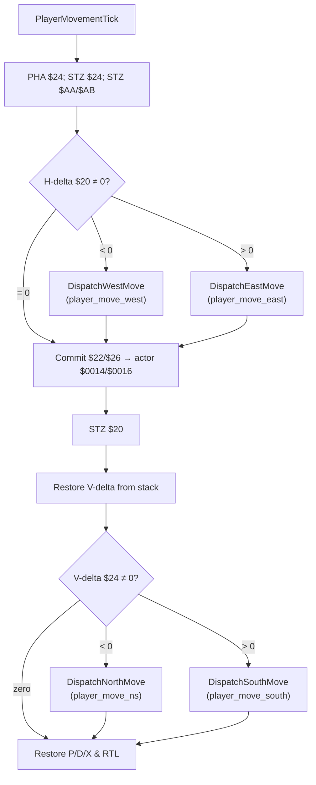

# Bank $02 — Player Movement Physics Engine

*Part of the [Bank $02 Documentation Suite](README.md)*

**Bank:** `$02` (FastROM; accessed via `$@` long calls from other banks)  
**Document scope:** Tile-collision-driven player movement physics — six ASM compilation units in the `player` scene that dispatch horizontal, vertical, diagonal, and ramp movement each frame.  
**ROM span:** `$02CFD0`–`$02E0F9` (4,402 bytes), ending with `CancelVerticalPhase`; `tile_collision.asm` begins at `$02E102` with `CombinedProbe_Unused`.

**Source:** [`player_move_main.asm`](../../../extracted/system/player/player_move_main.asm) · [`player_move_ns.asm`](../../../extracted/system/player/player_move_ns.asm) · [`player_move_south.asm`](../../../extracted/system/player/player_move_south.asm) · [`player_move_east.asm`](../../../extracted/system/player/player_move_east.asm) · [`player_move_ramps.asm`](../../../extracted/system/player/player_move_ramps.asm) · [`player_move_west.asm`](../../../extracted/system/player/player_move_west.asm)

> **Evidence labels.** Each major section is tagged with the kind of claim it makes: **[ASM]** = directly observed in the extracted asm of this block; **[INFERRED]** = interpretation of behavior that is not literally encoded in the file; **[XREF]** = cross-file / engine-wide convention stated elsewhere (not provable from this file alone). Sections that mix kinds split them into separately tagged bullets or paragraphs. The `.asm` files in `extracted/` are authoritative; where prose and asm comments disagree, the asm wins.

Convention (other file): `PlayerMoveController` (`extracted/actors/player/player_move_controller.asm`) calls `PlayerMovementTick` with `JSL` when the player actor’s `$0010` bit `$0008` is set; it scales positions to sub-pixels in `$22`/`$26` and writes velocities to `$20`/`$24` before the call.

**Related:** [`tile-collision.md`](tile-collision.md) · [`map-coordinates.md`](map-coordinates.md) · [`hardware-and-init.md`](hardware-and-init.md) · [`scene-script.md`](scene-script.md) · [`../bank00/direction-collision.md`](../bank00/direction-collision.md) · [`../../cop/README.md`](../../cop/README.md)

### Per-Frame Movement Tick

*Evidence: [ASM] + [XREF]*

`PlayerMovementTick` parks `$24` on the stack and zeroes `$24`/`$AA`/`$AB`, runs the horizontal pass when `$20` ≠ 0, publishes `$22`/`$26` >> 2 to the player actor `$0014`/`$0016`, clears `$20`, restores `$24` from the stack, then runs the vertical pass when `$24` ≠ 0. `$AA` bit `$0040` marks that the horizontal phase ran; bits `$0400`/`$0800` are tested before north/south dispatch but nothing in `extracted/` sets them (only `TRB` clears in `WallSlidePushUp`/`WallSlidePushDown`).



## Block Layout Overview

*Evidence: [ASM]*

```
$02CFD0 ├─ PlayerMovementTick (player_move_main, segment 1) ────┤
$02D038 ├─ DispatchNorthMove … ClearSpeedNS_2                    │  player_move_ns
$02D246 ├─ ComputeYSnapOffset … NudgeAxisMinus8Clamped         │  player_move_main (segment 2)
$02D376 ├─ DispatchSouthMove … FineAdjustXWest                  │  player_move_south
$02D6DC ├─ DispatchEastMove … ClearSpeedEW_6                    │  player_move_east (segment 1)
$02D843 ├─ EastRampDown … WestRedirectToSouth                   │  player_move_ramps
$02DACD ├─ AutoAlignNS_East … ComputeEastSnapOffset              │  player_move_east (segment 2)
$02DB80 ├─ DispatchWestMove … CancelVerticalPhase               │  player_move_west
$02E102 └─ CombinedProbe_Unused … (tile_collision.asm) ────────┘
```

> ROM order: `player_move_main` is split with `player_move_ns` inserted after the first segment; `player_move_east` is split around `player_move_ramps`. All six units cross-reference via `?INCLUDE` and `$&` same-bank `JSR`/`JMP`. The next unit after `CancelVerticalPhase` is `CombinedProbe_Unused` at `$02E102` (first label in `tile_collision.asm`; see [`tile-collision.md`](tile-collision.md)).


## Movement Variable Reference

*Evidence: [ASM] + [XREF]*

| Address | Size | Name / Role |
|---------|------|-------------|
| `$20` | 2 | **H-delta** — horizontal increment (sub-pixel ×4). Negative = west; positive = east. Cleared after EW pass. |
| `$22` | 2 | **Player X** — sub-pixel X (×4). Written to actor `$0014` each tick. |
| `$24` | 2 | **V-delta** — vertical increment (sub-pixel ×4). Negative = north / up; positive = south / down. Saved/restored across EW pass. |
| `$26` | 2 | **Player Y** — sub-pixel Y (×4). Written to actor `$0016` each tick. |
| `$1A` | 2 | **Probe X** — tile probe coordinate in pixel space. |
| `$1E` | 2 | **Probe Y** — tile probe coordinate in pixel space. |
| `$00` | 2 | **Map cell index** — index into the collision overlay left by the last `Probe*` / `MapCell*` step (`STX $00` when the caller must keep it). |
| `$02` | 2 | **Snap / push offset scratch** — wall-slide and fine-adjust helpers (`Compute*SnapOffset`, `ComputeWallSlidePush`, `FineAdjustX*`). |
| `$04` | 2 | **Sub-tile offset scratch** — auto-align routines store `n` (left-edge or row offset) here during range tests. |
| `$000A` | 2 | **Controller slot scratch** (absolute, not DP) — `PlayerMovementTick` stores the controller actor ID; `SetActorCollisionFlag` reads it. |
| `$AA` | 2 | **Movement tick flags** — bit `$0040` = horizontal phase ran (`AutoAlignEW_*` bails if set). Bits `$0400`/`$0800` are tested before NS dispatch and cleared by wall-slide push paths; no setter found in `extracted/`. |
| `$AB` | 2 | **Per-tick direction / wall-slide marks** — bit `$02` = west horizontal phase ran (`DispatchWestMove` `TSB`; `SouthWallNudge` reads it). Bits `$04`/`$08`/`$80` set by east/west wall-slide entry shims (no reader found in `extracted/`). |
| `$09C6` | 2 | `slopeFracAccum` — fractional filter for slope type `$0C` on north/south handlers. |
| `$09AE` | 2 | `playerFlags` — ramp handlers `TSB #$1000` directly on this word (on slope/ramp). |
| `$09AF` | 1 | `playerStateByte` (high byte of `playerFlags`) — slope handlers `TSB #$10` here (same `$1000` flag). Ledge-jump entry `SouthLedgeTile` `TSB #$08` here → `playerFlags` `$0800` (script/ability lock per asm comment, not a dedicated “stair” bit). |
| `$09B2` | 2 | `playerSpeedEw` — cleared by `ClearSpeedEW_*` and hard X snaps. |
| `$09B4` | 2 | `playerSpeedNs` — cleared by `ClearSpeedNS_*` and hard Y snaps. |
| `$7FC000`+ | — | Runtime collision overlay (see [`tile-collision.md`](tile-collision.md)). |

Coordinates use **×4 sub-pixel scale**: `$22`/`$26` are shifted right twice before storing to actor `$0014`/`$0016`.


## Per-Frame Tick Order

*Evidence: [ASM] + [INFERRED]*

`PlayerMovementTick` runs **two separated passes** on DP `$0000`. During the horizontal pass, `$24` is parked on the stack and cleared at DP `$24`, so dispatchers in the EW files see `$24` = 0 (wall-slide Y snaps in those files operate on the current Y — see their asm block notes). When `$20` ≠ 0, `$AA` bit `$0040` is set and `DispatchWestMove` (negative `$20`) or `DispatchEastMove` (positive `$20`) runs.

Between passes the tick **publishes** pixel position: `$22`/`$26` >> 2 → player actor `$0014`/`$0016` (`LDX` = `playerActor` `$09AA`), then `$20` is cleared. The vertical pass restores `$24` from the stack; if a horizontal handler zeroed the parked word (`CancelVerticalPhase` → `$05,S`, or wall-slide stack guard paths), the vertical phase is skipped. Otherwise negative `$24` → `DispatchNorthMove`, positive → `DispatchSouthMove` (each gated on `$AA` `$0800`/`$0400`, which always pass today).

Inferred: resolving X before Y lets a horizontal wall-slide or corner nudge change `$22` before north/south probes run, which matches the “slide along a wall” behavior described in the asm comments.

Convention (other file): `PlayerMoveController` commits the final `$22`/`$26` to the player after the tick returns; many free paths only adjust `$22` or `$26` inside a dispatcher and rely on that commit or on `ApplyMovementDeltas` from `tile_collision.asm`.


## 1. player_move_main.asm

*Evidence: [ASM]*

| Address | Name | Description |
|---------|------|-------------|
| `$02CFD0` | PlayerMovementTick | Main entry point for per-frame player movement collision. |
| `$02D246` | ComputeYSnapOffset | `$02` = 16 − (`$1E` & `$0F`) → 1..16 px (16 when Y flush; not 0). |
| `$02D257` | DiagSnapCompute_Unused | Dead code — no callers in the extracted ROM. |
| `$02D2BF` | AutoAlignEW_North | Attempts horizontal auto-alignment when north-south movement is blocked. |
| `$02D33B` | NudgeAxisPlus8Clamped | `$00,X` += 8 sub-pixels (2 px south); clamps at the next `$40` row line. |
| `$02D354` | NudgeAxisMinus8Clamped | `$00,X` −= 8 sub-pixels (2 px north); may round up to the next `$40` line. |

#### Group A: Movement Dispatcher

### PlayerMovementTick

Main entry for collision-checked movement (`RTL` return). **X at entry = controller actor slot** (not the player). Saves P/D/X, stores controller slot in absolute `$000A`, sets `D` = `$0000`, parks `$24` on the stack and zeroes `$24`, `$AA`, and `$AB`. Clears solid-contact bit `$0004` on the controller’s `$0010` (the controller later copies this bit into the player when publishing position).

Horizontal pass when `$20` ≠ 0: sets `$AA` bit `$0040`, `JSR DispatchWestMove` (negative `$20`) or `DispatchEastMove` (positive). Then `REP #$20`, `LDX playerActor` (`$09AA`), stores `$22`/`$26` >> 2 to player `$0014`/`$0016`, `STZ $20`, restores `$24` from stack. Vertical pass when restored `$24` ≠ 0: `DispatchNorthMove` if negative (after `$AA` bit `$0800` test), else `DispatchSouthMove` (after `$AA` bit `$0400` test). Restores X/D/P and `RTL`.

**Algorithm:**

| Step | Action |
|------|--------|
| 1 | Save P/D/X; `STX $000A`; `TCD #$0000`; `PHA` parked `$24`; `STZ $24`; `STZ $AA`/`$AB` |
| 2 | Clear controller bit `$0004` at `$0010,X` |
| 3 | If `$20` ≠ 0: set `$AA.$0040`; dispatch west (neg `$20`) or east (pos) |
| 4 | Commit `$22`/`$26` to actor; `STZ $20` |
| 5 | Restore `$24`; if ≠ 0 and direction not suppressed, dispatch north (neg) or south (pos) |
| 6 | Restore X/D/P; `RTL` |

**Variables:**

| Location | Direction | Role |
|----------|-----------|------|
| `$20` | R/W | H-delta; cleared after horizontal pass |
| `$22` | R/W | Sub-pixel X; committed to actor |
| `$24` | R/W | V-delta; saved on stack during horizontal pass |
| `$26` | R/W | Sub-pixel Y; committed to actor |
| `$AA` | W | Tick flags; cleared at entry |
| `$0010,X` | R/W | Actor flags; collision bit cleared |
| `$0014,X` | W | Actor pixel X |
| `$0016,X` | W | Actor pixel Y |

**Cross-References:**

| Symbol | Relationship |
|--------|--------------|
| `DispatchWestMove` | Called when `$20 < 0` |
| `DispatchEastMove` | Called when `$20 > 0` |
| `DispatchNorthMove` | Called when `$24 < 0` (unless suppressed) |
| `DispatchSouthMove` | Called when `$24 > 0` (unless suppressed) |
| `PlayerMoveController` | Upstream caller (`JSL`); supplies `$20`/`$24` and sub-pixel `$22`/`$26` |

### DiagSnapCompute_Unused

Dead code — no callers in the extracted ROM. Probes current TL; on wall type `$06` or (X-straddling and down-cell `$09`), builds a Y snap offset in `$02` using V-delta sign extension. No live diagonal snap dispatch exists; not an alternate path to `ComputeWallSlidePush`.

**Algorithm:**

| Step | Action |
|------|--------|
| 1 | Save `$1A`/`$1E`; probe current TL |
| 2 | If type `$06` or (X-aligned and down-cell `$09`): compute Y parity offset into `$02` |
| 3 | Add Y sub-tile snap: `$02 += negated($1E & $0F)` |
| 4 | Restore probe coords; `RTS` |

**Variables:**

| Location | Direction | Role |
|----------|-----------|------|
| `$1A` | R/W | Probe X (saved/restored) |
| `$1E` | R/W | Probe Y (saved/restored) |
| `$24` | R | V-delta for parity check |
| `$02` | W | Combined snap offset |

**Cross-References:**

| Symbol | Relationship |
|--------|--------------|
| `ProbeCurrentTL` | Called for tile probe |

### AutoAlignEW_North

Corner assist on a blocked **north** step only (`JSR` from `DispatchNorthMove`). Returns **carry clear** if X was nudged 2 px toward an open column; **carry set** if no nudge (caller hard-snaps Y). Gates (carry set): `$AA` bit `$0040`; actor solid mark in the collision byte at map index `X` (`$7FC000,X` high nibble `$F0`); or `n` = 0 where `n` = `(($22 >> 2) - 8) & $0F` (left-edge offset in the 16 px column). If `n` ≥ 6, probe `ProbeFutureTR`: type must be `< $0E` and ≠ `$06`, then temporary `$22` − `$20` (8 px west reference), `NudgeAxisPlus8Clamped` (+8 sub-pixels east), restore `$22`. Else if `n` < 9, probe `ProbeFutureTL`: type `< $0E` and ≠ `$09`, same reference shift, `NudgeAxisMinus8Clamped` (−8 sub-pixels west). South mirror: `AutoAlignEW_South` in `player_move_south.asm` uses `ProbeFutureBR` / `ProbeFutureBL` with the same `n` thresholds.

**Algorithm:**

| Step | Action |
|------|--------|
| 1 | Guard: skip if EW flag or dynamic collision |
| 2 | Compute X sub-tile offset → `$04` |
| 3 | If `$04` ≥ 6: probe future TR; if open (not type `$06`), nudge +8 sub-pixels east |
| 4 | Else if `$04` < 9: probe future TL; if open (not type `$09`), nudge −8 sub-pixels west |
| 5 | Return CLC (aligned) or SEC (blocked) |

**Variables:**

| Location | Direction | Role |
|----------|-----------|------|
| `$22` | R/W | Sub-pixel X (nudged via `$00,X`) |
| `$04` | W | X approach offset scratch |
| `$AA` | R | EW movement guard flag |
| `$7FC000,X` | R | Collision overlay byte at last probe index (high nibble = actor solid mark) |

**Cross-References:**

| Symbol | Relationship |
|--------|--------------|
| `DispatchNorthMove` | Caller (blocked path) |
| `NudgeAxisPlus8Clamped` / `NudgeAxisMinus8Clamped` | Called for alignment |
| `SnapYNorthCollision` | Fallback when SEC returned |

### NudgeAxisPlus8Clamped

Adds +8 sub-pixels (2 px toward larger coordinates — east or south depending on which word `X` points at). If the step crosses a `$40` line (16 px), floors to that line (`AND #$FFC0`). Operates on `$00,X` with `X` = `$22` or `$26`. `RTS`.

### NudgeAxisMinus8Clamped

Subtracts 8 sub-pixels (2 px toward smaller coordinates). On crossing a `$40` line, if low six bits ≠ 0, clamps up to that line: `(value & $FFC0) + $40`. `RTS`.

**Cross-References (both nudge helpers):**

| Symbol | Relationship |
|--------|--------------|
| `AutoAlignEW_North` / `AutoAlignEW_South` | Callers |
| `AutoAlignNS_East` / `AutoAlignYToGrid` | Callers (Y via `LDX #$0026`) |


## 2. player_move_ns.asm

*Evidence: [ASM]*

| Address | Name | Description |
|---------|------|-------------|
| `$02D038` | DispatchNorthMove | Northward movement dispatcher. |
| `$02D0BC` | SnapYNorthCollision | Blocked north: `$26 = (($24+$26) & $FFC0) + $40`, `$24 = 0` (full entry clears `playerSpeedNs`). |
| `$02D0D4` | NorthLadderTile | Handles tile type $02 (ladder) when moving north: `LadderClimbSouth`. |
| `$02D0EE` | NorthSlopeRight | Tile $03 (slope-right) handler for northward movement. |
| `$02D122` | NorthSlopeLeft | Tile $0C (slope-left) north handler with $09C6 slope accumulator. |
| `$02D188` | SouthWallHandler | Tile $06 (diagonal-edge type) handler; "South" is a type name, not a direction. |
| `$02D1CE` | SouthWallNudge | Future TL $06 nudge variant. |
| `$02D1EC` | ClearSpeedNS_1 | Branch-range stub: `STZ playerSpeedNs` → `RTS` (gap abort). |
| `$02D1F2` | NorthWallHandler | Tile $09 (diagonal-edge type) handler; "North" is a type name, not a direction. |
| `$02D238` | NorthProbeRedirect | Joins `NorthWallHandler` gap chain at `loc_02D208` (`MapCellDown`/`ReadCollisionNibble` here are dead code). |
| `$02D240` | ClearSpeedNS_2 | Branch-range stub: `STZ playerSpeedNs` → `RTS` (gap abort). |

#### Group B: Northward Movement

### DispatchNorthMove

Northward movement dispatcher (V-delta < 0). Probes current TL for wall `$06`, slope-right `$03`, slope-left `$0C`. Probes current TR for north wall `$09` (redirects to `NorthWallHandler`). Probes future TL for solid types (`$0E+`, `$08`), interact `$02`, south-wall nudge `$06`. Sub-tile and down-cell cascades handle `$09` redirects via `NorthProbeRedirect`. Free path adds `$24` to `$26`. Blocked path: `SetActorCollisionFlag`, `AutoAlignEW_North` (carry clear → `SnapYNorthCollision` at `loc_02D0C2` **without** clearing `playerSpeedNs`), else hard `SnapYNorthCollision`. Plain step: `$26 += $24`, `RTS` (does not call `ApplyMovementDeltas`).

**Algorithm:**

| Step | Action |
|------|--------|
| 1 | Probe current TL → dispatch wall/slope handlers |
| 2 | Probe current TR → `$09` → `NorthWallHandler` |
| 3 | Probe future TL → solid/interact/nudge dispatch |
| 4 | X flush → future TL `$09` redirect; X straddling → `MapCellRight` (future TR cell) cascade for `$09`/`$06` |
| 5 | Free: `$26 += $24`; Blocked: align → snap or apply |

**Variables:**

| Location | Direction | Role |
|----------|-----------|------|
| `$24` | R/W | V-delta |
| `$26` | R/W | Sub-pixel Y |
| `$09B4` | W | `playerSpeedNs` (cleared on hard snap, kept after `AutoAlignEW_North` nudge) |

**Cross-References:**

| Symbol | Relationship |
|--------|--------------|
| `SouthWallHandler` / `NorthSlopeRight` / `NorthSlopeLeft` | TL-type dispatch |
| `NorthWallHandler` | TR `$09` redirect |
| `AutoAlignEW_North` | Blocked-path alignment |
| `SnapYNorthCollision` | Snap fallback |

### NorthSlopeRight

Tile `$03` at current TL while moving north. TR must also be `$03`; Y flush, cell below `$03`, or row-offset test `d = 16 - n` with `d >= 8` sets `playerFlags` `$1000` via `TSB #$10` on `playerStateByte`, then `ApplyMovementDeltas`. If `d < 8` (lower half of tile), `ApplyMovementDeltas` runs without setting the flag.

**Algorithm:**

| Step | Action |
|------|--------|
| 1 | Probe TR; must be `$03` |
| 2 | Y alignment + right-cell `$03` check |
| 3 | `d = 16 - n` with `n` = row offset of top probe; `d < 8` → `ApplyMovementDeltas` without flag |
| 4 | Else `TSB #$10` on `playerStateByte` → `ApplyMovementDeltas` |

**Variables:**

| Location | Direction | Role |
|----------|-----------|------|
| `$24` / `$26` | R | Sub-tile Y calculation |
| `playerStateByte` | W | `TSB #$10` → `playerFlags` `$1000` |

**Cross-References:**

| Symbol | Relationship |
|--------|--------------|
| `EastSlopeRight` | EW counterpart |
| `ApplyMovementDeltas` | Finalizer |

### NorthSlopeLeft

Tile `$0C` (slope-left) north handler with **`$09C6` (`slopeFracAccum`) filter**. Positive accumulator leftovers are cleared; `$09C6 += $24`. If `|accum| >> 4` is zero, apply raw `$24`; else **replace `$24`** with −(`|accum| >> 4`) and add 16 to `$09C6` each step.

**Algorithm:**

| Step | Action |
|------|--------|
| 1 | Verify TR `$0C`; alignment + right-cell check |
| 2 | Free path or `TSB #$10` on `playerStateByte` |
| 3 | Clear positive `$09C6`; `$09C6 += $24` |
| 4 | If `\|accum\| >> 4` ≠ 0: replace `$24`, bump accum by 16 |
| 5 | `ApplyMovementDeltas` |

**Variables:**

| Location | Direction | Role |
|----------|-----------|------|
| `$09C6` | R/W | Slope accumulator |
| `$24` | R/W | Adjusted V-delta |
| `playerStateByte` / `$09C6` | W | Slope flag + `slopeFracAccum` filter |

**Cross-References:**

| Symbol | Relationship |
|--------|--------------|
| `SouthSlopeLeft` | South counterpart |
| `NorthSlopeRight` | Non-accumulator counterpart |

### SouthWallHandler

Entered when current TL type is `$06` while moving north (`SouthWallHandler` name reflects the type, not a compass direction). If current BR is also `$06`, `ClearMovementDeltas`. Else `ProbeFutureTL` + `CheckSubTileAlignY`: Y straddling with future TL `$06` runs the gap chain — cell east of future TL and cell below that east cell must both be type **0**, else `ClearSpeedNS_1`. Both empty: `ComputeYSnapOffset` → `FineAdjustXWest` (net X movement **east**) → `ApplyMovementDeltas`. Otherwise `SnapXWestCollision` (moves X to next column centre east), re-probe; still `$06` → slide path; else `STZ $24` + `SnapYSouthCollision` + `ApplyMovementDeltas`.

**Algorithm:**

| Step | Action |
|------|--------|
| 1 | BR `$06` → `ClearMovementDeltas` |
| 2 | Future TL + Y align → slide or corner |
| 3 | Slide: down/right cells open → X snap |
| 4 | Corner: `ComputeYSnapOffset` → `FineAdjustXWest` |

**Variables:**

| Location | Direction | Role |
|----------|-----------|------|
| `$24` | W | Zeroed before `SnapYSouthCollision` on failed slide |
| `$02` | W | Snap offset from `ComputeYSnapOffset` |

**Cross-References:**

| Symbol | Relationship |
|--------|--------------|
| `SnapXWestCollision` | Snap path (`player_move_west`) |
| `ComputeYSnapOffset` / `FineAdjustXWest` | Open gap slide |

### SouthWallNudge

Future TL `$06` during north move. If `$AB` bit `$02` (west horizontal phase ran) and X flush (`CheckSubTileAlignX` carry clear): `STZ $24` + `ApplyMovementDeltas`. Else `MapCellRight` from future TL: solid (`$0E+`) → `loc_02D1BC` (`STZ $24`, `SnapYSouthCollision`, apply); else join `SouthWallHandler` gap chain at `loc_02D19E`.

### NorthWallHandler

Entered when current TR type is `$09`. If current BL is also `$09`, `ClearMovementDeltas`. Else `ProbeFutureTR` + `CheckSubTileAlignY`: Y straddling with future TR `$09` → gap chain (cell **west** of future TR and cell below that west cell must be type **0**, else `ClearSpeedNS_2`). Open gap: `ComputeYSnapOffset` → `FineAdjustXEast` (net X **west**) → `ApplyMovementDeltas`. Else `SnapXEastCollision`, re-probe; still `$09` → slide; else `STZ $24` + `SnapYSouthCollision` + `ApplyMovementDeltas`.

**Algorithm:**

| Step | Action |
|------|--------|
| 1 | BL `$09` → `ClearMovementDeltas` |
| 2 | Future TR + Y align → slide or corner |
| 3 | Gap: west + below-west cells type 0 → slide |
| 4 | Else snap X east (`SnapXEastCollision`) or Y via `SnapYSouthCollision` |

**Variables:**

| Location | Direction | Role |
|----------|-----------|------|
| `$24` | W | Zeroed before `SnapYSouthCollision` when slide fails |
| `$02` | W | From `ComputeYSnapOffset` |

**Cross-References:**

| Symbol | Relationship |
|--------|--------------|
| `DispatchNorthMove` | TR `$09` redirect |
| `FineAdjustXEast` | Open-gap slide (X west) |

## 3. player_move_south.asm

*Evidence: [ASM]*

| Address | Name | Description |
|---------|------|-------------|
| `$02D376` | DispatchSouthMove | Southward (+Y) movement dispatcher. |
| `$02D3EA` | SouthBlockedWall | Sets collision flag, tries `AutoAlignEW_South`, branches to Y snap on failure. |
| `$02D3F7` | SnapYSouthCollision | Y snap for south collision (aligns Y to current tile row). |
| `$02D40B` | SouthLadderTile | Tile `$02` south: X-aligned redirect to `LadderClimbNorth`, then blocked path. |
| `$02D425` | SouthLedgeTile | Tile `$08` ledge jump: may require right cell `$08` when straddling; sets `playerFlags` `$0800` via `playerStateByte`; `LedgeJumpEntry`; `SnapYSouthCollision`. |
| `$02D44E` | SouthSlopeRight | Tile `$03` south slope: BR continuity, Y threshold `$08`, slope flag on block. |
| `$02D47F` | SouthSlopeLeft | Tile `$0C` south slope with `$09C6` accumulator (positive-direction variant). |
| `$02D4DA` | SouthWallNorthInteract | Tile `$09` moving south: double-wall, slide-down path, `ComputeSouthSnapOffset` → `FineAdjustXWest`. |
| `$02D524` | SouthWallNorthProbe | Down-cell probe redirect: solid → snap south; else → north slide path. |
| `$02D530` | ClearSpeedNS_3 | Branch-range stub: `STZ playerSpeedNs` → `RTS`. |
| `$02D536` | SouthWallSouthInteract | Tile `$06` moving south: TL double-wall, slide-up path, `ComputeSouthSnapOffset` → `FineAdjustXEast`. |
| `$02D57C` | SouthSlideJumpShim | Single BRA to south-wall slide entry — branch-range shim. |
| `$02D57E` | ClearSpeedNS_4 | Branch-range stub: `STZ playerSpeedNs` → `RTS`. |
| `$02D584` | AutoAlignEW_South | X auto-align when NS blocked (south variant). |
| `$02D5F9` | ComputeSouthSnapOffset | Computes south snap offset in `$02` from BL probe (`$09` or down-cell `$06`) with V-delta parity correction on `$1E` sub-tile. |
| `$02D655` | FineAdjustXEast | Fine X adjust after south wall snap (east edge). |
| `$02D69A` | FineAdjustXWest | Mirror of `FineAdjustXEast` with inverted distance metric for westward snap correction. |

#### Group B: Southward Movement

### DispatchSouthMove

Southward movement dispatcher for positive `$24` (downward on screen). Probes BL for north wall/slopes, BR for south wall, future BL for solids, ladders (`$02`, `SouthLadderTile`) and ledge jumps (`$08`, `SouthLedgeTile`). Sub-tile and down-cell cascades for north-wall slide. Free path adds `$24` to `$26`.

**Algorithm:**

| Step | Action |
|------|--------|
| 1 | Probe BL → wall/slope dispatch |
| 2 | Probe BR → `$06` → south wall interact |
| 3 | Probe future BL → type dispatch |
| 4 | Sub-tile + down-cell cascade |
| 5 | Free: `$26 += $24`; Blocked: align → snap |

**Variables:**

| Location | Direction | Role |
|----------|-----------|------|
| `$24` / `$26` | R/W | V-delta / sub-pixel Y |

**Cross-References:**

| Symbol | Relationship |
|--------|--------------|
| `SouthWallNorthInteract` / `SouthWallSouthInteract` | Wall handlers |
| `AutoAlignEW_South` | Blocked alignment |
| `PlayerMovementTick` | Entry when `$24 > 0` (unless suppressed) |

### SouthLedgeTile

Reached when `ProbeFutureBL` returns type `$08` while moving south (ledge-jump cells are south-entry only in this dispatcher: a ledge can only be jumped down from the north). `CheckSubTileAlignX`: single-column (carry clear) enters directly; straddling requires `MapCellRight` + type `$08` in the right-hand cell, else `SouthBlockedWall`. On success: `TSB #$08` on `playerStateByte` (`$09AF`) → `playerFlags` `$0800` (script/ability lock per asm comment), player entry `$0000` → `LedgeJumpEntry`, wait counter `$0008` cleared, then `SnapYSouthCollision` (`Y = (Y + $24) & $FFC0`, `$24` = 0, `playerSpeedNs` cleared).

### SouthSlopeRight

Handles southward entry onto a right-descending slope tile (`$03`) at the bottom-left corner. Both bottom corners must read `$03`, and the player must either be Y-aligned with a matching `$03` tile to the left or sit in the upper half of the tile (sub-tile Y offset `< $08`); otherwise the step is blocked as a wall collision. When the row-offset test fails the “plain move” path, `TSB #$10` on `playerStateByte` sets `playerFlags` `$1000` before `ApplyMovementDeltas`.

**Cross-References:**

| Symbol | Relationship |
|--------|--------------|
| `NorthSlopeRight` | NS counterpart |

### SouthSlopeLeft

Handles southward movement on a left-descending slope tile (`$0C`), mirroring `SouthSlopeRight`'s corner and sub-tile checks but using the **`$09C6` fractional accumulator** for smooth descent. When the player enters the lower tile half, incoming V-delta (`$24`) is added to `$09C6`; whole sub-pixel steps (÷16) are extracted and applied as actual movement while the remainder stays in the accumulator across frames. This spreads steep downward motion across multiple frames instead of snapping the player to the slope surface in one step.

**Algorithm:**

| Step | Action |
|------|--------|
| 1 | Verify BR `$0C`; alignment checks |
| 2 | Accumulate `$24` → `$09C6`; extract steps |
| 3 | `ApplyMovementDeltas` |

**Variables:**

| Location | Direction | Role |
|----------|-----------|------|
| `$09C6` | R/W | Slope accumulator |

**Cross-References:**

| Symbol | Relationship |
|--------|--------------|
| `NorthSlopeLeft` | NS variant |

### SouthWallNorthInteract

Handles southward movement when the bottom-left corner is on a `$09` diagonal-edge cell (top-left + bottom-right quadrants; "North" is the handler's type name, not a direction) — the mirror of `NorthWallHandler` but for downward motion instead of upward. If top-right is also `$09` the player is fully walled and all deltas are cleared. When sub-tile Y is aligned with a continuing `$09` wall ahead, the routine probes for a gap below the wall lip; an open gap triggers **westward wall-slide** via `ComputeSouthSnapOffset` → `FineAdjustXWest`, while a closed gap tries diagonal X snap first and may fall back to hard Y snap south.

**Cross-References:**

| Symbol | Relationship |
|--------|--------------|
| `ComputeSouthSnapOffset` / `FineAdjustXWest` | Resolution chain |
| `SnapXWestCollision` | Misaligned slide fallback |

### SouthWallSouthInteract

Handles southward movement when the bottom-right corner is on a `$06` diagonal-edge cell (top-right + bottom-left quadrants; "South" is the handler's type name, not a direction). Enclosure between `$06` at both top-left and bottom-right stops all movement; otherwise the handler probes the future bottom-right cell for a continuing south wall with Y sub-tile alignment. When a gap exists above the wall lip (cells up and left are walkable), the player **slides east** along the south wall through `ComputeSouthSnapOffset` → `FineAdjustXEast`. Misaligned paths snap X eastward first (`SnapXEastCollision`); if still blocked, vertical delta is zeroed and Y snaps north to the tile ceiling.

**Cross-References:**

| Symbol | Relationship |
|--------|--------------|
| `FineAdjustXEast` | Corner resolution |
| `SnapXEastCollision` | Misaligned slide fallback |

### AutoAlignEW_South

X auto-align when south movement is blocked. Mirror of `AutoAlignEW_North` but probes `FutureBR`/`FutureBL` instead of `FutureTR`/`FutureTL`. Returns **carry clear** on successful nudge, **carry set** on failure.

**Algorithm:**

| Step | Action |
|------|--------|
| 1 | Guard: skip if EW flag or dynamic collision |
| 2 | Compute X sub-tile offset → `$04` |
| 3 | If `$04` ≥ 6: probe future BR; if open, nudge X lower |
| 4 | Else if `$04` < 9: probe future BL; if open, nudge X upper |
| 5 | Return CLC (aligned) or SEC (blocked) |

**Cross-References:**

| Symbol | Relationship |
|--------|--------------|
| `AutoAlignEW_North` | Axis/direction mirror |
| `SouthBlockedWall` | Caller |
| `NudgeAxisPlus8Clamped` / `NudgeAxisMinus8Clamped` | Nudge calls |

### ComputeSouthSnapOffset

Computes the sub-pixel **snap correction** stored in `$02` for southward wall-sliding. When the current bottom-left is a north wall (`$09`) or a south wall (`$06`) with X right-half alignment, the routine predicts whether this frame's V-delta will cross a 16px sub-tile Y boundary and adds `$10` to `$02` if so. The final offset combines that boundary-crossing term with the probe Y sub-tile position (`$1E & $0F`), giving `FineAdjustXEast`/`FineAdjustXWest` the distance needed to align the player flush against the wall edge.

**Variables:**

| Location | Direction | Role |
|----------|-----------|------|
| `$02` | W | Output offset |
| `$1E` | R | Probe Y sub-tile |
| `$24` | R | V-delta for parity |

**Cross-References:**

| Symbol | Relationship |
|--------|--------------|
| `FineAdjustXEast` / `FineAdjustXWest` | Consumers |
| `SouthWallNorthInteract` / `SouthWallSouthInteract` | Callers |

### FineAdjustXEast

Fine X adjust after south wall snap (east edge). If pixel distance + `$02` ≥ `$11`, snaps `$22` to grid-aligned sub-pixel position.

**Cross-References:**

| Symbol | Relationship |
|--------|--------------|
| `SouthWallSouthInteract` | Primary caller |

### FineAdjustXWest

Precision X correction after a north-wall slide during southward movement — the west-edge counterpart to `FineAdjustXEast`. Instead of measuring distance from the east edge of the tile, it inverts the sub-tile X offset (distance from the **west** edge) and adds the snap correction from `$02`. If the combined distance is under 17 sub-pixels, movement applies without grid snap; otherwise `$22` is rewritten to snap the player to the previous tile column's west boundary, preventing the sprite from visually clipping through the wall corner.

**Cross-References:**

| Symbol | Relationship |
|--------|--------------|
| `SouthWallNorthInteract` | Primary caller |


## 4. player_move_east.asm

*Evidence: [ASM]*

| Address | Name | Description |
|---------|------|-------------|
| `$02D6DC` | DispatchEastMove | Eastward (+X) movement dispatcher. |
| `$02D760` | SnapXEastCollision | X-axis snap to 16-pixel tile column after east collision. |
| `$02D77C` | EastShimmyTile | Tile `$07` (wall-shimmy tile, not a ladder) east: Y-aligned redirect to `ShimmyRightEntry`. |
| `$02D799` | EastWallNorthDiag | Diagonal entry; falls through to `EastWallPushDown`. |
| `$02D79B` | EastWallPushDown | Tile `$09` moving east: slide path → `ComputeEastSnapOffset` + `WallSlidePushDown`. |
| `$02D7E1` | EastWallNorthFlag | Sets `$AB.$04`, joins north-wall adjacency chain. |
| `$02D7E7` | ClearSpeedEW_5 | Branch-range stub: `STZ playerSpeedEw` → `RTS`. |
| `$02D7ED` | EastWallSouthDiag | Diagonal entry; falls through to `EastWallPushUp`. |
| `$02D7EF` | EastWallPushUp | Tile `$06` moving east: slide path → `ComputeEastSnapOffset` + `WallSlidePushUp`. |
| `$02D81B` | EastWallSouthFlag | Sets `$AB.$08`, joins south-wall adjacency chain. |
| `$02D83D` | ClearSpeedEW_6 | Branch-range stub: `STZ playerSpeedEw` → `RTS`. |
| `$02DACD` | AutoAlignNS_East | Y auto-align when EW blocked (east). |
| `$02DB22` | ComputeEastSnapOffset | Computes east snap offset in `$02` from TR probe with EW-delta parity correction. |

#### Group E: Eastward Movement

### DispatchEastMove

Eastward movement dispatcher for positive `$20` (`RTS` on free paths). **`FindSlopeForEastMove`** (`map_coords`): Z set → carry set → `WestRampUp` (`$05`), carry clear → `EastRampDown` (`$0A`). Else probes TR `$09` → `EastWallPushDown`, BR `$06` → `EastWallPushUp`, `ProbeFutureTR` solid/`$09` flags, Y-alignment cascades, type `$07` → `EastShimmyTile`, BL `$05`/`$0A` → `WestRampDown`/`EastRampUp`. Free path: `$22 += $20`. Blocked: `AutoAlignNS_East` then `SnapXEastCollision` (full entry clears `playerSpeedEw`).

**Algorithm:**

| Step | Action |
|------|--------|
| 1 | `FindSlopeForEastMove` → ramp down dispatch |
| 2 | Probe TR/BR → wall handlers |
| 3 | Probe future TR → type dispatch |
| 4 | Sub-tile + down-cell cascade |
| 5 | BL ramp-up or free: `$22 += $20`; Blocked: align → snap |

**Variables:**

| Location | Direction | Role |
|----------|-----------|------|
| `$20` / `$22` | R/W | H-delta / sub-pixel X |

**Cross-References:**

| Symbol | Relationship |
|--------|--------------|
| `FindSlopeForEastMove` | Ramp pre-detection |
| `EastRampDown` / `WestRampUp` | Ramp entry (`player_move_ramps`) |
| `EastWallPushDown` / `EastWallPushUp` | Wall handlers |
| `AutoAlignNS_East` | Blocked alignment |

### EastWallPushDown

Tile `$09` moving east. Sets `$AB.$80`; probes future TR with X alignment; gap chain via `MapCellDown`/`MapCellLeft`. Resolves via `ComputeEastSnapOffset` → **`WallSlidePushDown`** (pushes the player **down** along the wall).

**Cross-References:**

| Symbol | Relationship |
|--------|--------------|
| `ComputeEastSnapOffset` / `WallSlidePushDown` | Resolution chain |
| `EastRedirectToNorth` | Ramp fallback entry |

### EastWallPushUp

Tile `$06` moving east. Sets `$AB.$80`; probes future BR; gap chain via `MapCellUp`/`MapCellLeft`. Resolves via `ComputeEastSnapOffset` → **`WallSlidePushUp`** (pushes the player **up** along the wall).

**Cross-References:**

| Symbol | Relationship |
|--------|--------------|
| `ComputeEastSnapOffset` / `WallSlidePushUp` | Resolution chain |
| `WestRedirectToSouth` | Ramp fallback entry |

### AutoAlignNS_East

Y auto-align when east movement is blocked. Skips if parked vertical velocity at `$06,S` is non-zero or the probe cell has an actor solid mark (`$7FC000,X` high nibble `$F0`). With `n = (($26 >> 2) & $0F)`, **`n` ≥ 4** tries south nudge (`NudgeAxisPlus8Clamped`, +2 px) when `ProbeFutureBR` < `$0E`; else **`n` ≤ 10** tries north nudge (`NudgeAxisMinus8Clamped`, −2 px) when `ProbeFutureTR` < `$0E`.

**Algorithm:**

| Step | Action |
|------|--------|
| 1 | Guard stack `$06,S` + dynamic collision |
| 2 | Y offset in `$04`; probe future BR/TR |
| 3 | Nudge `$26` lower/upper grid |
| 4 | CLC/SEC return |

**Cross-References:**

| Symbol | Relationship |
|--------|--------------|
| `AutoAlignEW_North` | Axis mirror |
| `NudgeAxisPlus8Clamped` / `NudgeAxisMinus8Clamped` | Nudge calls |

### ComputeEastSnapOffset

Computes the sub-pixel **snap correction** in `$02` for eastward wall-sliding, analogous to `ComputeSouthSnapOffset` but operating on the X axis. When the current top-right is a north wall (`$09`) or a south wall (`$06`) with Y right-half alignment, it checks whether this frame's H-delta (`$20`) will cross a 16px sub-tile X boundary and adds `$10` to `$02` on crossing. The probe X sub-tile (`$1A & $0F`) is then added to produce the total offset consumed by `WallSlidePushUp`/`WallSlidePushDown` after east-movement wall collisions.

**Variables:**

| Location | Direction | Role |
|----------|-----------|------|
| `$02` | W | Output offset |
| `$1A` | R | Probe X sub-tile |
| `$20` | R | H-delta for parity |

**Cross-References:**

| Symbol | Relationship |
|--------|--------------|
| `WallSlidePushUp` / `WallSlidePushDown` | Consumers |
| `EastWallPushDown` / `EastWallPushUp` | Callers |


## 5. player_move_ramps.asm

*Evidence: [ASM]*

| Address | Name | Description |
|---------|------|-------------|
| `$02D843` | EastRampDown | Descend east-facing slope `$0A` while moving east. |
| `$02D93F` | EastRampUp | Ascend east-facing slope `$0A` while moving east. |
| `$02D978` | EastRedirectToNorth | Ramp fallback: future TR `$09` → `EastWallNorthDiag` or free move. |
| `$02D986` | WestRampUp | Ascend west-facing slope `$05` while moving east (primary `$05` path). |
| `$02DA8A` | WestRampDown | Descend west-facing slope `$05` while moving east (BL `$05` ramp-up entry). |
| `$02DABF` | WestRedirectToSouth | Ramp fallback: future BR `$06` → `EastWallSouthDiag` or free move. |

#### Group F: East-Facing Ramps (`$0A`)

### EastRampDown

Descend an east-facing slope (`$0A`) while moving east. Multi-probe sequence at TR and offset positions; **`CheckTileBoundaryXor`** gates fractional Y displacement from X sub-tile position. Sets **`$09AE.$1000`**. Post-slope wall check at future TR/BR with corner snap fallback.

**Algorithm:**

| Step | Action |
|------|--------|
| 1 | `CancelVerticalPhase`; multi-probe for `$0A` |
| 2 | Boundary XOR gate; Y from X sub-tile (×4 + half-pixel bias) |
| 3 | Set ramp flag; probe future TR/BR |
| 4 | Passable → apply; blocked → single-axis or full corner snap |

**Variables:**

| Location | Direction | Role |
|----------|-----------|------|
| `$1A` | R/W | Probe X (offset adjusted) |
| `$26` | W | Y adjusted for ramp |
| `$09AE` | W | Ramp flag `$1000` |

**Cross-References:**

| Symbol | Relationship |
|--------|--------------|
| `EastRedirectToNorth` | Fallback when no slope found |
| `DispatchEastMove` | Entry via `FindSlopeForEastMove` |
| `RampSnapEastSouthBrWall` / `RampSnapEastNorthTrWall` | Partial wall snap helpers |

### EastRampUp

Ascend east-facing slope `$0A` while moving east. Probes raised `$1A+8` for `$0A`; boundary cross computes inverted `$24` from X sub-tile; joins `code_02D8CE` finalize shared with `EastRampDown`.

**Cross-References:**

| Symbol | Relationship |
|--------|--------------|
| `EastRampDown` | Shared finalize path |
| `DispatchEastMove` | BL `$0A` ramp-up entry |

### WestRampUp

Ascend west-facing slope `$05` while moving east. Mirror of `EastRampDown` with negated Y math and `$05` probes. Multi-probe through BL/adjacent cells; half-pixel rounding subtracts `$0004`.

**Algorithm:**

| Step | Action |
|------|--------|
| 1 | Multi-probe for `$05` at offset positions |
| 2 | Boundary XOR; negated Y from X sub-tile |
| 3 | Ramp flag; future corner probes |
| 4 | Apply or corner snap via `RampSnapWestSouthBrWall`/`RampSnapWestNorthTrWall` |

**Variables:**

| Location | Direction | Role |
|----------|-----------|------|
| `$26` | W | Y displacement (negated ramp math) |
| `$09AE` | W | Ramp flag |

**Cross-References:**

| Symbol | Relationship |
|--------|--------------|
| `WestRedirectToSouth` | Fallback |
| `DispatchEastMove` | Entry via `FindSlopeForEastMove` (carry set) |

### WestRampDown

Descend west-facing slope `$05` while moving east. Probes `$1A+8` for `$05`; boundary cross stores positive `$24` ramp fraction; joins `code_02DA19` finalize.

**Cross-References:**

| Symbol | Relationship |
|--------|--------------|
| `WestRampUp` | Shared finalize |
| `DispatchEastMove` | BL `$05` ramp-up entry |

## 6. player_move_west.asm

*Evidence: [ASM]*

| Address | Name | Description |
|---------|------|-------------|
| `$02DB80` | DispatchWestMove | West horizontal-phase dispatcher (negative `$20`). |
| `$02DC10` | SnapXWestCollision | X snap to 16-pixel tile column after west collision. |
| `$02DC2C` | WestShimmyTile | Tile `$07` (wall-shimmy tile, not a ladder) during west phase: Y-aligned redirect to `ShimmyLeftEntry`. |
| `$02DC49` | DiagWallSouthShim | Tile `$06` handler during west phase. |
| `$02DC9D` | DiagWallNorthShim | Tile `$09` handler during west phase. |
| `$02DCF3` | WestRampDescend | West-facing ramp tile `$05` — adds to `$26` so Y grows (down-left along ramp). |
| `$02DE02` | WestRampEdgeDescend | Partial-entry edge for tile `$05` during west movement. |
| `$02DE43` | DiagRedirectToSouth | Ramp fallback: future TL $06 → DiagWallSouthShim or free move. |
| `$02DE51` | WestRampAscend | East-facing ramp tile `$0A` — Y shrinks (up-left along ramp). |
| `$02DF5C` | WestRampEdgeAscend | Partial-entry edge for tile `$0A` during west movement. |
| `$02DF99` | DiagRedirectToNorth | Ramp fallback: future BL $09 → DiagWallNorthShim or free move. |
| `$02DFA7` | AutoAlignYToGrid | Nudges `$26` onto the 16-pixel Y grid when west movement is blocked. |
| `$02DFF6` | ComputeWallSlidePush | Wall-slide snap offset into `$02` after west-phase wall hits. |
| `$02E060` | WallSlidePushUp | Stores **negative** `$24` (northward wall-slide push). |
| `$02E0AB` | WallSlidePushDown | Stores **positive** `$24` (southward wall-slide push). |
| `$02E0FA` | CancelVerticalPhase | `STA #$0000` to `$05,S` (parked `$24` from `PlayerMovementTick`); cancels vertical phase. |

#### Group G: West horizontal phase (`player_move_west`)

### DispatchWestMove

West horizontal-phase dispatcher (negative `$20`). Sets `$AB.$02`. **`FindSlopeForWestMove`** first for ramp → `WestRampAscend`/`WestRampDescend`. Corner probes for walls, future TL, sub-tile cascades. `$07` shimmy/ledge tile; TR `$05`/`$0A` ramp edges. Free: `$22 += $20`. Blocked: `AutoAlignYToGrid` → snap.

**Algorithm:**

| Step | Action |
|------|--------|
| 1 | `$AB.$02`; `FindSlopeForWestMove` → ramp dispatch |
| 2 | Probe TL/BL → wall handlers |
| 3 | Probe future TL → type dispatch |
| 4 | Sub-tile + right-cell cascade |
| 5 | Free or align → snap |

**Variables:**

| Location | Direction | Role |
|----------|-----------|------|
| `$20` / `$22` | R/W | H-delta / sub-pixel X |
| `$AB` | W | Nudge flag set |

**Cross-References:**

| Symbol | Relationship |
|--------|--------------|
| `FindSlopeForWestMove` | Ramp pre-detection |
| `PlayerMovementTick` | Entry when `$20 < 0` |

### DiagWallSouthShim

Tile `$06` during west phase. Sets `$AB.$80`; future TL probe; right/down cell cascade. Resolves via `ComputeWallSlidePush` → `WallSlidePushDown`.

**Cross-References:**

| Symbol | Relationship |
|--------|--------------|
| `ComputeWallSlidePush` / `WallSlidePushDown` | Resolution |
| `DiagRedirectToSouth` | Entry redirect |

### DiagWallNorthShim

Tile `$09` during west phase. Sets `$AB.$80`; future BL probe; left/down cell cascade. Resolves via `ComputeWallSlidePush` → `WallSlidePushUp`.

**Cross-References:**

| Symbol | Relationship |
|--------|--------------|
| `WallSlidePushUp` / `ComputeWallSlidePush` | Resolution |
| `DiagRedirectToNorth` | Entry redirect |

#### Group H: West-phase ramp handlers

### WestRampDescend

West-facing ramp tile **`$05`** during west movement. Multi-probe for `$05`; `CheckTileBoundaryXor` gate; adds negated west delta to `$26` so **Y grows** (down-left along the ramp); sets `$1000` ramp flag; boundary collision snap fallback.

**Algorithm:**

| Step | Action |
|------|--------|
| 1 | Multi-probe `$05` at offset positions |
| 2 | Boundary XOR; inverted Y from X sub-tile |
| 3 | Set ramp flag; probe future TL/BL |
| 4 | Apply or hard boundary snap |

**Variables:**

| Location | Direction | Role |
|----------|-----------|------|
| `$1A` | R/W | Probe X |
| `$26` | W | Y correction |
| `$09AE` | W | Ramp flag |

**Cross-References:**

| Symbol | Relationship |
|--------|--------------|
| `WestRampAscend` | Mirror ramp |
| `FindSlopeForWestMove` | Entry path |

### WestRampEdgeDescend

Partial-entry edge for tile **`$05`**. Offset probe at `$1A−9`; boundary check; computes residual `$24` from X sub-tile for partial ramp entry.

**Cross-References:**

| Symbol | Relationship |
|--------|--------------|
| `WestRampDescend` | Shared finalize |
| `DispatchWestMove` | TR `$05` entry |

### WestRampAscend

East-facing ramp tile **`$0A`** during west movement. Multi-probe for `$0A`; when found, adds west delta to `$26` so **Y shrinks** (up-left along the ramp). Sets `$09AE` bit `$1000` (ramp flag) and runs post-slope wall checks at future corners.

**Cross-References:**

| Symbol | Relationship |
|--------|--------------|
| `WestRampDescend` | Mirror counterpart |

### WestRampEdgeAscend

Partial-entry edge for tile **`$0A`** during west movement (top-right reads `$0A` at the tile boundary). Probes at X−9px; may delegate to the full `$0A` path or store residual V-delta in `$24`.

**Cross-References:**

| Symbol | Relationship |
|--------|--------------|
| `WestRampAscend` | Shared finalize |
| `WestRampEdgeDescend` | Mirror edge handler |

#### Group I: West-phase auto-align & wall slide

### AutoAlignYToGrid

When west movement is blocked, nudges **`$26`** onto the 16-pixel Y grid (`NudgeAxisPlus8Clamped` / `NudgeAxisMinus8Clamped`). Stack re-entrancy guard; Y sub-tile probes future BL/TL.

**Algorithm:**

| Step | Action |
|------|--------|
| 1 | Guard stack `$06,S` + dynamic collision |
| 2 | Y offset; probe future BL/TL |
| 3 | Nudge `$26` lower/upper |
| 4 | CLC/SEC return |

**Cross-References:**

| Symbol | Relationship |
|--------|--------------|
| `AutoAlignNS_East` | Axis mirror (Y nudge before east X snap) |
| `DispatchWestMove` | Caller (blocked west path) |

### ComputeWallSlidePush

Wall-slide snap helper. Probes current TL; on `$09` or aligned right-cell `$06`, computes inverted X sub-tile offset with H-delta parity into `$02`.

**Variables:**

| Location | Direction | Role |
|----------|-----------|------|
| `$02` | W | Snap offset |
| `$1A` | R | Probe X sub-tile |
| `$20` | R | H-delta parity |

**Cross-References:**

| Symbol | Relationship |
|--------|--------------|
| `WallSlidePushUp` / `WallSlidePushDown` | Consumers |
| `DiagWallSouthShim` / `DiagWallNorthShim` | Callers |

### WallSlidePushUp

After a west-phase wall hit, stores a **negative `$24`** (northward Y velocity) from Y sub-tile distance + `$02`; may clear `$20`/`$AA` when the stack guard matches.

**Algorithm:**

| Step | Action |
|------|--------|
| 1 | Y distance + `$02`; if < `$11` → apply |
| 2 | Check stack `$03,S` vs H-delta magnitude |
| 3 | Match: clear stack + `$20`; else set `$24` slide |

**Variables:**

| Location | Direction | Role |
|----------|-----------|------|
| `$24` | W | Residual V-delta |
| `$20` / `$AA` | W | Cleared on flag truncate |
| `$03,S` | R/W | Stack guard byte |

**Cross-References:**

| Symbol | Relationship |
|--------|--------------|
| `WallSlidePushDown` | Mirror push |
| `EastWallPushUp` / `code_02DC9F` (`DiagWallNorthShim`) | Callers |

### WallSlidePushDown

Mirror of `WallSlidePushUp` for the opposite wall-slide case: stores a **positive `$24`** (southward Y velocity) from inverted Y sub-tile position + `$02`. When the push would overshoot the stack guard at `$03,S`, zeroes H-delta and clears selected `$AA` bits instead of applying the slide.

**Cross-References:**

| Symbol | Relationship |
|--------|--------------|
| `WallSlidePushUp` | Mirror counterpart |
| `EastWallPushDown` / `code_02DC4B` (`DiagWallSouthShim`) | Callers |

## Runtime-Verified Behaviour (Mesen2 campaigns B2 and B3)

*Evidence: runtime. Method: a collision pattern is painted into the layer (or the player walks natural terrain), a D-pad direction is held, and one row per frame plus exec hooks with registers and stack words are logged; every case runs twice and aborts on any difference; every run has a firing `$36` frame-counter control. Vanilla ROM and the rebuilt ROM agree on all 213 B2 cases (3,636 frames). Reports: `plans/extracted-audit/mesen2-results/B2_20261030.md`, `B2_special_tiles_20261029.md`, `B3_20261030.md`.*

### Parked `$24` on the stack

The word `PlayerMovementTick` parks equals the stack word at these positions on entry of each routine (S = stack pointer before the routine pushes anything; ticks with a nonzero parked word):

| Routine | Position | Ticks |
|---------|----------|-------|
| `CancelVerticalPhase` | S+5 (`$05,S`) | 24 of 24 |
| `AutoAlignNS_East`, `ComputeWallSlidePush` | S+5 | 66 of 66, 10 of 10 |
| `AutoAlignYToGrid` | S+5 (`$06,S` after its `PHP`) | 21 of 21 |
| `WestRampDescend`, `EastRampDown` | S+3 | 12 of 12 each |
| `WallSlidePushDown` / `WallSlidePushUp` | S+3 | 9 of 9 / 1 of 1 |

`SnapYSouthCollision` (S+5 in 1 of 10 ticks) and `AutoAlignEW_North` / `SnapYNorthCollision` (0 of 36 each) have no fixed position and are not part of the contract. On a ramp tick the sequence is `DispatchWest/EastMove` → ramp handler → `CancelVerticalPhase`, and neither `DispatchNorthMove` nor `DispatchSouthMove` runs; on flat ground with a diagonal input `DispatchWestMove` is followed by `DispatchSouthMove` (8 of 8).

### Which ramp handler runs

`DispatchEastMove` calls `FindSlopeForEastMove` and `DispatchWestMove` calls `FindSlopeForWestMove`. Probe pixels relative to the actor (identical in all samples): east (+8, −16) then (0, −16); west (−8, −16) then (0, −16). On return `$05` gives A = 5 and carry set, `$0A` gives A = 10 and carry clear, flat gives A = 0.

| Move | Tile found | Handler | Ticks traced |
|------|-----------|---------|--------------|
| east | `$05` | `WestRampUp` | 8 of 8 |
| east | `$0A` | `EastRampDown` | 14 of 14 |
| west | `$05` | `WestRampDescend` | 10 of 10 |
| west | `$0A` | `WestRampAscend` | 5 of 13 (the other 8 are flat ticks before the stair) |

When the speed word reverses on a stair, the other direction's handlers run (`EastRampDown` and `EastRampUp` while walking west up a `$0A` stair; `WestRampDescend` in 12 of 40 ticks walking east up a `$05` stair). `EastRampUp` / `WestRampDown` are the late entries from `ProbeCurrentBL`; "Up" / "Down" in the names is not the Y direction. Releasing the D-pad on a slope runs `SlopeFlatExit` → `ClampSpeeds` → `DecelerateEW`.

### Ramp arithmetic

- A lone `$0A` cell crossed from the west: the Y change in the tick that crosses the 16-px column line is 4n sub-pixels (n = pixels past the line) plus a +4 bias that depends on the Y phase (the sum includes `$26`); afterwards Y moves 1 px per 1 px of X. For `$05` the first change is negative (−8 or −4). A lone `$05` east of the player produces a repeating east/west wobble (`WestRampUp` / `WestRampDescend`), net X 384–386.
- Both hitbox rows engage a ramp at the same X (cell on row 10 or 11, first response at X = 386); row 9 gives no response.
- Corner snap (both future corners solid, wall column east of the ramp): X is pinned to the wall and `$26` rises by the distance pulled back, old `$22` + `$20` − new `$22`. `EastRampDown`: +8 / +4 / +4 sub-pixels per tick, the player slides **south 2 px per tick** (Y 188 → 190 → 192). `WestRampUp` (`loc_02DA3F`): +8 / +4 sub-pixels with the same sign, but the pixel Y stays the same in 3 of 4 traced ticks (net 0, against +2 px for the `$0A` handler). The `$05` corner was reached only with a synthetic 1–5 cell stair against a wall two columns east; no single-cell geometry reached it.
- Tile types `$03` / `$0C` act on the vertical axis only: `$03` pushes south, `$0C` pushes north (X never changed in a column stack). The `slopeFracAccum` trace on `$0C` matches the filter described above tick for tick (`$24` = −8 gives −8 / −1 alternation, about 56 percent of the step; at `$24` ≥ 16 each tick is −1 sub-pixel).
- `playerFlags` `$1000` from `NorthSlopeRight` is set when `d = 16 − n` ≥ 8 (upper half of the tile) and clear for `d` < 8; `n` = 8 was not sampled.

### `$06` / `$09` diagonal-edge cells

- A single painted `$06` on the player's row, entered walking east, moves the player 16 px **north** at 2 px per frame for 8 frames; `$09` moves it 16 px south. A tile one row above or below has no effect. The push is always 1–16 px and ends on a row line; the first call can move 8 or 16 px at once (`SnapYNorthCollision` with `$24` = 0: 16 px when flush, 15 / 8 / 2 / 1 px at other Y phases).
- Names are type names: `$09` under the left foot enters `SouthWallNorthInteract`, `$06` under the right foot `SouthWallSouthInteract`; neither means a compass direction. Walking north into a `$06` at TL slides east (X 364 → 373), into a `$09` at TR slides west.
- Wall slide (`FineAdjustXWest` / `FineAdjustXEast`): `$09` under the left foot pushes east by `$02` − n (n = (X − 8) AND 15); the `$06` mirror pushes west.
- `FineAdjustXEast` with `$02` = 17 (probe Y low nibble 15, i.e. Y = 191, south step crossing a row line): `16 − $02` = `$FFFF`, the `ORA` produces a wrapped X, and `$22` becomes 28, **X = 7**, a teleport of about 360 px west from X 361–375. At Y = 192 / 193 (`$02` = 2 / 3) the slide is normal; the `$09` mirror at Y = 191 lands on a valid X because `FineAdjustXWest` subtracts 16.
- `SouthWallSouthInteract` ends in `SnapYNorthCollision` (`((Y + $24) AND $FFC0) + $40`), which lands on the next row line (why the code picks it is intent, not decidable at run time): at Y = 190 it snaps `$26` 760 → 768 (Y 192, the row line the south step would reach) where `SnapYSouthCollision` would give 704 (Y 176, 16 px back north).
- `SouthWallNudge` (future TL `$06`, north move): `$AB` bit 1 is set only while left is held (the west horizontal phase ran); the zero-`$24` nudge fires only with it and with X flush (up + left from X 378: X 376, Y 176); a pure north walk takes the other branch and slides east and north (x +2, y −2 per tick).

### Ticks that publish position

Between the phases `PlayerMovementTick` writes `$22` / `$26` >> 2 to `$1014` / `$1016` (PC `$82:D00E` / `D015`) and rewrites them after the vertical phase (`B3A9` / `B3B3`). The vertical dispatch does not read the published pair: 0 reads between publish and rewrite in 15 ticks (flat W+down, E+up, S, N; ramp W+down). The consumer of the between-phase publish is not identified.

## Collision Cascade Pattern

*Evidence: [ASM] + [INFERRED]*

Nearly every movement handler follows the same multi-stage pipeline:

```
1. PROBE     — `ProbeCurrent*` / `ProbeFuture*` (or `FindSlopeFor*Move` / extra `TileProbeMain` samples on ramps)

2. DISPATCH  — Compare type in A; `JMP` to handler ($02 ladder, $03/$0C slope, $06/$09 diagonal-edge types (quadrant masks),
                $07 east/west shimmy tile, $08 ledge jump [south entry in `DispatchSouthMove`], $0A/$05 ramps, $0E+ solid)

3. ADJACENT  — For wall/slope types: probe neighboring cells via MapCell*
               and ReadCollisionNibble to detect slide paths or diagonal redirects

4. RESOLVE   — Plain `$22 += $20` or `$26 += $24` (`RTS`); or `ApplyMovementDeltas` (zeros `$20`/`$24` after applying);
               auto-align (`AutoAlignEW_*`, `AutoAlignNS_East`, `AutoAlignYToGrid`); grid snaps (`SnapX*`, `SnapY*`);
               `$02` push/snap helpers; ramp Y math; actor entry rewrite (ladder / ledge jump / shimmy).

5. FINALIZE  — `SetActorCollisionFlag` on blocked paths; `ClearSpeed*` / snap entries clear `playerSpeed*`; position may remain for controller commit
```

**Auto-align** routines attempt a small positional nudge (±8 sub-pixels, aligned to `$40` tile boundaries via `NudgeAxisPlus8Clamped` / `NudgeAxisMinus8Clamped`) before hard-snapping. They return **carry clear** if nudge succeeded, **carry set** if blocked.

**Snap collision** routines floor or offset sub-pixel position (`AND #$FFC0`, sometimes `+ $40` on north snaps), zero the matching velocity, and (on full entries) clear `playerSpeedEw` / `playerSpeedNs`.


## Key Patterns

*Evidence: [ASM]*

### Repeated Code: `ClearSpeed*` Stubs

Six identical **2-instruction + RTS** stubs exist because 65816 conditional branches have limited range:

| Label | File | Clears |
|-------|------|--------|
| `ClearSpeedNS_1` | `player_move_ns` | `playerSpeedNs` |
| `ClearSpeedNS_2` | `player_move_ns` | `playerSpeedNs` |
| `ClearSpeedNS_3` | `player_move_south` | `playerSpeedNs` |
| `ClearSpeedNS_4` | `player_move_south` | `playerSpeedNs` |
| `ClearSpeedEW_5` | `player_move_east` | `playerSpeedEw` |
| `ClearSpeedEW_6` | `player_move_east` | `playerSpeedEw` |

Each stub: `REP #$20` → `STZ playerSpeed*` → `RTS` (gap-chain abort; **no** position change).

### Slope Accumulator (`$09C6`)

Only **`NorthSlopeLeft`** / **`SouthSlopeLeft`** (TL/BL type `$0C`) run the `slopeFracAccum` filter before `ApplyMovementDeltas`:

- **North:** if accum ≥ 0, zero it; `accum += $24`; if `|accum| >> 4` ≠ 0, replace `$24` with `-step` and `accum += step << 4` (distance moved is not subtracted — asm notes alternating full/tiny steps for `$24 = -8`).
- **South:** if accum < 0, zero it; `accum += $24`; if `accum >> 4` ≠ 0, `$24` = step and `accum -= step << 4`.

Type `$03` slope handlers set `playerFlags` `$1000` via `playerStateByte` but do **not** touch `$09C6`.

### Unused Code

`DiagSnapCompute_Unused` (104 bytes at `$02D257`) has no callers in the extracted ROM.


## Cross-File Call Graph

*Evidence: [ASM]*



```mermaid
flowchart TD
    PMT[PlayerMovementTick<br/>player_move_main]

    PMT -->|"$20 < 0"| DDL[DispatchWestMove<br/>player_move_west]
    PMT -->|"$20 > 0"| DEM[DispatchEastMove<br/>player_move_east]
    PMT -->|"$24 < 0"| DNM[DispatchNorthMove<br/>player_move_ns]
    PMT -->|"$24 > 0"| DSM[DispatchSouthMove<br/>player_move_south]

    subgraph mc["map_coords"]
        FSW[FindSlopeForWestMove]
        FSE[FindSlopeForEastMove]
    end

    DDL --> FSW
    DEM --> FSE

    subgraph ramps["player_move_ramps"]
        ERD[EastRampDown / EastRampUp]
        WRU[WestRampUp / WestRampDown]
    end

    DEM --> ERD
    DEM --> WRU

    subgraph east["player_move_east"]
        EPD[EastWallPushDown / EastWallPushUp]
        AAE[AutoAlignNS_East]
        CES[ComputeEastSnapOffset]
        EPD --> WSD[WallSlidePushDown]
        EPD --> WSU[WallSlidePushUp]
        EPD --> CES
    end

    DEM --> EPD
    DEM --> AAE

    subgraph west["player_move_west"]
        WR[WestRampDescend / WestRampAscend]
        DWS[DiagWallSouthShim → code_02DC4B]
        DWN[DiagWallNorthShim → code_02DC9F]
        AYG[AutoAlignYToGrid]
        CWP[ComputeWallSlidePush]
        DWS --> CWP
        DWN --> CWP
        CWP --> WSD
        CWP --> WSU
    end

    DDL --> WR
    DDL --> DWS
    DDL --> DWN
    DDL --> AYG

    subgraph ns["player_move_ns + player_move_south"]
        SWH[SouthWallHandler / NorthWallHandler]
        CYS[ComputeYSnapOffset]
        CSS[ComputeSouthSnapOffset]
        FAW[FineAdjustXWest]
        FAE[FineAdjustXEast]
        SWH --> CYS
        SWH --> FAW
    end

    DNM --> SWH
    DSM --> CSS

    subgraph main["player_move_main"]
        AAEW[AutoAlignEW_North]
        NA8[NudgeAxisPlus8Clamped / Minus8Clamped]
    end

    DNM --> AAEW
    DSM --> AutoAlignEW_South[AutoAlignEW_South]
    AAE --> NA8
    AYG --> NA8
    AAEW --> NA8

    subgraph tc["tile_collision"]
        AMD[ApplyMovementDeltas]
        PRB[Probe* / MapCell* / ReadCollisionNibble]
    end

    DNM --> PRB
    DSM --> PRB
    DEM --> PRB
    DDL --> PRB
    SWH --> AMD
    DEM --> AMD
    DDL --> AMD
```

### Key Cross-File Dependencies

| Caller | Callee | Purpose |
|--------|---------|---------|
| `PlayerMovementTick` | `DispatchWestMove`, `DispatchEastMove`, `DispatchNorthMove`, `DispatchSouthMove` | Two-phase axis dispatch |
| `DispatchNorthMove` | `AutoAlignEW_North`, `ComputeYSnapOffset`, `player_move_south.FineAdjustX*` | Blocked north / wall slide |
| `DispatchSouthMove` | `AutoAlignEW_South`, `ComputeSouthSnapOffset`, `SnapYNorthCollision` (from `SouthWallSouthInteract`) | Blocked south / wall slide |
| `SouthWallHandler` / `NorthWallHandler` | `SnapXWestCollision`, `SnapXEastCollision`, `SnapYSouthCollision`, `ApplyMovementDeltas` | X snap then Y snap or slide |
| `DispatchEastMove` | `FindSlopeForEastMove`, ramp handlers, `EastWallPushDown`/`Up`, `AutoAlignNS_East`, `ComputeEastSnapOffset`, `player_move_west.WallSlidePush*` | East phase + shared wall-slide push |
| `DispatchWestMove` | `FindSlopeForWestMove`, `WestRamp*`, `code_02DC4B`/`code_02DC9F`, `AutoAlignYToGrid`, `ComputeWallSlidePush`, `SnapYNorthCollision`/`SnapYSouthCollision` | West phase |
| Ramp handlers (east/west) | `CancelVerticalPhase`, partial snaps in `player_move_ns` / `player_move_south` | Cancel stacked `$24`; corner wall fixes |
| `EastShimmyTile` / `WestShimmyTile` | `CancelVerticalPhase`, `ShimmyRightEntry` / `ShimmyLeftEntry` | Shimmy state + blocked snap path |
| All dispatchers | `tile_collision.*` | Probes, flags, `ApplyMovementDeltas` |


## See Also

*Evidence: [XREF]*

- [`tile-collision.md`](tile-collision.md) — probe geometry, collision type table, `$7FC000` overlay
- [`map-coordinates.md`](map-coordinates.md) — west/east ramp cascade probes (`FindSlopeForWestMove` / `FindSlopeForEastMove`)
- [`../bank00/direction-collision.md`](../bank00/direction-collision.md) — COP-driven dynamic collision (`$F0` high nibble)
- [`../bank00/data-tables-memory.md`](../bank00/data-tables-memory.md) — `$09AA`–`$09B6` player state WRAM map
