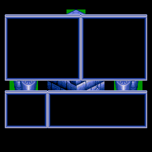
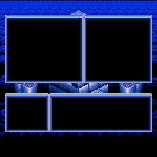
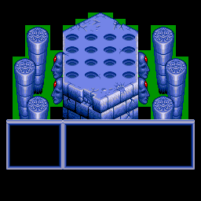
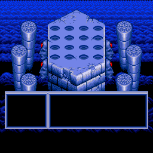
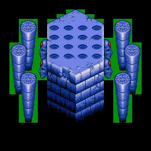
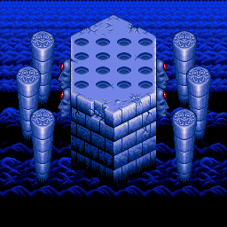
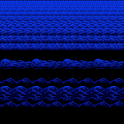
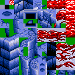
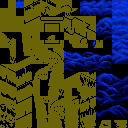
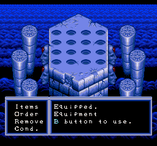

# `dmap_inventory_bg.dmp` — Inventory Background Tilemap Bundle

Full analysis of `extracted/system/inventory/dmap_inventory_bg.dmp`: what it contains, how it is stored, how the engine loads and consumes it, and how to bring it into gaia-mapper.

Evidence levels used below:

- **[ROM]** read from the ROM / extracted asm and decoded with an independent QuintetLZ implementation (exact byte match against the extracted file).
- **[RUNTIME]** verified in Mesen2 on the savestate `rebuilt/states/orig_S09_inventory.mss` (inventory open).
- **[STATIC]** derived by reading code, not observed at runtime.
- **[INFERRED]** best explanation, not proven.

---

## 1. Executive summary

- The file is **not a tileset and not a "tile bundle"**. It is **four complete 32×32 hardware BG tilemap screens** (4 × 2048 bytes = 8192 bytes of raw SNES tilemap words), already in PPU entry format (`vhopppcc cccccccc`). Dumping it into VRAM at word `$0000` makes the PPU able to draw the inventory backdrop immediately, with **no tileset expansion, no map decoding and no scroll-engine streaming**.
- The tile *graphics* those entries point to are **not** in the file. They live in the companion asset `gfx_inventory_bg` (256 tiles, 4bpp, 8192 bytes) loaded to VRAM word `$2000`. Palettes live in `pal_inventory_bg`.
- The four screens are:

| Screen | VRAM word | Contents | Selected by |
|---|---|---|---|
| 0 | `$0000` | **BG1 – Status page** (two stat panels top, two list panels bottom, pedestal art) | `BG1SC=$00`-region, `bg1ConfigMode=0` |
| 1 | `$0400` | **BG1 – Items page** (large item panel, pillars, pedestal, bottom panels) | `bg1ConfigMode=4` → `BG1SC=$04` |
| 2 | `$0800` | **BG1 – Statue-ceremony scene** (scene `$FD`): pedestal, pillars and a diagonal staircase | `BG1SC=$08` (scene `$FD` actor) |
| 3 | `$0C00` | **BG2 – animated water/backdrop**, shared by every page | `BG2SC=$0C` |

- **Callers (2):** scene `$FF` (Inventory) loads it through scene command `$17` `char-tiles`; scene `$FD` (Statue Inventory) reaches the same command through `jump < #11 >`. The "only used once" claim in the brief is true of the *file* (one ROM copy, one command that names it) but it is *executed* from two scenes.
- **Loader:** `SceneCmd_LoadCharTiles` (`scene_script.asm`, ROM `$02:8C30`-`$02:8CE6`, addresses 166960-167142). Stored LZ-compressed (QuintetLZ) in the original ROM (2328 bytes in ROM: 4-byte header + 2-byte size word + 2322-byte stream → 8192 bytes of body); stored **raw** in the rebuilt ROM, which needs `MenuBGLoad.patch.asm` because the vanilla loader can never take its raw path.
- **gaia-mapper:** the mapper today ignores `char-tiles` entirely, so scenes `sy/inventory` and `sy/statue_inventory` render blank. The content *can* be mapped losslessly into the mapper's metatile model (each screen needs only 27–106 distinct aligned 2×2 patterns), but the faithful approach is a **direct VRAM-tilemap layer** (new asset type `chartiles`). §9 gives a phased plan.
- **Documentation errors found** (§10): the VRAM-destination formula for flag bit 7 is documented as `× 4`; the code gives `× $400` words. Fixes must go through `npm run merge` (not edited here).

---

## 2. Identity and location

| Item | Value |
|---|---|
| Extracted file | `extracted/system/inventory/dmap_inventory_bg.dmp` (8196 bytes) |
| `db-us/files.json` | group `system`, folder `inventory`, type **`Meta17`**, compressed |
| `db-us/fileTypes.json` | `Meta17` → extension `.dmp`, null-header handling |
| Original ROM | pointer `$D4:54E1` (ROM offset 1332449 = `0x1454E1`, `files.json` `start 1332449 / end 1334777` = 2328 bytes): 4 B header `00 02 00 02`, 2 B size word `00 20`, 2322 B LZ stream |
| Rebuilt ROM | file `084002` in `artifacts/file-layout.json`; bytes `00 02 00 02 00 E0` + 8192 raw bytes |
| Scene command | `17 80 E1 54 D4` = `char-tiles < #80, @dmap_inventory_bg >` |
| Companion graphics | `gfx_inventory_bg.bin` (8192 B, 256 tiles 4bpp) |
| Companion palette | `pal_inventory_bg.pal` |
| Bank | data in bank `$D4` (file offset `0x14xxxx`); loader code in bank `$02` |

The pointer encoding matters: `LoadScriptPointer` leaves a bank byte ≥ `$70` unchanged, so `$D4` is used as-is (a bank < `$70` would be added to the script-bank base).

---

## 3. Complete file format

### 3.1 Extracted (`.dmp`) layout

```
+0   4 bytes  header   00 W 00 H            (kept raw by gaia-core; here 00 02 00 02)
+4   8192 B   body     W*H screens of 32x32 tilemap words (little-endian u16), 2048 B each
```

`W`/`H` count **256-pixel screens** (one 32×32 tilemap each), not tiles or bytes. The loader computes:

```
cols  = byte0 | byte3        (read as two words, XBA+ORA — see §4)
rows  = byte1 | byte2
units = cols * rows           (Multiply8x8Unsigned)
DMA bytes ($0666) = units << 11   (2048 bytes per screen)
```

With `00 02 00 02` → 2×2 = 4 screens → `$2000` = 8192 bytes. Because 2×2 is symmetric, `b0|b3` (columns) vs `b1|b2` (rows) cannot be told apart from this file alone **[INFERRED]**. No other `Meta17` file exists to disambiguate.

The body is read as one linear block: screen *n* occupies body bytes `n*2048 .. n*2048+2047` and lands at VRAM word `base + n*$400`. There is **no spatial arrangement of the 2×2** — screens are consecutive, not a 64×64 map. Which screen is displayed is chosen by `BG1SC`/`BG2SC` (§6).

### 3.2 Tilemap entry (PPU format)

```
 15  14  13  12 11 10   9 8 7 6 5 4 3 2 1 0
  V   H   P   p  p  p   c c c c c c c c c c
```

| Bits | Meaning |
|---|---|
| 0-9 | tile number (all entries here are `< $100`; BG chr base selects the page) |
| 10-12 | palette (0-7) |
| 13 | priority (`P`) |
| 14 | H-flip |
| 15 | V-flip |

Observed values: BG1 uses palette 2 (`$0800` bit pattern) with priority set only in the bottom panels (rows 19-26); BG2 uses palette 7. Entry `$0000` is tile 0, an empty tile.

### 3.3 Stored (compressed) form — original ROM

```
+0   4 bytes  header        00 02 00 02   (kept raw, not compressed)
+4   u16 LE   size word     decompressed length ($2000)
+6   ...      QuintetLZ stream, 2322 bytes   (file total 2328)
```

The stream is the standard Quintet bit-stream:

- 256-byte dictionary at `$7E:0200`, initialised to `$20`, write position starts `$EF`.
- Control bit `1` → **literal**: next 8 bits are the byte.
- Control bit `0` → **match**: 8-bit dictionary index, then 4-bit length (+2).
- Decompression ends when the output counter (`Y = $78`, loaded from the size word) hits zero.

Statistics from the independent decoder **[ROM]**: 1136 literals + 642 matches = 8192 bytes; the full ROM file is 2328 bytes (28.4 % of 8192). The decoded result matches the extracted file's body byte-for-byte.

Header handling in gaia-core: the 4-byte `00 W 00 H` header is *not* compressed; `ChunkFile.enrichWithRawDataFromDbFile` loads the extracted file as header + body, and the writer recompresses only the body (QuintetLZ `compact`) behind a 2-byte size word.

### 3.4 Stored (raw) form — rebuilt ROM

The rebuilt build sets `config.uncompress`, so the file is stored as:

```
00 02 00 02   header
00 E0         size word  = $E000 = -8192   (negative = "raw")
...8192 bytes raw tilemap data
```

The size word `$E000` is deliberately **negative** so the patched loader can recognise raw data (§4.3).

---

## 4. The loader: `SceneCmd_LoadCharTiles`

Location: `extracted/system/engine/scene_script.asm` (addresses 166960-167142). Operands after opcode `$17`: **flags byte** + **3-byte far pointer**.

Annotated flow (condensed):

1. Read flags → `$066A`.
2. `LoadScriptPointer` → `$3E/$40` points at the file (header first).
3. Read two header words, `XBA` + `ORA` each pair → `cols`, `rows`; `JSR Multiply8x8Unsigned`.
4. Product → `XBA`, then `ASL` ×3 → `$0666` = `units << 11` (DMA size).
5. `LDA [$3E]` reads the size word; `INC $3E; INC $3E` steps the source pointer past it.
6. `BEQ loc_028C81` ← **tests the result of the INC, not the loaded value** (see §4.2).
7. `STA $78` (output length).
8. Decompress with `QuintetLzDecompress` into the WRAM staging buffer **`$7E:7000`**.
9. Compute VRAM destination from flags (§4.1).
10. Program DMA: mode `$01` (two registers, word increment), B-bus `$18` (VMDATAL), source `$7E:7000`, size `$0666`.

### 4.1 Flags byte (`$066A`) — destination in VRAM

| Flags | Destination (VRAM word address) |
|---|---|
| bit 7 set | `(flags & $7F) << 10` → **`× $400` words per unit** |
| bit 7 clear, bit 0 set | `$1000` |
| bit 7 clear, bit 1 set | `$1800` |

This scene uses flags `$80` → `(0 & $7F) << 10 = $0000`. The extracted-asm documentation says "× 4"; the code is `ASL; ASL` on a value that was `XBA`'d into the high byte, i.e. `flags << 8 << 2 = flags << 10`. Treat `× 4` as a doc bug (§10).

Because the destination is `(flags & $7F) * $400`, bit 7 mode addresses VRAM in units of **one hardware tilemap screen** — a strong hint that the opcode was designed for exactly this purpose (preformatted tilemaps), not for character data. `char-tiles` is a misleading name **[INFERRED]**.

### 4.2 Vanilla quirk: the raw path is dead

In the unpatched game the sequence is:

```
LDA [$3E]       ; size word
INC $3E
INC $3E         ; Z flag now reflects $3E+2, not the size word
BEQ loc_028C81  ; never taken: $3E+2 is a ROM offset, never zero
STA $78
```

`BEQ` tests the INC's result, so the "zero size → raw" branch can never fire in vanilla. Compare `SceneCmd_LoadBgTiles`, which does `CMP #$0000` explicitly. This is a latent bug / dead path in the original **[ROM]**; `QuintetLzDecompress` itself has no negative-size path either.

### 4.3 `baserom/scene-load/MenuBGLoad.patch.asm`

The rebuild patch adds `CMP #$0000 / BEQ loc_028C81 / BMI loc_028C81` after the INC pair, and redefines `loc_028C81` as `SEP #$20`. Net effect:

- size word `0` or **negative** → skip decompress; the DMA reads the raw body straight from ROM at `$3E`;
- positive → vanilla LZ path.

The `uncompress` rebuild writes `$E000` for exactly this reason. Without the patch the vanilla loader would treat the rebuilt file's `$E000` as an LZ output length and decode raw tile bytes as a bit stream.

---

## 5. Callers

### 5.1 Scene `$FF` — Inventory (`extracted/tables/scene_meta.asm`)

```
scene_meta_00FF [
  display-mode < #00 >                             ; preset 0
  bitmap  < #00, #20, #00, @gfx_inventory_sprites, #01 >
  palette < #00, #80, #80, @pal_inventory_sprites >
  meta_label_11:
  palette < #00, #70, #10, @pal_inventory_bg >     ; 112 colours -> CGRAM $10-$7F
  bitmap  < #00, #10, #00, @gfx_inventory_bg, #00 >; 8 KB -> VRAM word $2000
  char-tiles < #80, @dmap_inventory_bg >           ; 8 KB -> VRAM word $0000
]
```

Trigger chain:

1. Select pressed → `GlobalInputHandler` → `JSL OpenInventoryScreen` (`inventory_overlay.asm`).
2. `OpenInventoryScreen` saves actor pools/state, sets `BG3SC=$78`, builds the scene with **`SceneScriptNoMusic`** (same dispatcher without music commands), so the script above runs.
3. After the scene script, the overlay overrides PPU state: `BG2SC=$0C`, `BG1SC=$04`, `bg1ConfigMode=$04`, loads scene palettes, and invalidates VRAM cache slots C/D.
4. Main loop (`UpdateFrameDialogue`) mirrors `bg1ConfigMode` → `BG1SC` every frame.
5. On close: restore pools/state, `SceneScriptNoMusic` for the previous scene — that scene's own tilemap/tile loads overwrite VRAM `$0000-$0FFF`. The dmap is not preserved anywhere; it is simply **re-decompressed and re-DMA'd on every inventory open** (no cache).

### 5.2 Scene `$FD` — Statue Inventory

```
scene_meta_00FD [
  display-mode < #00 >
  bgm < ... >
  bitmap  < sprites >
  palette < sprites >
  jump < #11 >            ; -> meta_label_11 of scene $FF
]
```

`jump #11` re-enters scene `$FF`'s script at `meta_label_11`, which runs the BG palette, the BG graphics and **the same `char-tiles` command**. This is how the one ROM file serves two scenes without duplicating assets. The scene is executed through the normal pipeline (`scene_lifecycle.asm` → `JSL SceneScriptMain`) when a boss script queues the map change, with actor `statue_inventory_reward` running in it.

Runtime trace of scene `$FD` was **not** captured (no state available) — its use of screen 2 is **[STATIC]**: the actor writes `BG1SC=$08`, `BG2SC=$0C`.

### 5.3 Other consumers of the loaded VRAM

- `options_menu_core.asm` (rebuild module) reuses the Status background with `bg1ConfigMode=0` rather than loading its own.
- A search of `*.asm`/`*.json` in the baserom finds the file only in `scene_meta.asm` (scene `$FF`), `files.json`, `file-layout.json` and the notes. (`db-jp/groups.json` lists it as `{"type":"meta17","meta":{"param":128}}`; there is no equivalent US `groups.json` entry.)

---

## 6. Consumers: how the PPU and engine use the screens

### 6.1 Register state (inventory open) **[RUNTIME]**

| Register | Value | Meaning |
|---|---|---|
| BGMODE | mode 1, BG3 priority | BG1/BG2 4bpp, BG3 2bpp (text) |
| BG1SC | `$00` or `$04` (per page) | BG1 tilemap word `$0000` / `$0400`, 32×32 |
| BG2SC | `$0C` | BG2 tilemap word `$0C00`, 32×32 |
| BG3SC | `$78` | text layer at `$7800` |
| BG12NBA | `$22` | BG1/BG2 chr base = word `$2000` (byte `$4000`) |
| TM / TS | per scene (inventory: preset 0) | |
| Scene `$FD` | `TM $13`, `TS $11`, `CGWSEL $82`, `CGADSUB $02` | sub-screen colour math on BG2 |

Verified in Mesen2: VRAM `$0000`-`$0FFF` equals the dmap body byte-for-byte, VRAM `$4000`-`$5FFF` (bytes) equals `gfx_inventory_bg`.

### 6.2 VRAM map

```
words  $0000-$03FF  screen 0  BG1 Status
words  $0400-$07FF  screen 1  BG1 Items / Use / Discard / Arrange
words  $0800-$0BFF  screen 2  BG1 statue-ceremony (scene $FD only)
words  $0C00-$0FFF  screen 3  BG2 water backdrop
words  $2000-$2FFF  gfx_inventory_bg tiles (256 x 4bpp)       <- tile numbers in the tilemaps index this
words  $7800        BG3 text tilemap
```

### 6.3 BG1 page selection (`bg1ConfigMode`, `$0AE6`)

| Value | BG1SC | Page | Set by |
|---|---|---|---|
| 0 | `$00` | Status | `inventory_menu.asm` (Status, and its hover preview); `options_menu_core.asm` |
| 4 | `$04` | Items | `inventory_menu.asm` (Use/Discard and their previews) |

Scene `$FD` writes `BG1SC=$08` directly (screen 2), bypassing `bg1ConfigMode`.

### 6.4 Palettes

- `pal_inventory_bg` loads 112 colours to CGRAM index `$10`. The extracted file is 512 bytes but only 224 bytes are real.
- File palette 0 is all zeros (CGRAM palette 1, unused by the tilemaps).
- File palette 1 → CGRAM palette 2 → **BG1** (all BG1 entries use palette 2).
- File palette 6 → CGRAM palette 7 → **BG2**.
- `OpenInventoryScreen` additionally patches CGRAM colour 2 to `$5B1B` after `LoadScenePalettes` (for the overlay's own use; not part of the dmap).

### 6.5 Animation applied to the static screens

The dmap is static data. The motion on screen is produced by other engine pieces **[STATIC]/[INFERRED]**:

- **BG2 water**: per-scanline H-scroll via HDMA. Scroll table type `$03` in `parallax_scroll_table.asm`, 11 auto bands built by `scanline_band_hdma_thinker`. (The `$03` linkage is inferred from the table, not traced at runtime.)
- **Palette cycling**: thinkers at `0CEB30` and `0CEB46` in `scene_thinkers.asm` → `palette_parent_child`, `ambient_palette_cycler`. The meaning of flag `$01` in `palette_parent_child` was not traced.
- **BG3 text**: scrolled by `inventory_bg3_scroll_hdma`.

---

## 7. Content of the four screens

All images are rendered from the real data (`docs/assets/dmap-inventory-bg/`) with the real CGRAM/CHR.

### 7.1 Screen 0 — BG1 Status (`$0000`)



Layout (tile coordinates; 32×32 screen, visible rows 0-27):

| Region | Cols | Rows | Notes |
|---|---|---|---|
| Top-left panel | 1-16 | 3-16 | frame: TL `$25`, top `$26`, TR `$27`, left `$35`, right `$37`, fill `$11`, bottom `$55/$56/$57` |
| Top-right panel | 17-30 | 3-16 | same frame tiles |
| Pedestal peak | 14-17 | 2 | `$72 $73 $73h $72h` |
| Pillar/pedestal row | 2-29 | 17-18 | decor between top and bottom panels |
| Bottom-left panel | 1-9 | 19-26 | **priority bit set** |
| Bottom-right panel | 10-30 | 19-26 | **priority bit set** |

The panel fill `$11` is an opaque black tile; BG3 text is drawn over it. Priority on the bottom panels makes them sit above BG2's wave layer.

Composite with BG2 behind it:



### 7.2 Screen 1 — BG1 Items (`$0400`)



Same bottom panels (rows 19-26, priority) and pedestal as Status; the top is replaced by the large item panel with a 3-wide item grid pattern (`$20-$22 / $30-$32` repeating), pillars (cols 2-7 and 24-29), pedestals and ornament columns. Fewer panels, more art.



### 7.3 Screen 2 — BG1 statue ceremony (`$0800`)



Shares most of its art with the Items page (pedestal, pillars, ornament) and replaces the bottom panels with a **diagonal staircase** (rows 19-25, tiles `$E0`-`$FB`, `$9A`-`$DB`). No panel frame tiles: scene `$FD` shows the statue on a stage, not a menu.



(An earlier draft of this analysis labelled this screen "unreferenced". That was wrong: scene `$FD`'s actor selects it with `BG1SC=$08`.)

### 7.4 Screen 3 — BG2 water (`$0C00`)



A seamless wave pattern using 27 distinct 2×2 patterns, palette 7. The HDMA scroll scrolls it horizontally per band, so only the repeating pattern matters.

### 7.5 Tile art

BG1 tiles with palette 2:



BG2 tiles with palette 7:



### 7.6 Runtime confirmation



Mesen2 screenshot of the inventory open with the Status page; matches the static composite plus BG3 text/sprites on top.

---

## 8. Why it exists (design rationale)

Normal scenes build BG tilemaps from map data: metatile tileset (2 KB) + block tilemap → expanded to hardware tilemaps and streamed as the camera scrolls, with collision layer rebuild at the end of `SceneScriptMain`. For a fixed, non-scrolling menu that is wasted work. `char-tiles` skips all of it: **one decompress (or none) + one 8 KB DMA**. Scene `$FF` has no map, no tileset command and no camera, so the engine's map streaming has nothing to do. Compression saves ROM (2.3 KB vs 8 KB); the DMA takes the same time either way.

Cost: the content is **not editable in map form** — the engine has no representation of it beyond the VRAM dump, which is exactly the gap gaia-mapper needs to fill.

---

## 9. Recommendations: integrating with gaia-mapper

### 9.1 What the mapper does today

- `build-payload.ts` `parseCommand` **skips `char-tiles`**, and `TYPE_EXTENSIONS` has no `.dmp`, so the file is never in the payload.
- Scenes `sy/inventory` (id 255) and `sy/statue_inventory` (id 253) exist in `groups.json`, load their bitmaps and palettes, and show an **empty map** (no tileset/tilemap assets).
- The mapper's model is *metatile tileset + `[W][H]` block tilemap* (`src/core/tileset.ts`, `tilemap.ts`), composited by `compositor.ts` (BG1/BG2, priority, colour math). `VirtualVRAM` (`src/core/vram.ts`) models VRAM as bytes with `BG_BASE = 0x4000`; bytes `0..0x3FFF` (words `$0000-$1FFF`) are unused, i.e. **exactly where the dmap lands**.

### 9.2 Key findings that constrain the design

1. **Not in the preset.** `BG1SC` / `BG2SC` are not carried by the `display-mode` preset; they are set by code in the overlay / actor. The mapper needs a curated override table.
2. **`useOffset` must be false.** Preset 0 has layer-flag bit 7 clear, which `usesEffectTileOffset()` would turn into "+`$100` tile page" for layer 2. The dmap tiles use page 0.
3. **Priority is per 8×8 cell**, not per metatile quad lookup. The compositor must be able to read it from a tilemap entry directly.
4. **Palette loading**: the mapper's `loadPalette` matches scene opcode `$04` and does not emulate any colour-0 mirroring; irrelevant here (file colour 0 is zero).
5. **Scroll/animation not modelled** (BG2 HDMA bands, palette cycling): preview will be static. Acceptable.
6. **Scene `$FD` overrides PPU state** (`TM $13`, `TS $11`, `CGWSEL $82`, `CGADSUB $02`), which differs from the preset. The mapper's `parseDisplayBlend()` already supports sub-screen math; it only needs a per-scene override.

### 9.3 Lossless fit into the metatile model (option A)

Counting **aligned 2×2 patterns** (the mapper's metatile is 16×16 = 2×2 8×8 entries):

| Screen | Distinct aligned 2×2 patterns |
|---|---|
| 0 (BG1 Status) | 51 |
| 1 (BG1 Items) | 106 |
| 2 (BG1 Statue) | 101 |
| 3 (BG2) | 27 |
| BG1 union (0+1+2) | **151** (≤ 256) |

So a single BG1 tileset of 151 metatiles reproduces all three BG1 screens and a 27-metatile tileset reproduces BG2; each screen is then a 1×1-block tilemap (256×256 px). Palette, flip and priority travel in the tileset entries, and block bit 9 stays 0 because every tile index is `< 256`. This would let the existing editors edit the data without new UI.

Limits of option A: edits are bounded by 16×16 granularity unless the tileset editor creates new metatiles (105 spare for BG1); export must **re-expand** to 8×8 entries and rewrite the screens — any pair of tiles that doesn't fit the metatile structure after an edit is still representable (new metatile), but the round trip is lossy in *structure* (metatile dedupe) even if lossless in pixels. It also needs fake scene-level tilesets/tilemaps (new files) that the game never reads.

### 9.4 Recommended: direct VRAM-tilemap layer (option B)

Treat the dmap as what it is — raw hardware tilemaps in VRAM:

**Phase 1 — read-only, faithful**

1. `build-payload.ts`: parse `char-tiles < flags, @file >` into a new asset type `chartiles` with meta `{ flags, vramWord }` (computed as in §4.1); include `Meta17` / `.dmp` in `TYPE_EXTENSIONS`; bump `PAYLOAD_VERSION`.
2. `manifest.ts` `AssetEntry.type` union: add `'chartiles'`.
3. `scene-loader.ts`: `executeAssetCommand` for `chartiles` → copy `file.subarray(4)` (8192 bytes) into `VirtualVRAM` at byte `vramWord * 2`. Also record the header W/H.
4. New "direct plane": a layer descriptor `{ vramWord: screenBase, pageBase: 0x4000, palette from entries }` that renders a 32×32 screen straight from VRAM using the existing tile decoder (`getTileAddress(n, false)` with the BG chr base). Extend the compositor's layer input so each plane exposes `priorityAt(x, y)` rather than deriving it only from the metatile entry.
5. Per-scene overrides (new `scene-overrides.json` in the mapper, referenced from this doc): for `sy/inventory` provide **views** *Status* (`BG1SC=$00`, `BG2SC=$0C`) and *Items* (`BG1SC=$04`, `BG2SC=$0C`); for `sy/statue_inventory` provide the view `BG1SC=$08`, `BG2SC=$0C` with the `TM/TS/CGWSEL/CGADSUB` override from §6.1. All with `useOffset=false`. Expose them via the existing layer/asset dropdown (a view selector in the toolbar).

**Phase 2 — editing**

6. 8×8 entry editor: click a cell → place `{tile, palette, H, V, priority}` from the existing GFX viewer + palette viewer + properties panel (they already hold `selectedGfxTile`, `selectedPalette`, flips, priority). Reuse the stamp-batch undo with `TileChange` records at 8×8 granularity.
7. `exportAssetData` for `chartiles`: write the 4-byte header (`00 W 00 H`, recomputed from the screen count) + body, **uncompressed**. gaia-core's rebuild recompresses (original) or leaves raw (uncompress profile). Add a round-trip test: import → export must be byte-identical for the unmodified file.

**Phase 3 (optional)**

8. Option A bridge: import/export the screens as metatile tileset+tilemap (§9.3) for users who prefer the 16×16 workflow.
9. Model BG2 HDMA band scrolling and palette cycling as a cosmetic preview only.

### 9.5 Capacity rules for edits (important)

| Limit | Value | Source |
|---|---|---|
| VRAM space for the bundle | `$0000-$1FFF` words = up to 8 screens (16 KB) before hitting BG1/BG2 chr at `$2000` (but see WRAM limit) | PPU layout §6.2 |
| WRAM staging | decompress target `$7E:7000`; 8 KB uses `$7000-$8FFF`. The free span above that was **not** verified, so treat 6 screens (to `$9FFF`) as the safe maximum until checked | `SceneCmd_LoadCharTiles` **[STATIC]** |
| Header product | `cols*rows << 11` must fit 16 bits → ≤ 31 screens | `$0666` is 16-bit |
| Size word | positive = LZ (vanilla/original), `0`/negative = raw (needs `MenuBGLoad`) | §4 |
| Dictionary | `$7E:0200-$02FF` is clobbered by LZ decompress | `QuintetLzDecompress.asm` |

Growing past 4 screens is **untested**: verify the WRAM span above `$9000` is free during the inventory scene, and that the BG chr (`$2000+`) is not overwritten, before relying on it.

### 9.6 Priority / effort

| # | Item | Value | Effort |
|---|---|---|---|
| 1 | `char-tiles` → payload `chartiles` + VRAM load | enables everything | S |
| 2 | Direct plane + per-cell priority in compositor | faithful preview | M |
| 3 | Scene override table (BG1SC/BG2SC/PPU) | correct pages | S |
| 4 | Export `.dmp` + round-trip test | editable | S-M |
| 5 | 8×8 cell editor | editing UI | M |
| 6 | Metatile bridge (option A) | optional | M |
| 7 | HDMA/palette-cycle preview | cosmetic | L |

---

## 10. Documentation errors found (to fix via `npm run merge`)

Do not edit by hand; use `npm run merge -- <spec.json>` (dry-run first, then `npm run extract:lt`).

| Where | Current claim | Correct |
|---|---|---|
| `extracted/tables/scene_meta.asm` line 27 (opcode `$17` note) | flag bit 7 destination = `(flags & $7F) × 4` | `(flags & $7F) << 10` words (`× $400`), i.e. one tilemap screen per unit |
| `scene_script.asm` `SceneCmd_LoadCharTiles` block note | same `× 4` | same correction; also note that the opcode loads **preformatted tilemaps**, not character data |
| `SceneCmd_LoadCharTiles` block note | does not mention the dead `BEQ` | add: `BEQ` tests the INC result, so the vanilla raw path never fires; `MenuBGLoad.patch.asm` fixes it for the rebuild |
| `scene_meta.asm` line 27 ("One use: scene $FF") and the scene `$FF` part note (line 3052 / `notes/partNotes/bank0D.json`: "the only char-tiles command of the file") | one use, scene `$FF` | one *command*, but executed from scene `$FD` too via `jump #11` |

---

## 11. Risks and open items

- **BG2 H-scroll** mechanism is inferred from `parallax_scroll_table` type `$03`; not traced at runtime.
- **Palette cycling**: flag `$01` of `palette_parent_child` untraced.
- **Scene `$FD`** load of the dmap and screen 2 are statically derived; no scene `$FD` runtime state was captured.
- **Header W/H ambiguity**: 2×2 is symmetric, so `b0|b3` vs `b1|b2` cannot be separated from this file.
- **`char-tiles` name** is misleading (content is tilemaps). Renaming the opcode in docs/tools is a separate change.
- The mapper recommendations are untested design; no mapper code was changed.

## 12. Appendix: reference points

| Topic | File |
|---|---|
| Loader | `extracted/system/engine/scene_script.asm` (`SceneCmd_LoadCharTiles`) |
| Raw-path patch | `baserom/scene-load/MenuBGLoad.patch.asm` |
| LZ routine | `extracted/system/engine/QuintetLzDecompress.asm` |
| Multiply | `extracted/system/engine/hardware_math.asm` (`Multiply8x8Unsigned`) |
| Scenes | `extracted/tables/scene_meta.asm` (`$FF`, `$FD`) |
| Overlay | `extracted/system/inventory/inventory_overlay.asm`, `inventory_menu.asm` |
| Statue scene | `extracted/system/statue_inventory/statue_inventory_reward.asm` |
| Display preset 0 | `extracted/tables/display_preset_table.asm` |
| Animation | `parallax_scroll_table.asm`, `scanline_band_hdma_thinker.asm`, `palette_parent_child.asm`, `inventory_bg3_scroll_hdma.asm` |
| gaia-core | `src/rom/rebuild/processor.ts`, `writer.ts`, `src/compression/QuintetLZ.ts`, `src/types/files.ts` |
| gaia-mapper | `scripts/build-payload.ts`, `src/data/scene-loader.ts`, `src/core/vram.ts`, `src/core/compositor.ts`, `src/core/display.ts` |
