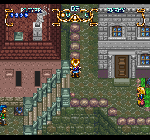
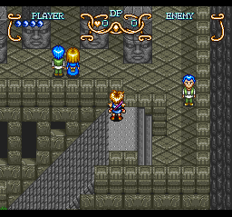
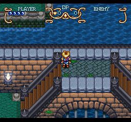
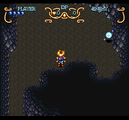
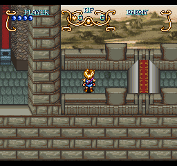

# B1 collision census: what the collision layer holds in every scene, and what `$06` / `$09` are

ROM: O (original US ROM, vanilla)

| Tag | File | Size | SHA-1 | CRC-32 | Mode source |
|-----|------|-----:|-------|--------|-------------|
| O | `rebuilt/Illusion of Gaia.smc` | 2,097,152 | `38de0c84dd2bc3bdfc0a3d7ab0220c79b70887c3` | `1c3848c0` | vanilla ROM, read with `load_rom` (`get_rom_info`: HiROM, FastROM, title `ILLUSION OF GAIA USA`, checksum complement valid) |

`artifacts/crc.json` today = `{checksum 222977929, crc -524441819, totalSize 3062193, mode "tagged", sha1 2e4a88a3de6dd4bdefc23c0dd626b953c18fe808}`. That describes the **R** build, not this run; O is the vanilla file, so no build mode applies and the `GATE:` line of ACTION_PLAN is not needed. Two facts for the apply pass: `crc.json` says `tagged` but `extracted/` carries no `; {n}` tags right now (checked: `rg "; \{\d+\}" extracted/system/engine/tile_collision_physics.asm` finds nothing), so run `npm run extract:lt` before any merge that uses comment addresses; and the spec below uses only `expectOld`/`find` guards, so its dry-run does not need the tags.

Server: Mesen2 MCP server 0.5.2 (`get_server_status`), not 0.5.0 as the step text says. All tools used here (`load_rom`, `pause`, `load_state_file`, `run_script`, `read_memory`, `write_memory`, `advance_frame`, `take_screenshot`, `save_state_file`, `set_breakpoints` count mode) exist and behave as documented; the state sidecars of S13/S14 say `serverVersion 0.5.2`.

State: `rebuilt/states/orig_S01r_south-cape-ready.mss` (valid: yes. H1 test on this run: load, 120 frames, `cpu.k = $82`, `cpu.sp = $01F9`; ROM SHA-1 equal to the index row: yes, `romCheck match`). New states of this session: `orig_S13_slope-field.mss`, `orig_S14_ramp-scene.mss` (see "S13 and S14"; each passed the H1 test twice).

Static prelude:
- `tile_collision_physics.asm:32`: the map is stored as 256-byte pages of 16 x 16 cells; index = `(((ty>>4)*stride + (tx>>4)) << 8) | ((ty&15)<<4) | (tx&15)`, `stride = $0693` (high byte of `mapBoundsX` `$0692`); `$0697` is the high byte of `mapBoundsY` `$0696`. Same formula as plan section 2. No disagreement. Largest page count seen: 32 (8 KB), so the layer never reaches past `$7F:DFFF`.
- `scene_script.asm:2043` `BuildMetatileFlagTable` (note at `scene_script.asm:2041`): bit 9 of each of the four tilemap words of a 2 x 2 metatile goes into one nibble of a flag table (first tile in bit 0), and the word is rewritten with bit 9 cleared (`AND #$FDFF`). `RebuildCollisionLayer` (`scene_script.asm:2101`) calls `FillCollisionFromLayer0` (`:2117`: collision[i] = flagTable[mapData[i]]) and `OverlayCollisionFromLayer1` (`:2147`: nonzero layer-1 flags overlay it when `$06EF` bit 0 is set). Scene `$F7` skips the rebuild.
- So the low nibble is a **mask of four 8 x 8 quadrants** of the 16 x 16 cell (bit 0 = first tile = top-left, then top-right, bottom-left, bottom-right in the tilemap order: static reading). `$06` = bits 1 and 2, `$09` = bits 0 and 3, `$05` = bits 0 and 2, `$0A` = bits 1 and 3, `$0E` = bits 1, 2, 3, `$04` = bit 2 only, `$0F` = all four. The high nibble is the dynamic actor mark (only `$F0` was ever seen).
- `CheckActorOnSpecialTile` (`tile_collision_physics.asm:992`, notes at `:55-57`) is the actor-only pattern test (not called by the player: see B2). It is not exercised here.

Script (verbatim; `kit/lib/gaia_kit.lua`, lines 63-169; call lines: census `gaia.coll.censusRun({6, 9, 4, 14}, 10, 6)`, flow check `gaia.coll.flowRun({6, 9}, 6)`; both through `run_script` with `includes ["gaia_kit"]`, `frames 20`, turbo, one script per scene):

```lua
-- B1 census of the whole collision layer of the loaded scene ------------------------------------
-- Walks every cell of the page grid (stride = $0693 pages across, $0697 pages down; one page = 16 x 16 cells) with
-- gaia.coll.get. Returns one row (a table for kit.finish): bounds words, strides, per-nibble histograms (index = value + 1),
-- the first `maxFirst` cells (tx, ty in row-major order) of every type in `firsts` (low nibble), map-data-size words.
-- A page grid above 64 pages would run past $7F:FFFF (the layer starts at $7F:C000): it is clamped and flagged.
function gaia.coll.census(firsts, maxFirst)
  firsts, maxFirst = firsts or { 6, 9 }, maxFirst or 10
  local A = gaia.addr
  local stride, rows = kit.r8(A.collStride), kit.r8(0x0697)
  local clamped = false
  if stride * rows > 64 then rows = math.max(1, 64 // math.max(stride, 1)); clamped = true end
  local w, h = stride * 16, rows * 16
  local low, hi = {}, {}
  for i = 1, 16 do low[i], hi[i] = 0, 0 end
  local want, first = {}, {}
  for _, t in ipairs(firsts) do want[t] = true; first[string.format("%02X", t)] = {} end
  for ty = 0, h - 1 do
    for tx = 0, w - 1 do
      local v = gaia.coll.get(tx, ty)
      local lo, hn = v & 15, v >> 4
      low[lo + 1] = low[lo + 1] + 1
      hi[hn + 1] = hi[hn + 1] + 1
      if want[lo] then
        local f = first[string.format("%02X", lo)]
        if #f < maxFirst then f[#f + 1] = { tx, ty, v } end
      end
    end
  end
  return {
    scene = kit.r16(A.sceneCur), boundsX = kit.r16(A.boundsX), boundsY = kit.r16(A.boundsY),
    stride = stride, rows = rows, cellsW = w, cellsH = h, clamped = clamped,
    stride1 = kit.r8(0x0695), rows1 = kit.r8(0x0699), boundsX1 = kit.r16(0x0694), boundsY1 = kit.r16(0x0698),
    size069A = kit.r16(0x069A), size069C = kit.r16(0x069C), scrollMode06EF = kit.r16(0x06EF),
    low = low, hi = hi, first = first,
    playerX = kit.r16(A.playerX), playerY = kit.r16(A.playerY), mask = kit.r16(A.inputMask), banner = kit.r8(A.bannerFlag),
  }
end

-- OQ-3 data-flow check (scene_script BuildMetatileFlagTable + FillCollisionFromLayer0): the collision byte of cell i is
-- flagTable[mapData[i]] with the flag table in bank $7F (pointer $06AA) and the map data (one metatile index byte per cell,
-- bank $7E, start = word $069E). Counts the cells whose low nibble differs from the flag table byte (a high nibble is a
-- dynamic mark and is ignored), the words of the 256 metatile definitions (bank $7E, pointer $06AE, 4 words each) that still
-- have bit 9 set (the routine clears it), and returns the 4 words of the first metatile whose flag is each of `want`.
function gaia.coll.verifyFlow(want)
  want = want or { 6, 9 }
  local baseA, ftab, defp = kit.r16(0x069E), kit.r16(0x06AA), kit.r16(0x06AE)
  local n = kit.r8(0x0693) * kit.r8(0x0697) * 256
  local mism, firstm, used = 0, {}, {}
  for m = 0, 255 do used[m] = 0 end
  for i = 0, n - 1 do
    local m = kit.r8(baseA + i)
    used[m] = used[m] + 1
    local f = kit.r8(0x10000 + ftab + m) & 15
    local c = kit.r8(0x1C000 + i) & 15
    if c ~= f then
      mism = mism + 1
      if #firstm < 5 then firstm[#firstm + 1] = { i, m, c, f } end
    end
  end
  local bit9, merge, hist = 0, {}, {}
  for i = 1, 16 do hist[i] = 0 end
  local meta = {}
  for m = 0, 255 do
    local f = kit.r8(0x10000 + ftab + m) & 15
    if used[m] > 0 then hist[f + 1] = hist[f + 1] + used[m] end
    local words = {}
    for w = 0, 3 do
      local v = kit.r16(defp + m * 8 + w * 2)
      words[#words + 1] = v
      if used[m] > 0 and (v & 0x0200) ~= 0 then bit9 = bit9 + 1 end
    end
    for _, t in ipairs(want) do
      if f == t and used[m] > 0 and not meta[string.format("%02X", t)] then
        meta[string.format("%02X", t)] = { metatile = m, cellsUsingIt = used[m], words = words }
      end
    end
  end
  return { baseA = baseA, flagTable = ftab, defTable = defp, cells = n, mismatches = mism, firstMismatches = firstm,
           usedMetatileWordsWithBit9 = bit9, cellsPerFlagValue = hist, firstMetatileOfType = meta,
           scrollMode06EF = kit.r16(0x06EF), mergeWord06A2 = kit.r16(0x06A2) }
end

-- Runs gaia.coll.census at the `after`-th frame end (default 3) with a positive control: the number of writes of the
-- frame counter $36 seen up to then (the NMI writes it once per frame). Ends the run with the row (kit.finish).
function gaia.coll.censusRun(firsts, maxFirst, after)
  local ctl, f = 0, 0
  emu.addMemoryCallback(function(a, v)
    if (a & 0xFFFF) == 0x36 then ctl = ctl + 1 end
  end, emu.callbackType.write, 0x36, 0x36, emu.cpuType.snes, WR)
  kit.onFrame(function()
    f = f + 1
    if f < (after or 3) then return end
    local row = gaia.coll.census(firsts, maxFirst)
    row.control36Writes, row.frames = ctl, f
    kit.finish(row)
  end)
end

-- Same as censusRun for gaia.coll.verifyFlow (OQ-3).
function gaia.coll.flowRun(want, after)
  local ctl, f = 0, 0
  emu.addMemoryCallback(function(a, v)
    if (a & 0xFFFF) == 0x36 then ctl = ctl + 1 end
  end, emu.callbackType.write, 0x36, 0x36, emu.cpuType.snes, WR)
  kit.onFrame(function()
    f = f + 1
    if f < (after or 3) then return end
    local row = gaia.coll.verifyFlow(want)
    row.scene, row.control36Writes, row.frames = kit.r16(gaia.addr.sceneCur), ctl, f
    kit.finish(row)
  end)
end
```

Python drivers (all under `harness/`, none edits notes or names): `scenario_b1_census.py` (loads S01r, quick warp: write `$0642 = scene`, advance the full 300 frames, check `$0644 == scene` and `$0642 == 0`, up to 12 A-pulse tries to dismiss the banner `$00B4`, 30 frames; scene `$0A` needs event flag 63 = byte `$0A07` bit 7, written before the warp; one `run_script` per scene; batches of about 40), `b1_report.py` (merges the batches into `raw/B1_census.md`), `scenario_b1_shots.py` (screenshots), `b1_adjacency.py` (neighbour counts), `b1_states.py` (S13/S14), `b1_window.py` (prints a window of the layer).

Positive control:
- Census: the write counter of `$36` read **5** in each of the 6-frame runs of all 223 valid rows (expected 5; a row with fewer than 4 is flagged). Flow runs: 5 in all 223.
- Native H4 control on S01r (`set_breakpoints` count mode, 120 frames): write `$36` = 119 hits, exec of the NMI handler at ROM offset 33528 (`$80:82F8`, `NmiHandler` from `artifacts/labels/iog-original.mlb`) = 119 hits, exec at 38524 (a control offset that is not an NMI entry) = 0 hits. Both controls fire; the zero is a real zero.
- Data-flow control: the flow check reproduces South Cape exactly (3072 of 3072 cells equal, 0 mismatches), the same scene as the reference row (`$06` 16, `$09` 18, stride 3).

Coverage: all 228 ids of `artifacts/scenes.json` loaded by quick warp (Will, no other flag than 63 for `$0A`), 6 frames per row, one load per scene; `$06` / `$09` screenshots for 147 scenes, 30 frames after the player is written next to the cell. **223 rows are valid.** The other five are not map scenes or did not rebuild the layer: `$F7` (credits; `RebuildCollisionLayer` is skipped, bytes are leftovers), `$FB`, `$FD`, `$FF` (the quick warp loads no map, the layer still holds South Cape: bounds and histogram equal row `$01`) and `$FE` (world map; the positive control did not fire because `$36` is not written there, so the row is INCONCLUSIVE). Every absence claim below ("only in N scenes") means "among the 223 valid scenes, whole layer read, 538,112 cells". Single layer read per scene: dynamic marks that actors add later in a scene are not tracked (the high nibble was `$F` in 773 cells of 135 scenes at frame 6, nothing else).

Observations (full table: `raw/B1_census.md`; raw JSON: `raw/B1_census_O_*.json`, `raw/B1_flow_O_*.json`, `raw/B1_adjacency_O.json`, `raw/B1_shots_O_001-240.json`; run logs `raw/B1_run_log_20261030.txt`, `raw/B1_flow_run_log_20261030.txt`, `raw/B1_shots_run_log_20261030.txt`):

```
 1 cur=  1 ok=True    768x 1024 stride=3 06=  16 09=  18 05=   3 0A=   0 0E=   0 ctl=5     (reference row, South Cape)
10 cur= 10 ok=True   1024x 1024 stride=4 06=  37 09=  36 05=   0 0A=   0 0E=   0 ctl=5     (scene $0A, flag 63 written)
 1 flow:  baseA=40960 ($A000) flagTable=0 ($7F:0000) defTable=8192 ($2000) cells=3072 mismatches=0 bit9words=0 ctl=5   (same three pointers in all 223 valid rows)
Cell types over the 223 valid scenes (538,112 cells): 0:172,620 1:2,094 2:328 3:123 4:169 5:335 6:3,347 7:893 8:1,633 9:3,238 A:311 B:0 C:34 D:1 E:87,605 F:265,381
Scenes holding each type:                             1:88 2:23 3:13 4:10 5:28 6:145 7:12 8:59 9:145 A:27 B:0 C:7 D:1 E:106 F:197
South Cape first $06 cells (tx,ty): (28,32) (27,33) (26,34) (28,34) (25,35) (27,35) (24,36) (26,36) (25,37) (24,38)   <- steps of (-1,+1): a "/" line
South Cape first $09 cells (tx,ty): (22,15) (26,18) (27,19) (26,20) (28,20) (27,21) (29,21) (28,22) (29,23) (29,34)   <- steps of (+1,+1): a "\" line
Aqueduct $0D first $06: (12,18) (11,19) (10,20) (12,20) (9,21) (11,21) (8,22) (10,22) (9,23) (8,24)   first $09: (19,18) (20,19) (19,20) (21,20) (20,21) (22,21) (21,22) (23,22) (22,23) (23,24)
$05 cells 335: south neighbour $06 220, $05 112, other 3; north: $05 112, $0E 111, $06 107, $0F 4, $09 1
$0A cells 311: south neighbour $09 238, $0A 71, other 2; north: $09 140, $0E 99, $0A 71, $05 1
$06 cells 1,046 (inside the 28 scenes that hold $05 or $0A; 977 $09 cells): north $00 361, $0F 300, $05 220, $0E 112, $09 49; south $0F 338, $00 332, $0E 221, $05 107, $09 45
Scene $85 gate towers, columns 62-64, rows 9-12:  06 0E 09 / 05 0E 0A / 05 0E 0A / 06 0F 09  (the other three towers have the same columns of 06 0E 09 on the bottom row: columns 80-82, 98-100, 104-106)
Scene $85 ramp actors (scene_actors.asm, scene_85_actors): ramp_west at tile x $3E $50 $62 $68, ramp_east at $40 $52 $64 $6A, all at tile y $0B
Scene $15 rows 20-22 (cols 65-70):  06 05 05 05 06 / 06 05 05 05 06 / 06 05 05 05 06, each row one column further west (rows 16-19 are narrower: 06 at the east end, then 05 cells)
$069A equals (boundsX/16)*(boundsY/16) in 228 of 228 rows; bounds are multiples of 256 in 228 of 228; non power of two: boundsX 43 scenes (768 1280 1536), boundsY 58 (768 1280 1536 1792 2304), either 83 scenes
Flow check, 223 valid rows: 214 single layer, 9 dual layer ($06EF bit 0: $0B $30 $5F $60 $61 $62 $64 $65 $67); metatile words in use with bit 9 still set: 0 of all; 209 of 214 single-layer scenes have 0 mismatches over 510,976 cells
Flow check mismatches in single-layer scenes: $55 20 cells (flag 14, collision 0), $6B 4 (flag 6/9, collision 15), $78 36 (flag 15, collision 0), $D6 24 (flag 15, collision 0), $D7 2,208 (flag 0, collision 15)
Flow check mismatches in dual-layer scenes: $0B 6, $5F 2,054, $60 1,594, $61 1,844, $62 2,612, $64 533, $65 201, $67 32, $30 0
Screenshots: 290 taken (294 rows, 4 scenes lack one of the two types: $AC and $F0 have no $06, $B3 and $C3 have no $09); 276 are valid (scene unchanged, player stayed on the written position); 14 are not (see B1_census.md): the player was moved or the scene changed within the 30 frames ($2C, $40 x2, $6E x2, $6F, $70 x2, $71 x2, $73 x2, $74 x2)
```

Screenshot evidence (embedded):

South Cape `$06` at (28,32), player at (29,32): the cell is on the "/" edge of the stair rail.



Itory Village `$06` at (70,16), player at (71,16): the "/" side of the stair band going down to the lower left.



Aqueduct `$0D` `$06` at (12,18): the left rail runs from upper right to lower left.



Cave `$3D` `$06` at (8,13): the rounded corner of the cave wall.



Great Wall `$85` after the S14 settle (gate tower with the red carpet is the structure with `06 0E 09` over `05 0E 0A`):



Scenes with `$06` or `$09` (147 valid scenes; 145 carry each, `$AC` and `$F0` only `$09`, `$B3` and `$C3` only `$06`; 71 scenes have equal counts of the two; 3,347 `$06` cells, 3,238 `$09` cells): `01 02 0A 0D 0E 0F 12 15 19 1A 1B 1C 1D 1E 22 23 2B 2C 2D 2E 30 32 33 34 35 36 37 38 39 3A 3B 3C 3D 3E 3F 40 41 42 44 45 46 47 49 4D 4F 51 53 56 5A 5B 5C 5D 5E 5F 60 61 62 63 65 66 67 68 69 6A 6B 6C 6D 6E 6F 70 71 72 73 74 75 79 7A 7B 7C 7D 7E 82 83 85 86 87 88 8B 91 92 93 94 95 96 97 98 99 9A 9B 9C 9D A0 A1 A2 A3 A4 A5 A6 A7 A8 A9 AC AD AE B0 B1 B3 B6 BA C3 C4 C5 C6 C7 C8 C9 CC CD CE CF D0 D1 D2 D3 D4 D5 D6 D7 D8 D9 DA DB DD E6 E8 E9 F0`. Per scene counts and the first ten cells of each type: `raw/B1_census.md`, section "Scenes with `$06` or `$09`".

What the shapes are (from the dumps and the screenshots; no behaviour tested here): `$06` and `$09` appear as runs that step one cell per row (`$06` toward the lower left, `$09` toward the lower right, as in South Cape and the aqueduct), as the two edges of a stair band (Itory `$15`, rows 20-22: `$06`, three `$05`, `$06`), as the chamfered corners of the Great Wall gate towers (`06 0E 09` at the top, `06 0F 09` at the bottom) and as rounded cave-wall corners (`$3D`). The ramp gate towers of `$85` coincide with the ramp actors: the four ramp_west / ramp_east pairs sit at tile x 62/64, 80/82, 98/100 and 104/106, the same columns as the four towers.

S13 and S14 (states created, `rebuilt/states/`, rows in `states-index.md`):
- **S13 `orig_S13_slope-field.mss`**: scene `$15` Itory Village (69 `$05` + 24 `$0A` cells, the largest `$05`/`$0A` field in the game; 40 `$06`, 24 `$09`). Player (1144, 288) = cell (71,17), the free landing at the top of the stair band that runs down to the lower left (rows 16-22). Form Will, no flags, banner dismissed, camera settled (30 frames). H1 test twice: `k $82`, `sp $01F9`, scene `$15`, actor unchanged.
- **S14 `orig_S14_ramp-scene.mss`**: scene `$85` Great Wall (wall_rampway: 8 `$05`, 16 `$0A`, 4 ramp_west and 4 ramp_east actors, type 3). Player (936, 192) = cell (58,11), 4 cells west of the first ramp_west (tile 62,11), so a `right` input runs into the ramp window. Camera: ScrollCameraVertical does not follow X, a teleported player is caught up slowly by the horizontal camera, so the state was saved after 300 frames (at 30 frames the player was off screen). H1 test twice: `k $82`, `sp $01F9`, scene `$85`.
- B4 note: the Itory ramp pair (`$15`, tile (48,25) ramp_east and (15,37) ramp_west, type 1) is in S13's scene; S14's four pairs are the type-3 pairs.

Verdicts (a verdict with two halves gets one row per half):

| ID | Verdict (plain sentence) | Grade | Note shipped today (file:line) | Action |
|----|--------------------------|-------|--------------------------------|--------|
| OQ-3 (data flow) | The low nibble of every collision cell equals the flag-table nibble of the metatile at that map index: 209 of the 214 single-layer scenes match in all 510,976 cells compared (0 mismatches); no metatile word in use keeps bit 9 in the definition table (0 of all 223 scenes), so the routine lifts bit 9 out and clears it, as described. | VERIFIED-RUNTIME | `scene_script.asm:2041` (flag byte description) | none (the note is right; "measured" may be added) |
| OQ-3 (meaning) | Bit 9 of a tile word is a per-8 x 8-tile collision flag: the four flags of a 16 x 16 cell are the low nibble, so a cell is a quadrant mask (`$0F` = all four, 265,381 cells; `$0E` = three; `$06` / `$09` = the two diagonal pairs). The diagonal meaning of `$06` / `$09` is confirmed by the geometry of their cells and by the screenshots (a `$06` run steps toward the lower left, a `$09` run toward the lower right). | VERIFIED-RUNTIME | `scene_script.asm:2041` (silent on the meaning) | merge: `B1_notes.json` entries carry the meaning; no edit needed in this note |
| OQ-3 (bit order of the single quadrants) | Bit 0 = first tile of the metatile (top-left), then top-right, bottom-left, bottom-right (so `$05` = left half, `$0A` = right half, `$03` = top half, `$0C` = bottom half) rests on the static reading of `BuildMetatileFlagTable`; the diagonal pairs fix only that bits 1 and 2 form one diagonal and bits 0 and 3 the other. | VERIFIED-STATIC | `scene_script.asm:2041` ("first tile in bit 0") | none; B2 quadrant sweep can confirm |
| OQ-3 (what changes the layer after the build) | In 5 single-layer scenes the layer differs from the flag table after the load: `$55` viper_lair 20 cells (table `$0E`, layer `$00`), `$6B` angel_village 4 (table `$06` / `$09`, layer `$0F`), `$78` watermia 36 and `$D6` pyramid_vader_a 24 (table `$0F`, layer `$00`) and `$D7` pyramid_vader_b 2,208 cells (table `$00`, layer `$0F`). Which writer does it (scene script, actor, event block) was not traced. In the dual-layer scenes the mismatch is the layer-1 overlay as described (8 of 9 scenes differ, `$30` does not); the overlay rule itself was not checked cell by cell. | INCONCLUSIVE | `scene_script.asm` (`OverlayCollisionFromLayer1` note) | new question (below) |
| OQ-16 (meaning) | `$06` and `$09` are the two diagonal-edge cells of the quadrant mask: `$06` = top-right + bottom-left quadrants, `$09` = top-left + bottom-right. They form diagonal runs (South Cape, aqueduct), stair-band edges (Itory), chamfered tower corners (Great Wall) and rounded cave corners (`$3D`), in 145 scenes each; 71 scenes hold equal counts. | VERIFIED-RUNTIME | `tile_collision_physics.asm:57` "Collision types $06 and $09 are not traced to a purpose." | merge: replace sentence (`B1_notes.json`) |
| OQ-16 (docs table) | The table of `docs/wram-memory-map.md` calls `$06` "Wall (south-facing)" ("Block south, allow east slide") and `$09` "Wall (north-facing)": both are diagonal edges, neither is a south- or north-facing wall. `$0F` is the fully flagged cell (265,381 cells in 197 scenes, the most common value of all), not a value that only out-of-bounds probes return; the low nibble of the layer is a quadrant mask. | CONTRADICTED | `docs/wram-memory-map.md:629` and `:632` (rows `$06`, `$09`), `:636` (`$0F` row) | docs correction text below (docs are outside this step) |
| OQ-16 (what the actor pattern test does) | The special-tile patterns (`$06` at (x,y) and (x+1,y+1), `$00` with `$09` right and below) are the actor test of `CheckActorOnSpecialTile`; no actor was run on them. | INCONCLUSIVE | `tile_collision_physics.asm:55-57` | B2 (actor with flag `$0008` on a painted pattern) |
| OQ-41 (`$069A`) | `$069A` is the number of map data bytes: it equals (boundsX / 16) x (boundsY / 16) = stride x rows x 256 in all 228 rows, and `$069C` equals `stride1 x rows1 x 256` in all 228 (layer 1; 77 rows hold the same value as `$069A`). The wrap modulus reading is right. | VERIFIED-RUNTIME | `camera_tilemap.asm:394` ("inferred from the arithmetic") and `:433` ("wrap modulus, inferred") | merge: replace both (`B1_notes.json`) |
| OQ-41 (power of two) | The bounds are not always powers of two: 43 scenes have a non-power-of-two X bound (768, 1280, 1536) and 58 a Y bound (768, 1280, 1536, 1792, 2304); 83 of 223 scenes have at least one (for example Itory Village 1280 x 1024, stride 5). All bounds are multiples of 256 and all page counts are at most 32. The shipped warning that `AND bounds-1` is exact only for powers of two therefore applies to 83 scenes. | VERIFIED-RUNTIME | `camera_tilemap.asm:57` and `:74` ("exact only for power-of-two bounds") | none (the note is right) |
| OQ-41 (the `AND #$0100` column wrap) | Not run: whether the odd wrap shows on screen for stride 5 and 7 scenes (X bound `$0500` / `$0700`) was not tested. | INCONCLUSIVE | none | new question (below) |
| OQ-I029-5 (meaning) | Same verdict as OQ-16 (meaning): `$06` = top-right + bottom-left, `$09` = top-left + bottom-right quadrants. The west and east files' "wall-like" handlers are therefore diagonal-edge handlers; "north" and "south" are handler names. | VERIFIED-RUNTIME | `player_move_west.asm:15` ("meaning is undecoded"), `player_move_east.asm:5`, `player_move_ns.asm:5`, `player_move_south.asm:10`, `tile_collision.asm:7` ("meaning not decoded"), comments at `player_move_south.asm` for `185211` and `185235` | merge: replace the phrases (`B1_notes.json`) |
| OQ-I029-5 (why the two files use opposite north / south words) | Not tested here; the push directions of a single painted `$06` / `$09` tile are already measured by B2 (`$06` moves the player 16 px north, `$09` 16 px south). | INCONCLUSIVE | `player_move_west.asm:15` | none from B1; handler-level reading stays with B2 / B3 |
| OQ-I030-3 (which maps) | On real maps `$06` / `$09` sit on diagonal stair edges, rails, chamfered tower corners and cave corners, not on door frames, ledges or bridge edges: 147 scenes (list above; examples: South Cape, Edward's castle `$0A`, aqueduct `$0D`-`$12`, Itory `$15`, Great Wall `$85`, mine `$3D`, pyramid `$CC`-`$DB`). | VERIFIED-RUNTIME | `tile_collision_physics.asm:57` | merge (same entry as OQ-16) |
| OQ-I030-3 (which probe results reach the handlers) | Not tested: this step reads the layer, it does not trace callers. | INCONCLUSIVE | `player_move_ns.asm:28-30` (handler description) | B2 / B3: write-trace of the handler entries while walking S13 / S14 and South Cape |
| OQ-I032-4 (what the types are) | Same verdict as OQ-16 (meaning). | VERIFIED-RUNTIME | `player_move_south.asm:10` | merge (same entries) |
| OQ-I032-4 (cell below and above `$05` / `$0A`) | The `$05` / `$0A` slope cells form vertical stacks capped by `$06` / `$09`: of 335 `$05` cells the cell directly south is `$06` in 220 and `$05` in 112 (332 of 335); of 311 `$0A` cells the south cell is `$09` in 238 and `$0A` in 71 (309 of 311). East and west neighbours are mostly `$00` or `$0E` (`$05`: west `$00` 204 of 335, east `$0E` 144 of 335). So a probe that tests the row below and the row above a `$06` / `$09` cell for `$05` / `$0A` finds the slope cell there (above a `$06`: `$05` in 220 of 1,046; above a `$09`: `$0A` in 238 of 977, below: 140), and a probe to the left or right would not. The code reading of why is unchanged. | VERIFIED-RUNTIME | `slope_ramp_physics.asm:72` ("one row below and one row above the probe tile are tested for $05 / $0A") | none (the note is right; "measured" with the counts may be added) |
| OQ-I051-6 (what `$0E` is) | `$0E` is the three-quadrant mask (top-right + bottom-left + bottom-right): 87,605 cells in 106 scenes, the third most common value after `$0F` and `$00`; every caller treats `>= $0E` as solid. In the Great Wall gate towers `$0E` is the middle column between `$05` and `$0A`. | VERIFIED-RUNTIME | `field_reveal_object.asm:175` "(its meaning is not traced)" (stored as a comment at address 56118) | merge: replace comment (`B1_notes.json`) |
| OQ-I051-6 (where a dropped pickup lands) | Not run: no pickup was dropped. Rows of `$0E` exist in 106 scenes (examples: `$0B` castle_prison 829 cells, `$0C` aqueduct_entrance 140, `$0D` aqueduct_main 1,230), so the drop test is possible; needs the actor that runs the probe. | INCONCLUSIVE | `field_reveal_object.asm:167` | needs a scene with a `$0E` row under the actor (candidate `$0C`); not B1 |
| OQ-I052-4 (what `$04` is) | `$04` is the bottom-left-quadrant-only mask. It occurs in 10 of the 223 scenes only: `$3D` mine_promise_passage (2 cells), `$CC` pyramid_main (30), `$CE` pyramid_ramptastic_a (6), `$D0` (8), `$D1` (36), `$D2` (19), `$D3` (5), `$D4` (28), `$D5` (29), `$D6` (6) of the pyramid meltdown / focus / trickle / vader rooms. | VERIFIED-RUNTIME | `player_transition_handlers.asm:243-246` and `:267` (aura landing test, no meaning given) | none needed; "terrain type `$04` occurs only in 10 rooms" may be added to a note |
| OQ-I052-4 (does the unbounded scan terminate / what happens without the tile) | Not run: no aura use was tested. 213 of the 223 scenes have no `$04` cell, so the "room without a floor tile of that type" case exists everywhere outside those 10 rooms (for example South Cape `$01`, which has none). | INCONCLUSIVE | `player_transition_handlers.asm:243` | needs an aura run in S01r (no `$04`) and in `$CC` (30 cells); not B1 |

Docs correction text (not mergeable; for the apply pass, `docs/wram-memory-map.md` section 4.10): replace the `$06` row by "`$06` | Diagonal edge (top-right + bottom-left quadrants) | handled by the wall-slide routines; see `tile_collision_physics`", the `$09` row by "`$09` | Diagonal edge (top-left + bottom-right quadrants) | same", and add one sentence before the table: "The low nibble is a mask of the four 8 x 8 quadrants of the 16 x 16 cell (bit 0 top-left, bit 1 top-right, bit 2 bottom-left, bit 3 bottom-right, from bit 9 of the four tilemap words of the metatile); `$0F` is a fully flagged cell, `$0E` and above are solid." The `$0F` row's "Out of bounds" wording needs the caller of the out-of-bounds probe checked first.

Tool issues: none added to `tool-issues.md` (no server or Lua-API defect). Facts that are game or harness matters, not tool issues: the quick warp writes the scene id into `$0644` at the start of the load, so a short wait reads the old map (harness fixed: full 300 frames plus a `$0644` / `$0642` check); `$36` is not incremented in scene `$FE` (world map; `$FA` and `$FC` do count), so the positive control cannot fire there; the horizontal camera of scene `$85` follows a teleported player slowly (the state was saved after 300 frames).

Notes spec: `specs/B1_notes.json` (8 files: 6 block-note edits, 2 part/comment edits in `camera_tilemap.asm`, 3 comments with `expectOld`). Dry-run: `npm run merge -- plans/extracted-audit/mesen2-results/specs/B1_notes.json --dry-run` printed "[DRY RUN] 5 notes file(s) would change; nothing written. OK" (`notes/blockNotes/bank02.json`, `bank03.json`, `notes/partNotes/bank02.json`, `notes/comments/bank00.json`, `bank02.json`). No names spec: no shipped name is shown wrong (the handler names `SouthWallNorth*` / `SouthWallSouth*` stay valid as "type names, not directions"). Wording check (rule 12): present tense, no ids, no history, one specific "not traced" kept (why `CheckActorOnSpecialTile` needs the (+X,+Y) neighbour).

New questions (text only; ids are assigned by Z1):
1. What rewrites the collision layer after `RebuildCollisionLayer` in scenes `$55` viper_lair, `$6B` angel_village, `$78` watermia, `$D6` pyramid_vader_a and `$D7` pyramid_vader_b (4 to 2,208 cells where the layer and the flag table disagree)? Method: write-watch on `$7F:C000-$DFFF` after the scene load in each scene and read the PC.
2. Does the `AND #$0100` wrap in the `CameraFullRefresh` column loop show on screen in the 83 scenes whose bounds are not powers of two (Itory Village `$15`, 1280 wide; the stride 5 and 7 scenes)? Method: scroll to the right edge in S13 and screenshot.
3. Which quadrants of a `$05` / `$0A` / `$0E` cell are solid for the player's hit box (the layout of the Great Wall gate towers suggests `$05` = left half, `$0A` = right half, `$0E` = all but top-left)? Method: B2 single-tile sweep with a 1 px approach on `$05`, `$0A`, `$0E`, `$04`, `$01`, `$08`.
4. Why does scene `$FE` (world map) never write `$36` while `$FA` and `$FC` do (which routine replaces the NMI frame counter)? Needed for any positive control there.
5. Scene `$0B` and the eight other dual-layer scenes (`$30 $5F $60 $61 $62 $64 $65 $67`): is the layer-1 overlay exactly "nonzero flags win" (mismatch counts 6 to 2,612 cells)? Method: compare the collision layer with a layer-0-only rebuild.

Recommended next step: B2 session part 2 (actor-driven `CheckActorOnSpecialTile` patterns and the quadrant sweep for the player), on S13 (`$05`/`$0A`/`$06` band) and S14 (gate towers), then B4 (ramps) on S14.
